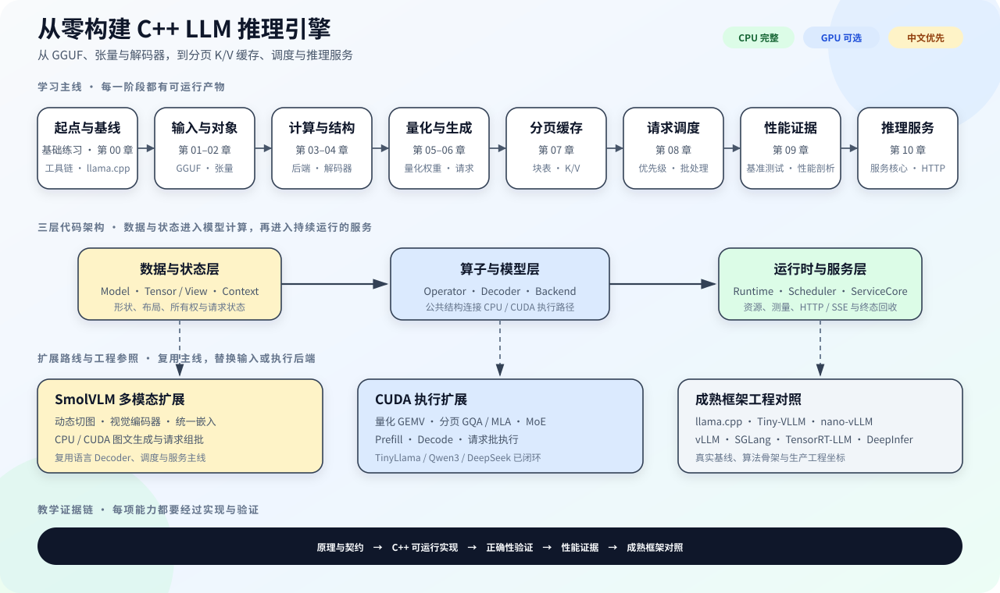
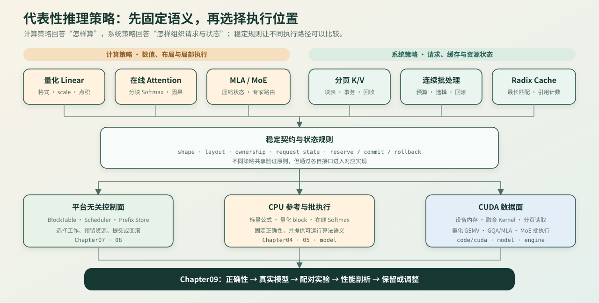

# 从零构建 C++ LLM 推理引擎

`cpp-llm-engine`

从 GGUF、张量与解码器，到分页 K/V 缓存、调度与推理服务

_A Practical Tutorial for Building a C++ LLM Inference Engine_

[](https://github.com/datawhalechina/cpp-llm-engine/actions/workflows/ci.yml)

这是一套中文优先、以 C++ 为实现主线的推理引擎工程教程。你将从一次 TinyLlama 真实推理开始，逐步实现模型加载、张量、算子、解码器、生成、缓存、调度和服务。只使用 CPU 也能完成整条主线；具备单张 NVIDIA GPU 时，可以继续学习 CUDA 加速。多模态路线使用 SmolVLM 说明图片怎样进入语言模型。完成教程后，你将得到一个可以继续替换组件和验证优化效果的单机推理服务框架。

## 教程特点

- **从 CPU 完成完整主线**：普通 CPU 环境即可学习加载、解码、生成、缓存、调度和服务，再按需进入消费级 GPU 加速路线。
- **从不同模型理解架构差异**：先用 TinyLlama 掌握 Llama 解码器，再通过 Qwen3 学习另一种稠密架构，通过 Qwen1.5-MoE 和 DeepSeek-V2-Lite 学习专家路由与 MLA。
- **先理解原理，再学习优化**：先在 CPU 或平台无关代码中看清分页 K/V、连续批处理、前缀缓存和在线 Softmax，再观察 CUDA 如何改变数据布局与计算方式。
- **亲手验证每一步**：使用固定结果、组件测试、真实模型对照和性能实验检查实现，并通过成熟框架对照理解教学代码与生产系统的差距。



## 快速开始

按下面四步完成第一次学习：确认工具链、运行入门检查、建立真实模型基线，再进入教程自己的 C++ 实现。

### 1. 检查工具链

准备 CMake 3.20+、支持 C++17 的编译器和 Git。Linux 可以直接运行，Windows 建议使用 WSL2 Ubuntu：

```bash
cmake --version
c++ --version
git --version
```

安装方法见 [Chapter00 环境准备](source/chapter00_quickstart/01_environment_setup.md)。如果还不熟悉 C++ 所有权、CMake 或 CTest，先按需完成 [Foundation](source/foundation/intro.md) 的对应练习。

### 2. 运行入门检查

这一步不需要模型、网络或 GPU：

```bash
bash code/chapter00_quickstart/run.sh
```

看到 CTest 全部通过，说明仓库入口和 C++ 构建环境可用。

### 3. 建立真实模型基线

按照[构建 llama.cpp](source/chapter00_quickstart/02_clone_and_build_llamacpp.md)和[准备 TinyLlama](source/chapter00_quickstart/03_download_tinyllama.md)完成一次性准备，然后运行：

```bash
bash code/chapter00_quickstart/run_real_inference.sh
```

终端会显示生成文本、耗时摘要和 `real inference passed`。这条外部基线帮助你先观察完整推理，再进入各组件的 C++ 实现。

### 4. 进入 C++ 实现

从 Chapter01 开始构建并验证模型加载、结构校验和分词器组件：

```bash
bash code/chapter01_tensor_loader/run.sh
```

看到三组 Chapter01 测试通过后，按照 [USAGE.md](USAGE.md) 的学习顺序继续 Chapter02–10。

## 教程框架

主图展示章节主线和可选扩展。下面进一步说明推理策略怎样从算法原理进入 CPU/CUDA 执行，以及不同模型为教程带来的架构差异；具体页面和运行命令统一由 [USAGE.md](USAGE.md) 导航。

### 推理策略



Chapter04–05 建立注意力（Attention）与量化线性层（Linear）的计算规则，Chapter07–08 组织缓存、请求和连续批处理，Chapter09 再通过正确性检查、对照实验和性能分析判断优化是否有效。具体格式、实现状态和实验结果见[教程架构](source/reference/architecture.md)与[实验资产表](source/reference/experiment_assets.md)。

### 模型适配

| 模型 | 架构差异带来的学习内容 | 可运行路径 |
| --- | --- | --- |
| TinyLlama 1.1B | Llama 稠密解码器、22 个解码器块、GGUF 与分组查询注意力（GQA） | CPU/CUDA 生成与服务主线 |
| Qwen3-0.6B | Q/K 归一化、NeoX 旋转位置编码、非对称 Q/K/V 头和共享输出层 | CPU/CUDA 生成与服务已通过固定结果验证 |
| Qwen1.5-MoE-A2.7B | 60 选 4 专家路由、紧凑专家权重、共享专家和混合量化 | CPU 24 层生成、按专家分组批执行、调度与服务已验证 |
| DeepSeek-V2-Lite | 多头潜在注意力（MLA）、混合稠密/MoE 层、64 选 6 专家路由与共享专家 | CPU/CUDA 27 层生成、分页 MLA、分块预填充与文本服务已验证 |
| SmolVLM-500M | 视觉编码器（Vision Encoder）、投影层（Projector）与视觉词元序列 | CPU 图文推理与服务生命周期已验证；CUDA 已完成视觉组件、小窗口流水线与语言模型上下文对照 |

各模型分阶段的可运行入口和适用范围见[模型能力与扩展顺序](source/reference/model_support.md)。

## 当前可运行能力

| 学习方向 | 你可以完成什么 |
| --- | --- |
| CPU 主线 | 从 GGUF 加载、量化解码和文本生成进入分页缓存、连续批处理与 HTTP/SSE 服务 |
| CUDA 主线 | 运行 TinyLlama、Qwen3 和 DeepSeek-V2-Lite，比较量化计算、分页注意力与批处理实现 |
| 模型架构 | 对照稠密解码器、专家混合（MoE）和多头潜在注意力，理解模型差异怎样影响引擎设计 |
| 推理策略 | 实验分页 K/V、前缀复用、连续批处理、在线 Softmax 和自适应量化矩阵-向量乘 |
| 多模态 | 在 CPU 上完成图片预处理、视觉编码、图文推理和服务验证，并用 CUDA 对照视觉组件及语言模型请求上下文 |
| 验证与性能 | 使用组件测试、真实模型对照、配对实验和性能分析验证实现与优化 |

## 继续学习

学习路线、章节命令和验证层级见 [USAGE.md](USAGE.md)，图片进入语言模型的原理从[多模态扩展教程](source/extensions/multimodal/intro.md)开始；术语、公式、实验和框架源码坐标见 [Reference](source/reference/README.md)。希望参与代码或文档建设时，再阅读 [CONTRIBUTING.md](CONTRIBUTING.md)。GitHub Actions 持续检查文档、默认回归和发布验收规则。

测试从对象规则逐步扩展到组件协作、跨章主线和真实模型；性能实验建立在正确性验证通过之后。
