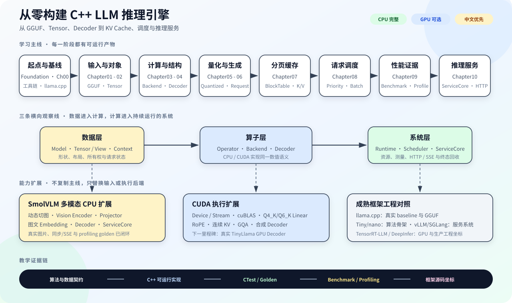
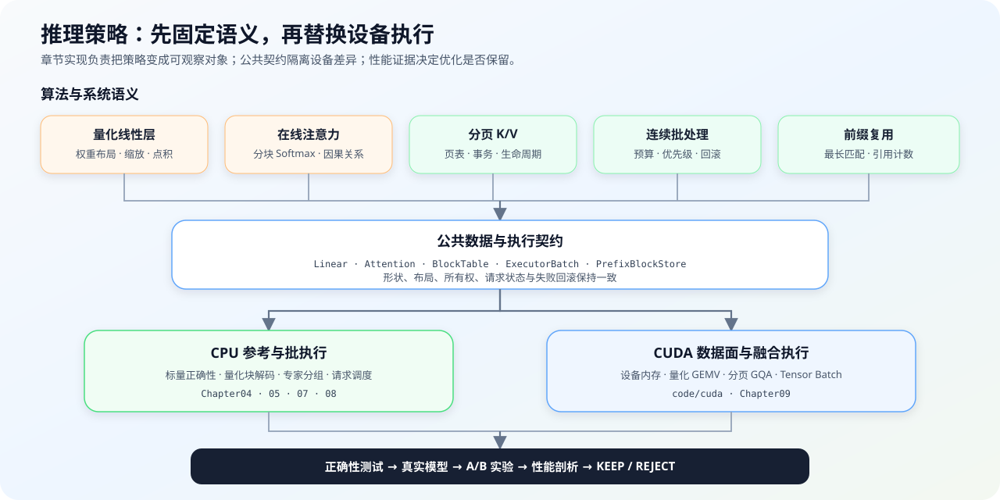
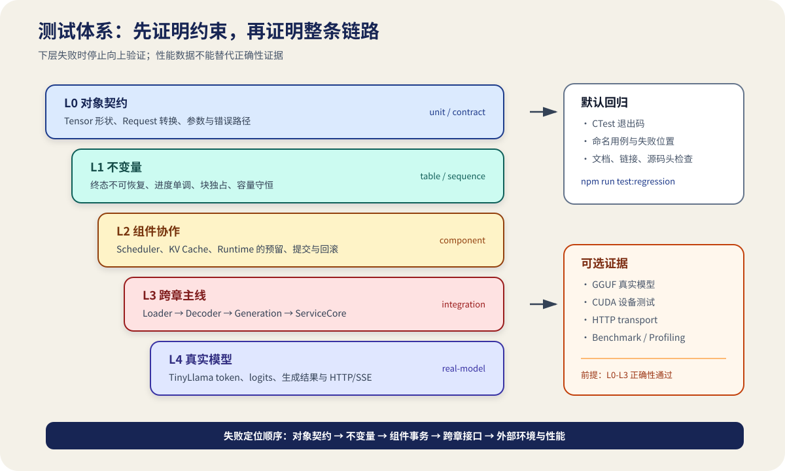

# 从零构建 C++ LLM 推理引擎

`cpp-llm-engine`

从 GGUF、张量与解码器，到分页 K/V 缓存、调度与推理服务

_A Practical Tutorial for Building a C++ LLM Inference Engine_

[](https://github.com/datawhalechina/cpp-llm-engine/actions/workflows/ci.yml)

这是一套中文优先、以 C++ 为实现主线的推理引擎工程教程。你将从一次 TinyLlama 真实推理开始，逐步实现模型加载、张量、算子、解码器、生成、缓存、调度和服务。只使用 CPU 也能完成整条主线；具备单张 NVIDIA GPU 时，可以继续学习 CUDA 加速，并通过 SmolVLM 把文本输入扩展到图文输入。完成教程后，你将得到一个可以继续替换组件和验证优化效果的单机推理服务框架。

## 教程特点

- **从 CPU 完成完整主线**：普通 CPU 环境即可学习加载、解码、生成、缓存、调度和服务，再按需进入消费级 GPU 加速路线。
- **从不同模型理解架构差异**：先用 TinyLlama 掌握 Llama 解码器，再通过 Qwen3 学习另一种稠密架构，通过 Qwen1.5-MoE 和 DeepSeek-V2-Lite 学习专家路由与 MLA。
- **先理解原理，再学习优化**：先在 CPU 或平台无关代码中看清分页 K/V、连续批处理、前缀缓存和在线 Softmax，再观察 CUDA 如何改变数据布局与计算方式。
- **亲手验证每一步**：使用固定结果、组件测试、真实模型对照和性能实验检查实现，并通过成熟框架对照理解教学代码与生产系统的差距。



## 快速开始

按下面四步完成第一次学习：确认工具链、运行仓库检查、建立真实模型基线，再进入教程自己的 C++ 实现。

### 1. 检查工具链

准备 CMake 3.20+、支持 C++17 的编译器和 Git。Linux 可以直接运行，Windows 建议使用 WSL2 Ubuntu：

```bash
cmake --version
c++ --version
git --version
```

安装方法见 [Chapter00 环境准备](source/chapter00_quickstart/01_environment_setup.md)。如果还不熟悉 C++ 所有权、CMake 或 CTest，先按需完成 [Foundation](source/foundation/intro.md) 的对应练习。

### 2. 运行仓库检查

这一步不需要模型、网络或 GPU：

```bash
bash code/chapter00_quickstart/run.sh
```

看到 CTest 全部通过，说明仓库入口和 C++ 构建环境可用。

### 3. 建立真实模型基线

按照[构建 llama.cpp](source/chapter00_quickstart/02_clone_and_build_llamacpp.md)和[准备 TinyLlama](source/chapter00_quickstart/03_download_tinyllama.md)完成一次性准备，然后运行：

```bash
bash code/chapter00_quickstart/run_real_inference.sh
```

终端会显示生成文本、耗时摘要和 `real inference passed`。这条外部基线帮助你先观察完整推理，再进入各组件的 C++ 实现。

### 4. 进入 C++ 实现

从 Chapter01 开始构建并验证模型加载、结构校验和分词器组件：

```bash
bash code/chapter01_tensor_loader/run.sh
```

看到三组 Chapter01 测试通过后，按照 [USAGE.md](USAGE.md) 的学习顺序继续 Chapter02–10。

## 教程框架

主图展示章节主线和可选扩展。下面进一步说明推理策略怎样从算法语义进入 CPU/CUDA 执行，以及不同模型为教程带来的架构差异；具体页面和运行命令统一由 [USAGE.md](USAGE.md) 导航。

### 推理策略



Chapter04–05 建立 Attention 与量化 Linear 的数值语义，Chapter07–08 把缓存和请求组织成持续执行的数据面，Chapter09 再用正确性闸门、A/B 实验和性能剖析决定是否保留优化。具体格式、实现状态和实验结果见[教程架构](source/reference/architecture.md)与[实验资产表](source/reference/experiment_assets.md)。

### 模型适配

| 模型 | 架构差异带来的学习内容 | 当前状态 |
| --- | --- | --- |
| TinyLlama 1.1B | Llama 稠密 Decoder、22 个解码器块、GGUF 与 GQA | CPU/CUDA 生成与服务主线 |
| Qwen3-0.6B | Q/K Norm、NeoX RoPE、非对称 Q/K/V 头和共享 LM Head | CPU/CUDA 推理服务闭环 |
| Qwen1.5-MoE-A2.7B | 60 选 4 Router、packed experts、共享专家和混合量化 | CPU 24 层生成、按专家分组批执行、调度与服务闭环 |
| DeepSeek-R1-Distill-Qwen-1.5B | Qwen2.5 配置、Tokenizer 与聊天模板差异 | 待适配 |
| DeepSeek-V2-Lite | MLA、混合稠密/MoE 层、64 选 6 Router 与共享专家 | CPU/CUDA 27 层生成、分组批执行和服务核心闭环 |
| SmolVLM-500M | Vision Encoder、Projector 与视觉词元序列 | CPU 多模态模型与服务生命周期闭环 |

各模型分阶段的完成状态、真实入口和剩余边界见[模型能力与扩展顺序](source/reference/model_support.md)。

## 当前可学内容

更新时间：**2026-11-12**。下面按最新内容在前排列；需要复现实验或核对具体环境时，再查阅[实验资产表](source/reference/experiment_assets.md)。

| 时间 | 新增学习内容 | 你可以复现什么 |
| --- | --- | --- |
| 2026-11-12 | DeepSeek-V2-Lite CUDA 纵向闭环 | 运行三阶段 MLA、量化 MoE、27 层生成、跨请求分组批执行与 ServiceCore |
| 2026-11-12 | 统一模型能力矩阵 | 按外部基线、加载、CPU/CUDA 模型、批处理和服务阶段核对真实入口与剩余边界 |
| 2026-11-10 | Qwen1.5-MoE 批处理与服务 | 比较逐词元与按专家分组执行，并观察四个请求在运行中加入、生成和释放资源 |
| 2026-11-10 | Qwen1.5-MoE 完整生成 | 用真实分词器运行 24 层 MoE 模型，观察 Top-K 专家选择、分层 K/V 和文本生成 |
| 2026-11-09 | Qwen3 推理服务 | 运行 Qwen3-0.6B 的 28 层 CPU/CUDA 推理、分页缓存、前缀命中以及 HTTP/SSE 输出 |
| 2026-11-09 | 自适应量化 GEMV | 在不同批量、上下文长度和解码步数下切换量化矩阵-向量乘实现，并比较延迟 |
| 2026-11-09 | CUDA 量化性能分析 | 使用配对实验和 Nsight Compute 指标判断一次计算核优化是否有效 |
| 2026-11-09 | 分页缓存与前缀复用 | 观察 CUDA 预填充与解码怎样使用物理块、共享前缀并影响请求调度 |
| 2026-11-09 | 三条学习路线 | 分别沿 CPU、CPU+GPU 或多模态路线学习，并使用术语、公式和框架对照资料 |
| 2026-11-08 | TinyLlama CUDA 完整链路 | 从 22 层 GPU 模型执行进入真实生成、分页注意力和推理服务 |
| 2026-11 | 教程验证体系 | 用章节测试、默认回归、发布验收和文档检查判断代码是否仍然可运行 |
| 2026-10 | SmolVLM 多模态链路 | 把图片经过视觉编码器和投影层送入解码器，并比较同步与流式服务结果 |
| 2026-10 | TinyLlama CPU 完整链路 | 从 22 层解码器进入生成运行时，再通过 HTTP/SSE 输出真实模型结果 |
| 2026-08 | Foundation 与章节骨架 | 按需练习 C++、CMake、CTest，并沿章节入口逐步进入推理引擎 |

## 查阅与贡献

学习路线、章节命令和验证层级见 [USAGE.md](USAGE.md)；术语、公式、实验和框架源码坐标见 [Reference](source/reference/README.md)；修改、测试和提交方法见 [CONTRIBUTING.md](CONTRIBUTING.md)。GitHub Actions 持续检查文档、默认回归和发布验收规则。

测试从对象规则逐步扩展到组件协作、跨章主线和真实模型；性能实验建立在正确性验证通过之后。


