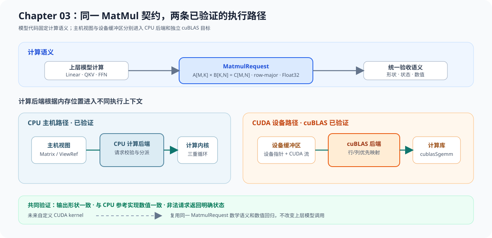

# Chapter 03：MatMul 与计算后端

本目录接收教学 `Matrix` 或 Chapter02 `Tensor` View，把二维矩阵乘转换为公共 `MatmulRequest`，再交给 CPU 参考后端执行。这里建立的形状约束、计算语义和验证方法会继续用于 Chapter04 Decoder；Chapter04 采用独立的教学 Linear 实现，并复用这些约束与验证方法。原理、公式和设计推导从[Chapter03 导读](../../source/chapter03_matmul/intro.md)开始阅读。

## 代码架构

代码有两个输入入口。`MatMulOp` 接收拥有存储的教学 `Matrix`；`tensor_matmul_adapter` 接收借用 Chapter02 Storage 的 `TensorViewRef`。两条路径都要求 CPU、Float32、二维、连续行主序布局，并转换成不拥有缓冲区的 `MatmulRequest`。

`MatMulOp` 借用计算后端，类型系统禁止传入临时后端。CPU 后端只负责报告设备身份并分派请求，三重循环保留在参考内核。算子路径先创建临时 `Matrix`，View 路径先写入临时 `vector`；只有后端成功后才提交输出，因此 shape 校验或计算失败不会覆盖调用方原结果。

```text
教学 Matrix ──> MatMulOp::try_compute ───────────────┐
                                                     ├─> MatmulRequest
Chapter02 Tensor View ──> tensor_matmul_adapter ─────┘         │
                                                               ▼
                                                  MatmulBackend 接口
                                                               │
                                                               ▼
                                               CPU 参考内核（三重循环）
                                                               │
                                                               ▼
                                                    临时结果 -> 成功后提交
```



## 阅读顺序与资产

先从教学数据对象和公共请求开始，再沿算子、后端、内核进入计算，最后阅读 Tensor 适配和测试。这样可以先看清数据要求，再判断每个对象为什么存在。

| 顺序 | 文件 | 阅读重点 | 对应验证 |
| --- | --- | --- | --- |
| 1 | `include/chapter03_matmul/matrix.h`、`src/matrix.cpp` | 行主序存储、二维索引和尺寸溢出 | `chapter03_matmul_test` |
| 2 | `../core/include/cpp_llm_engine/core/matmul_contract.h` | `MatmulRequest` 的形状、缓冲区和后端接口 | `cpp_llm_engine_core_test` |
| 3 | `include/chapter03_matmul/matmul_op.h`、`src/matmul_op.cpp` | shape 校验、后端生命周期和成功后提交 | `chapter03_matmul_test` |
| 4 | `src/cpu_backend.cpp`、`src/cpu_kernel.cpp` | 后端分派与三重循环参考计算 | `chapter03_matmul_test` |
| 5 | `src/tensor_matmul_adapter.cpp` | View 布局校验、offset 和显式连续化要求 | `chapter02_tensor_matmul_integration_test` |
| 6 | `examples/main_matmul.cpp`、`tests/` | 最小输出、失败路径和跨章证据 | `scripts/run.sh` |

## 运行与验证

从仓库根目录执行下面的命令。脚本使用隔离构建目录，先运行示例，再执行本章、跨章和 Core 测试。

```bash
bash code/chapter03_matmul/scripts/run.sh
```

示例应输出 `2x2`，左上角元素为 `58`，右下角元素为 `154`。三个 CTest 分别证明局部计算、Chapter02 View 交接和 Core 公共对象仍然成立。

| 验证层级 | target | 证明内容 |
| --- | --- | --- |
| 组件 | `chapter03_matmul_test` | 固定数值、shape、溢出、后端生命周期和失败原子性 |
| 集成 | `chapter02_tensor_matmul_integration_test` | 连续与 offset View、显式连续化、接口错误和失败后保留输出 |
| 公共契约 | `cpp_llm_engine_core_test` | `Backend`、`Status` 和 Tensor 公共数据结构 |

## 扩展入口

CPU 参考内核是数值基线，不承担 GPU 执行。cuBLAS 在独立 CUDA target 中复用 `MatmulRequest` 的形状数据，并通过带 CUDA Stream 的独立接口执行；Chapter04 复用矩阵乘语义和公共 Tensor View，独立组合 Attention 与 FFN。

| 方向 | 代码位置 | 连接对象 | 验证入口 |
| --- | --- | --- | --- |
| CUDA/cuBLAS | `code/cuda/src/cublas_matmul_backend.cpp` | `MatmulRequest`、设备缓冲区和 CUDA stream | `CUDA_HOME=... bash code/cuda/scripts/run.sh` |
| Decoder | `code/chapter04_attention/` | Linear、Attention 和 FFN | `bash code/chapter04_attention/scripts/run.sh` |
| 量化 GEMV | `code/chapter05_quantization/`、`code/cuda/` | packed 权重、融合反量化和小批量执行 | `bash code/chapter05_quantization/scripts/run.sh` |
| 批执行与性能决策 | `code/chapter08_scheduling/`、`code/chapter09_performance/` | 请求组批、实现选择和性能证据 | 学到对应章节后执行 |
