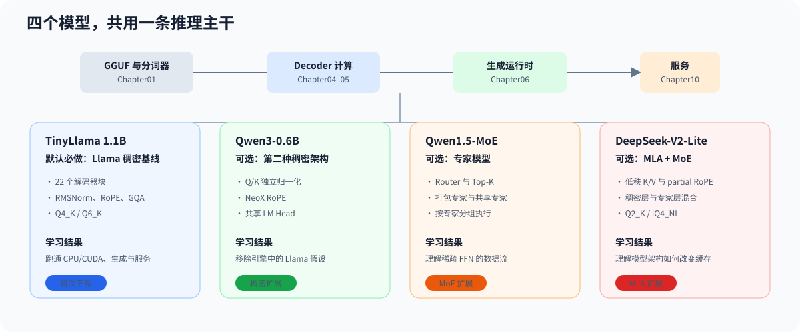

# 00.3 选择并准备真实模型

本教程使用 TinyLlama 1.1B Chat Q4_K_M 建立默认语言模型主线。它保留真实 Tokenizer、22 个 Decoder Block、RMSNorm、RoPE、GQA、SwiGLU、KV Cache 和 LM Head，同时把 GGUF 文件控制在约 638 MiB。第一次学习只下载 TinyLlama；Qwen3、Qwen1.5-MoE 和 DeepSeek-V2-Lite 分别在学习稠密适配、专家模型和 MLA 时按需准备。

## 选择理由

| 条件 | TinyLlama Q4_K_M 的作用 |
| --- | --- |
| CPU 可运行 | 没有 GPU 也能完成真实推理和后续回归 |
| 模型结构完整 | Chapter01–06 可以沿同一模型拆解加载、Decoder 和 Runtime |
| 量化格式真实 | Q4_K/Q6_K payload 可以进入 Chapter05 实验 |
| 外部结果可对照 | llama.cpp 和自研实现读取同一 GGUF |

TinyLlama 用于验证执行链，不用于代表更大模型的生成质量。

## 不同模型在教程中的角色

Chapter00 使用 llama.cpp 建立外部基线，后续章节再把同一模型接入教程自己的 C++ 执行链。四个模型依次增加一种需要理解的结构变化；第一次学习只准备 TinyLlama，其余模型在进入对应主题时下载。具体接入证据、资源限制和后续目标见[模型基线与扩展顺序](../reference/model_support.md)。



| 模型 | 适合学习什么 | 教程当前状态 |
| --- | --- | --- |
| TinyLlama 1.1B Chat Q4_K_M | 从 GGUF、Decoder、生成到服务的完整主线 | 默认模型，CPU/CUDA 真实链路已接通 |
| Qwen3-0.6B | 权重命名、Tokenizer、聊天模板、Q/K Norm、NeoX RoPE 和 Decoder 配置适配 | CPU/CUDA 推理服务纵向闭环已接通 |
| Qwen1.5-MoE-A2.7B-Chat | Router、Top-K、共享专家与专家执行 | CPU 24 层生成、批执行、调度与服务闭环已接通 |
| DeepSeek-V2-Lite Q2_K | MLA、压缩 K/V 与稠密/MoE 混合层 | CPU 27 层 Decoder、生成、请求组批和服务闭环已接通 |

## 下载与校验

从仓库根目录执行：

```bash
test -d llama.cpp/.git
mkdir -p llama.cpp/models
curl -L --fail --retry 3 -C - \
  -o llama.cpp/models/tinyllama-1.1b-chat-v1.0.Q4_K_M.gguf \
  https://huggingface.co/TheBloke/TinyLlama-1.1B-Chat-v1.0-GGUF/resolve/main/tinyllama-1.1b-chat-v1.0.Q4_K_M.gguf
```

校验文件大小和 SHA256：

```bash
ls -lh llama.cpp/models/tinyllama-1.1b-chat-v1.0.Q4_K_M.gguf
echo '9fecc3b3cd76bba89d504f29b616eedf7da85b96540e490ca5824d3f7d2776a0  llama.cpp/models/tinyllama-1.1b-chat-v1.0.Q4_K_M.gguf' \
  | sha256sum --check
```

校验通过后进入 [`第一次真实推理`](./04_first_inference.md)。下载中断时重复执行同一条 `curl -C -` 命令即可续传。

## 可选模型

Qwen3-0.6B 已接入教程 CPU/CUDA 主线，适合在完成 TinyLlama 后比较 Q/K Norm、NeoX RoPE 和非对称 Q/KV 投影。下载脚本固定模型 revision、文件大小和 SHA256，随后用同一套 llama.cpp 参数建立外部基线：

```bash
bash code/chapter00_quickstart/download_qwen3.sh
bash code/chapter00_quickstart/run_qwen3_baseline.sh
```

Qwen1.5-MoE-A2.7B-Chat 用于后续 MoE 路线。下载脚本会先检查剩余磁盘空间，支持断点续传，并在完成后打印 SHA256：

```bash
bash code/chapter00_quickstart/download_qwen15_moe.sh
bash code/chapter00_quickstart/run_qwen15_moe_baseline.sh
```

DeepSeek-V2-Lite 用于比较 MLA 与 MoE 怎样同时改变模型输入结构。固定 Q2_K GGUF 约 6.43GB，下载脚本校验 revision、文件大小和 SHA256：

```bash
bash code/chapter00_quickstart/download_deepseek_v2_lite.sh
bash code/chapter00_quickstart/run_deepseek_v2_lite_baseline.sh
bash code/chapter01_tensor_loader/run_deepseek_v2_lite_schema.sh
```

前两条命令建立 llama.cpp 外部结果，第三条命令验证教程 Loader 识别 27 层、MLA 压缩维度和混合 Dense/MoE 权重布局。后续章节已经连接 MLA、Q2_K/IQ4_NL Linear、完整 CPU Decoder、Generation Runtime、跨请求专家分组和 HTTP/SSE 服务；具体入口见[模型基线与扩展顺序](../reference/model_support.md#deepseek-v2-lite-当前接入层级)。

这些 Chapter00 入口先建立外部结果。教程自己的实现与验证入口分布在 Chapter01、04～06、08～10，当前支持范围汇总在[模型基线与扩展顺序](../reference/model_support.md)。

## 验证与衔接

| 检查项 | 通过条件 | 失败时先看 |
| --- | --- | --- |
| llama.cpp 仓库 | `llama.cpp/.git` 存在 | 先完成 00.2 |
| GGUF 文件 | 大小约 638 MiB | 下载路径和剩余磁盘空间 |
| 文件内容 | `sha256sum --check` 输出 `OK` | 删除损坏文件后重新下载 |
