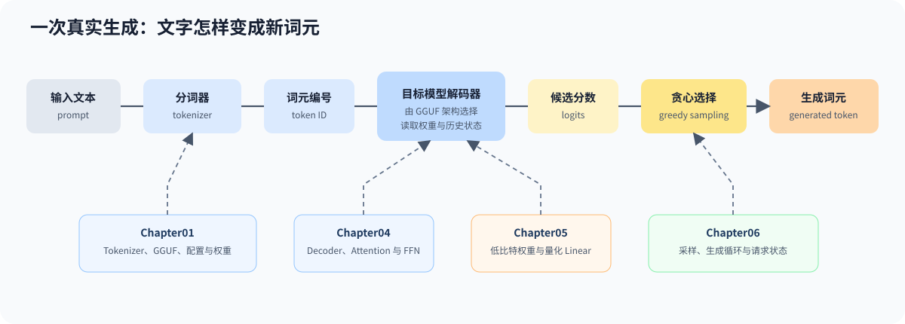

# 00.4 运行第一次真实推理

本节用一条命令连接输入文本（`prompt`）、真实分词器（`tokenizer`）、GGUF 权重、模型解码器（`Decoder`）和生成词元（`token`）。模型先输出每个候选词元的未归一化分数（`logits`），贪心选择（`greedy sampling`）再取分数最高的词元。Chapter00 只观察这条链是否成立，后续章节分别展开内部实现。



## 运行 CPU 基线

从仓库根目录执行：

```bash
bash code/chapter00_quickstart/run_real_inference.sh
```

脚本优先查找 `llama.cpp/build-cpu/bin/llama-simple`，并兼容已有的 `llama.cpp/build`。它默认使用 `-ngl 0`、prompt `Hello, world` 和 8 个新 token，只显示生成文本与关键耗时。

更换 prompt 和生成长度：

```bash
bash code/chapter00_quickstart/run_real_inference.sh "Hello TinyLlama" 4
```

固定 llama.cpp commit、GGUF、prompt 和 greedy sampling，可以让不同环境的运行结果具有可比性。本章脚本只检查模型确实生成了 token，不把具体文本作为 golden；固定 token 和数值结果由 Chapter04 的真实 Decoder 测试验证。

## 可选 GPU 检查

已完成 CUDA 构建时，可以让同一脚本使用 GPU offload：

```bash
LLAMA_CPP_BUILD_DIR="$PWD/llama.cpp/build-cuda" \
CHAPTER00_GPU_LAYERS=99 \
bash code/chapter00_quickstart/run_real_inference.sh "Hello TinyLlama" 4
```

该命令只验证 llama.cpp 的外部 GPU 基线，不代表本教程 CUDA backend 已完成。Chapter00 的必做结果仍是 CPU 推理。

Qwen1.5-MoE Q3_K_M 约 7.44GB。12GB 显卡先使用短 prompt、batch 1 和较小上下文尝试完整卸载：

```bash
CHAPTER00_GPU_LAYERS=999 \
bash code/chapter00_quickstart/run_qwen15_moe_baseline.sh
```

若设备还承担桌面显示或工作区不足，可以降低 `CHAPTER00_GPU_LAYERS`，让剩余层留在 CPU。激活参数量影响每个词元的计算量，总参数量仍决定需要容纳的专家权重。

## 验证与衔接

| 输出 | 表示什么 | 通过条件 |
| --- | --- | --- |
| `model:` | 实际读取的 GGUF | 路径指向 TinyLlama 文件 |
| 生成文本 | Tokenizer 与模型执行已连通 | 至少生成 1 个 token |
| `decoded_tokens=N` | 脚本解析的生成数量 | `N > 0` |
| 关键耗时 | load、prompt eval、eval 和 total | 数值存在且进程正常退出 |

看到 `real inference passed` 后，真实推理链路已经连通。下一步进入 [`Chapter01`](../chapter01_tensor_loader/intro.md)，实现教程自己的模型输入和加载对象。
