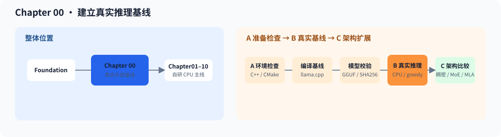

# 00.0 建立真实推理基线

## 本章导读

Foundation 准备了构建和测试能力；本章使用 `llama.cpp` 加载 TinyLlama GGUF，先得到一次真实分词、模型执行和生成结果。这个结果会成为 Chapter 01 以后自研模型加载器、解码器和生成运行时的外部参照。

| 教学范围 | 成熟实现提供 | 深入入口 |
| --- | --- | --- |
| 构建本地基线、准备模型、运行一次 CPU 推理 | GGUF 加载器、分词器、模型执行和采样循环 | [`llama.cpp` 项目卡](../reference/ecosystem/llama_cpp.md) |

| 学习线 | 本章怎样学习 | 可验证产物 |
| --- | --- | --- |
| A 准备检查线 | 编译仓库内最小程序，确认 C++、CMake、路径和脚本入口可用 | `smoke check passed` 与明确的失败位置 |
| B 真实基线线 | 构建 llama.cpp，下载 TinyLlama GGUF，并运行一次真实分词与生成 | 可重复执行的真实 prompt、token 和生成结果 |



## 开始学习

先运行仓库内不依赖模型的快速检查：

```bash
bash code/chapter00_quickstart/run.sh
```

看到 `chapter00_quickstart` 输出 `smoke check passed` 后，说明连通性检查已经通过。按表格继续准备 `llama.cpp` 和 TinyLlama，第四步使用 <a href="../_code/chapter00_quickstart/run_real_inference.sh"><code>run_real_inference.sh</code></a> 执行真实模型。

| 顺序 | 路线 | 页面 | 读完后应看到什么 |
| --- | --- | --- | --- |
| 1 | A/B 公共 | [`00.1 检查本地环境`](./01_environment_setup.md) | C++、CMake 和 CPU 运行条件可用 |
| 2 | B | [`00.2 构建 llama.cpp 外部基线`](./02_clone_and_build_llamacpp.md) | `llama.cpp` 可执行文件构建完成 |
| 3 | B | [`00.3 准备 TinyLlama 真实模型`](./03_download_tinyllama.md) | 本地存在可读取的 TinyLlama GGUF |
| 4 | B | [`00.4 运行第一次真实推理`](./04_first_inference.md) | 真实分词器处理输入文本，模型生成非空结果 |
| 5 | A/B 公共 | [`00.5 排查首次运行问题`](./05_troubleshooting.md) | 能按环境、路径、模型和运行参数排查失败 |

## 验证与下一步

真实模型基线建立后，进入 [`Chapter 01`](../chapter01_tensor_loader/intro.md)，开始实现教程自己的张量对象、模型加载器、元数据适配器和分词器契约。

| 验收层级 | 执行入口 | 通过条件 | 本章要求 |
| --- | --- | --- | --- |
| L1 默认 CPU | `bash code/chapter00_quickstart/run.sh` | 仓库快速检查编译成功并输出 `smoke check passed` | 必做 |
| L2 真实模型 | `bash code/chapter00_quickstart/run_real_inference.sh` | TinyLlama GGUF 被读取，真实分词器处理输入文本，模型生成结果并正常退出 | 必做 |
| L3 可选 CUDA | 不单独设置 Chapter00 CUDA 验收 | GPU 计算后端从 Chapter03 和 Chapter05 开始验证 | 不适用 |
