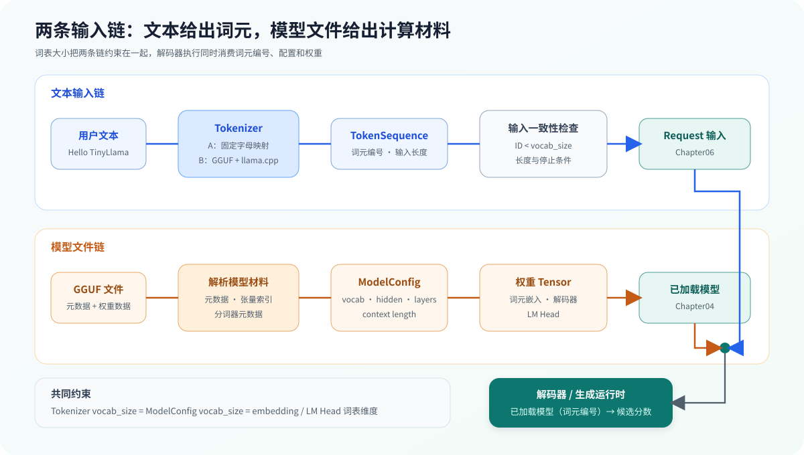

# 01.4 输入契约与分词器

模型权重已经可以进入程序，真实推理还需要把用户文本转换为模型词表中的词元编号（token ID）。文本链产生本次请求的离散输入，模型链产生配置与权重；两者在解码器执行时汇合。

## 两条输入链怎样汇合

文本不会直接进入张量，GGUF 权重也不会解释用户输入文本（prompt）。一次执行需要同时取得两类产物：

| 输入链 | 经过的对象 | 交给后续章节的产物 |
| --- | --- | --- |
| 文本输入 | 分词器、输入约束 | 词元编号、输入长度、停止词元 |
| 模型文件 | 模型元数据、张量索引、`ModelLoader` | `ModelConfig`、权重张量、解码器布局 |

两条链共享词表约束：Tokenizer 产生的每个 ID 必须小于 `vocab_size`，embedding 和 LM Head 的词表维度也必须与它一致。下图从两种原始输入开始，追踪到 Chapter04 的 Decoder 与 Chapter06 的 Request/Runtime。



## 从教学 Tokenizer 到真实模型规则

教学接口位于 <a href="../_code/chapter01_tensor_loader/src/tokenizer.h"><code>tokenizer.h</code></a>：

```cpp
class Tokenizer {
public:
    TokenSequence encode(std::string_view text) const;
    std::string decode(const TokenSequence& tokens) const;
    std::size_t vocab_size() const;
};
```

默认 `Tokenizer` 用固定字母映射建立最小闭环：字母转换为整数，未知字符转换为 `0`。它适合验证接口、越界行为和编码/解码，但这些整数不构成 TinyLlama 的真实分词结果。

`RealTokenizer` 位于 <a href="../_code/chapter01_tensor_loader/src/real_tokenizer.cpp"><code>real_tokenizer.cpp</code></a>。它读取真实 GGUF vocabulary，并调用 llama.cpp tokenizer API 执行模型规定的规则：

| 真实 Tokenizer 数据或规则 | 为什么影响结果 |
| --- | --- |
| 词表与词元编号 | 决定每个整数对应的字节序列 |
| BPE merge 或 SentencePiece model | 决定文本怎样切分与合并 |
| normalization 与 Unicode 处理 | 决定相同可见文本进入算法前的字节形式 |
| BOS、EOS、PAD、UNK | 决定序列起止和异常输入行为 |
| 对话模板 | 决定对话角色和生成提示怎样进入词元序列 |

`ModelConfig` 位于 <a href="../_code/chapter01_tensor_loader/src/model_config.h"><code>model_config.h</code></a>，保存 `vocab_size`、`hidden_size`、`max_position`、`layer_count` 和 `max_new_tokens`。进入 Decoder 前至少满足：

```text
ModelConfig.vocab_size == Tokenizer.vocab_size
0 <= token ID < vocab_size
embedding / lm_head 的词表维度 == vocab_size
prompt length + max new tokens <= max position
```

Chapter06 会把词元编号、长度上限和停止条件写入 `Request`；Chapter04 使用同一组词元编号查找嵌入向量并运行解码器。

## 验证与衔接

先运行 Chapter01 默认测试：

```bash
bash code/chapter01_tensor_loader/run.sh
```

默认 CTest 验证教学分词器的编码/解码、未知字符和词表范围，以及 `ModelConfig` 与分词器、权重形状的一致性。具备本地 llama.cpp 和 TinyLlama GGUF 时，再运行真实分词器对照：

```bash
bash code/chapter01_tensor_loader/run_real_tokenizer.sh
```

脚本固定检查 `Hello TinyLlama` 得到 6 个词元：`15043,18439,1460,29931,5288,29874`，并要求反分词后恢复原文。该基准结果属于当前 TinyLlama GGUF；更换模型后应使用新模型的分词器重新建立基线。

验证完成后，文本侧得到合法词元序列，文件侧得到与词表一致的模型配置。[`模型元数据与 GGUF`](./05_model_metadata_and_gguf.md) 将继续追踪配置、张量索引和权重数据怎样组成真实模型对象。
