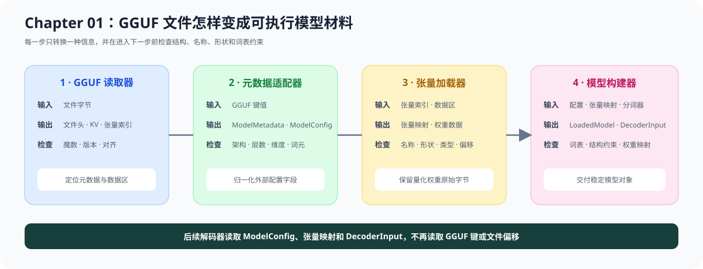

# 01.5 模型元数据与 GGUF

真实模型文件同时保存模型元数据、分词器配置、张量索引和权重数据。本节沿 GGUF Reader、Metadata Adapter、Tensor Loader 和 Model Builder 追踪这些信息如何变成后续章节使用的内部对象。

模型元数据（metadata）是模型的配置说明，例如隐藏维度为多少、包含多少个解码器块、使用多少个注意力头。模型结构约束（schema）是检查规则：它根据架构和元数据，确认文件中确实存在所需权重，并检查每个权重的形状。两者的关系可以先记成：

```text
模型元数据：模型声明“我是怎样的模型”
模型结构约束：加载器核对“权重是否符合这份声明”
```

例如，元数据声明隐藏维度为 `1024`；结构约束随后检查 `token_embd.weight` 的第一维是否为 `1024`，并检查每个解码器块是否具有该架构要求的注意力和 FFN 权重。

## GGUF 加载链

<a href="https://github.com/datawhalechina/cpp-llm-engine/blob/main/code/chapter01_tensor_loader/src/gguf_reader.cpp"><code>gguf_reader.cpp</code></a> 读取文件结构，<a href="https://github.com/datawhalechina/cpp-llm-engine/blob/main/code/chapter01_tensor_loader/src/model_metadata_adapter.cpp"><code>model_metadata_adapter.cpp</code></a> 归一化配置，<a href="https://github.com/datawhalechina/cpp-llm-engine/blob/main/code/chapter01_tensor_loader/src/model_builder.cpp"><code>model_builder.cpp</code></a> 检查配置与权重是否匹配。



| 层 | 主要输入 | 主要输出 | 检查内容 |
| --- | --- | --- | --- |
| GGUF Reader | 文件字节 | header、KV、tensor index、offset | 二进制结构与数据区位置 |
| Metadata Adapter | GGUF 键值 | `ModelMetadata` | 架构字段、层数、维度和特殊词元 |
| 张量加载器 | 张量索引和数据区 | 张量映射 | 名称、形状、数据类型、偏移和权重数据 |
| 模型构建器 | 模型元数据、张量映射、分词器 | `LoadedModel`、`DecoderInput` | 词表、模型结构约束和权重映射 |

Tokenizer metadata 来自同一份 GGUF，但使用独立接口读取 vocabulary、scores、token types、BOS/EOS 和可选 chat template。Tokenizer 规则不会混入权重读取过程。

外部格式经过 adapter 后统一为内部配置：

```text
GGUF Reader -> GGUF Metadata Adapter -> ModelMetadata
其他 Reader -> 对应 Metadata Adapter -> ModelMetadata
                                      -> ModelConfig
```

替换文件格式时，解码器和生成运行时继续消费 `ModelConfig` 和张量映射，不读取 GGUF 键或文件偏移。

## 配置、权重与模型布局

内部配置保存能够检查模型结构的稳定字段：

| 字段 | 用途 |
| --- | --- |
| `architecture` | 选择对应模型结构约束 |
| `vocab_size` | 校验 tokenizer、embedding 和输出层 |
| `hidden_size` | 校验 Tensor shape 和 Decoder hidden state |
| `max_position` | 限制输入长度和位置编号 |
| `layer_count` | 校验解码器块数量 |
| `attention_head_count` / `attention_head_count_kv` | 计算 Q 头和共享 K/V 头的投影宽度 |
| `attention_key_length` / `attention_value_length` | 确定 GQA 的头维度，或 MLA 每个词元保存的压缩 K/V 宽度 |
| `bos_token_id` / `eos_token_id` | 固定输入输出的特殊 token 语义 |

TinyLlama 1.1B 提供本教程的第一条真实模型基线。`block_count=22` 对应 `blk.0` 到 `blk.21`；每个 Block 的九个权重 Tensor 由 Llama schema 检查，embedding、Final Norm 和输出权重位于 Block 堆栈之外。

Qwen3 复用同一批主体名称，但结构约束并不完全相同：

| 检查项 | Llama / TinyLlama | Qwen3 |
| --- | --- | --- |
| 注意力与 FFN 主体权重 | Q/K/V、输出投影、Gate/Up/Down | 复用相同主体名称 |
| 投影宽度 | Q 输出通常等于隐藏维度 | 由头数和头维度计算，不能从隐藏维度直接推断 |
| Q/K 归一化 | 没有独立权重 | 每层要求 `attn_q_norm.weight` 和 `attn_k_norm.weight` |
| 输出权重 | `output.weight` 必需 | 可以缺省并与 `token_embd.weight` 共享 |
| BOS | TinyLlama 文件提供 | 可以缺省，内部使用 `-1` 表示不存在 |

Qwen3-0.6B 的隐藏维度是 1024，但每个 Q/K/V 头包含 128 个数值。16 个查询头得到宽度 2048 的 Q 投影，8 个 K/V 头得到宽度 1024 的 K/V 投影；输出投影再把 2048 维注意力结果映射回 1024 维隐藏状态。默认合成测试和真实 GGUF 都会核对这些关系；Chapter04 再用首层执行验证 Q/K Norm、NeoX RoPE 与增量 K/V，并用 28 层 CPU Decoder 对照 llama.cpp。

Qwen1.5-MoE 使用另一份结构约束。真实 GGUF 声明 24 层、60 个专家，并为每个词元选择 4 个专家。每层除了注意力权重，还包含 Router、三组打包专家权重、共享专家门控和三组共享专家权重。`MoeDecoderTensorLayout` 只描述这些名称与形状，不执行 Top-K 或专家 FFN；Chapter04/05 先用真实首层解释计算，再由 `code/model` 连接 24 层模型与请求上下文。

DeepSeek-V2-Lite 同时改变注意力和 FFN 布局。它的多头潜在注意力（MLA）先把 K/V 历史压缩到低秩表示，再在计算注意力时展开；因此 Loader 需要同时保存压缩缓存宽度、展开后的 K/V 头宽度和 K/V 低秩维度。

| DeepSeek2 字段 | 固定模型值 | Loader 用途 |
| --- | --- | --- |
| K/V 低秩维度 | `512` | 每个词元保存的潜在 K/V 内容 |
| RoPE 维度 | `64` | 与 K/V 低秩内容共同形成 576 维压缩 K |
| MLA K/V 展开维度 | `192 / 128` | 检查注意力投影输出形状 |
| 前置稠密层数 | `1` | `blk.0` 使用普通 Gate/Up/Down FFN |
| 路由专家 | `64 选 6` | `blk.1` 以后检查 Router、专家和共享专家 |

早期 DeepSeek2 GGUF 把 `192 / 128` 写入通用 K/V 长度字段，较新的转换器提供独立 MLA 字段。Metadata Adapter 将两种表示统一为 576/512 的压缩缓存宽度和 192/128 的展开宽度；后续代码只读取归一化后的内部字段。真实固定资产使用合并的 `attn_kv_b.weight`，结构约束也兼容较新的 K-B、V-B 分离命名。

文件解析和模型布局通过两条路径汇合：

```text
metadata adapter -> ModelMetadata -> ModelConfig
张量加载器       -> 张量映射      -> 稠密 Decoder 张量布局 -> LoadedModel / DecoderInput
                                  -> MoE Decoder 张量布局  -> 真实 MoE Model / Context
                                  -> DeepSeek2 张量布局     -> MLA/MoE 结构输入
```

`DecoderInput` 保存稳定的 Tensor 名称映射，payload 仍由 `LoadedModel.tensors` 持有。Chapter04 根据这些配置和权重映射解释真实 Decoder 的计算；Chapter05 负责解码 Q4_K、Q6_K 等量化 payload。

## 模型路径、架构与后端怎样选择

模型切换包含三个不同决定：

| 决定 | 信息来源 | 当前行为 |
| --- | --- | --- |
| 读取哪个模型 | 命令行模型路径或 `CPP_LLM_ENGINE_MODEL_PATH` | 调用者选择 GGUF 文件 |
| 使用哪种模型架构 | GGUF 的 `general.architecture` | Loader 自动识别 `llama`、`qwen3`、`qwen2moe` 或 `deepseek2`，并选择对应结构约束 |
| 在哪里执行 | CPU/CUDA 入口或后续设备配置 | Qwen3 已接入 CPU/CUDA；Qwen1.5-MoE 与 DeepSeek2 已接入 CPU；DeepSeek2 CUDA 已完成稠密首层，MoE 与全模型执行继续由后续章节接入 |

架构由模型文件声明，正常运行不需要额外传入 `--architecture`。显式架构参数容易让配置与真实权重冲突，因此只应作为诊断断言，而不应覆盖 GGUF。稠密模型按架构选择 Llama 或 Qwen3 数学路径；Qwen2MoE 与 DeepSeek2 分别使用独立的 CPU Model 和执行器工厂。Chapter01 只识别架构并交付元数据与权重布局；DeepSeek2 的 MLA、MoE 和完整 27 层执行由 Chapter04–06 与 `code/model` 接续。

## 验证与衔接

默认回归使用小型测试文件检查 GGUF 文件头、模型元数据、张量索引、数据对齐，以及 Llama、Qwen3、Qwen2MoE 和 DeepSeek2 结构约束：

```bash
bash code/chapter01_tensor_loader/run.sh
```

已下载 TinyLlama GGUF 时，可以直接检查真实模型索引：

```bash
cmake -S code/chapter01_tensor_loader \
  -B /tmp/cpp-llm-engine-chapter01-build \
  -DCMAKE_BUILD_TYPE=Release
cmake --build /tmp/cpp-llm-engine-chapter01-build \
  --target gguf_inspect -j2
/tmp/cpp-llm-engine-chapter01-build/gguf_inspect \
  llama.cpp/models/tinyllama-1.1b-chat-v1.0.Q4_K_M.gguf \
  --validate-schema
```

Qwen3-0.6B 使用同一个工具验证。当前固定资产来自 bartowski 的 GGUF 仓库 revision `f9184d8b4c371cb52af5b8cb3d38e55e3cf0f4a0`，文件 SHA-256 为 `9acfc1e001311f34b4252001b626f2e466d592a42065f66571bff3790d4e1b14`：

```bash
/tmp/cpp-llm-engine-chapter01-build/gguf_inspect \
  llama.cpp/models/qwen3-0.6b/Qwen3-0.6B-Q4_K_M.gguf \
  --validate-schema
```

完整的 Qwen3 Loader 基线可直接运行：

```bash
bash code/chapter01_tensor_loader/run_qwen3_baseline.sh
```

Qwen1.5-MoE 下载完成后，运行固定资产入口验证专家布局：

```bash
bash code/chapter01_tensor_loader/run_qwen15_moe_schema.sh
```

预期输出包含 `schema: qwen2moe tensors valid`、`decoder layers: 24` 和 `experts selected/total: 4/60`。

DeepSeek-V2-Lite 下载完成后，运行真实 MLA 与混合层结构检查：

```bash
bash code/chapter01_tensor_loader/run_deepseek_v2_lite_schema.sh
```

预期输出包含 `schema: deepseek2 tensors valid`、`MLA key/value length: 192/128`、`leading dense layers: 1` 和 `experts selected/total: 6/64`。该入口只读取 GGUF 元数据与张量索引，不执行 DeepSeek Decoder。

需要单独核对某个权重时，使用 `--tensor` 查看数据类型和形状：

```bash
/tmp/cpp-llm-engine-chapter01-build/gguf_inspect \
  llama.cpp/models/qwen3-0.6b/Qwen3-0.6B-Q4_K_M.gguf \
  --tensor blk.0.attn_q.weight
```

验证结果应覆盖：模型元数据能转换为 `ModelConfig`，Tensor Loader 能按索引读取支持的权重数据，模型结构约束能发现缺失或形状错误的权重，Model Builder 能生成持有稳定映射的 `LoadedModel`。TinyLlama 真实配置与权重由 [`Chapter04`](../chapter04_attention/06_real_tinyllama_decoder.md) 的 `code/model` 消费；Qwen3 的 Loader 产物已进入 [`首层与完整 CPU Decoder`](../chapter04_attention/05_load_first_layer.md)。[`Chapter02`](../chapter02_tensor_ops/intro.md) 使用独立 CPU Float32 教学 Tensor 学习 shape、Storage 和 View 契约，不承接 GGUF payload。
