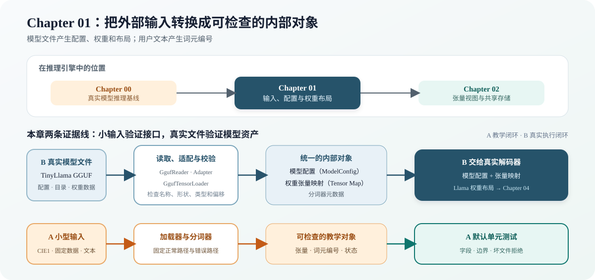

# 01.0 加载模型权重并建立张量对象

## 本章导读

Chapter 00 已经用 llama.cpp 跑通 TinyLlama，证明模型文件、分词器和运行环境可用；本章开始建立教程自己的输入对象，把模型文件转换为配置、权重张量和模型对象，把用户文本转换为词元编号（token ID）。Chapter 02 会继续学习张量怎样共享存储和改变观察方式。

| 学习线 | 本章怎样学习 | 可验证产物 |
| --- | --- | --- |
| A 教学闭环 | 用小型 CIE1 文件、固定测试数据和教学分词器分开观察格式、加载过程与输入错误 | 可检查的张量、错误文件拒绝和词元编号 |
| B 真实执行闭环 | 读取 TinyLlama GGUF 的模型元数据、真实分词器信息和权重目录；用 Qwen3 检查第二种稠密架构 | `ModelConfig`、张量映射、稠密 Decoder 权重布局和真实文件检查 |
| C 架构扩展坐标 | 用 Qwen1.5-MoE 检查专家权重，用 DeepSeek-V2-Lite 检查 MLA 与混合层 | 两种 MoE 输入结构均可验证，并已交付后续 CPU Model 与执行器 |
| G GPU 扩展坐标 | 复用 Host 侧 GGUF 解析结果，再由 CUDA 适配器上传权重 | 本章不在 GPU 上解析文件；设备权重验证位于 `code/cuda` |
| M 多模态扩展坐标 | 复用 GGUF Reader 读取视觉投影 metadata 与 payload | mmproj schema 与视觉权重验证位于 `code/multimodal` |

| 本章新术语 | 先这样理解 | 首次解释 |
| --- | --- | --- |
| 张量（`Tensor`） | 带名称、形状、数据类型和底层字节的数据对象 | [`01.1 Tensor Object`](./01_tensor_object.md) |
| 模型加载器（`ModelLoader`） | 把文件中的权重恢复成可按名称查询的张量 | [`01.3 ModelLoader and Validation`](./03_model_loader_validation.md) |
| 分词器（`Tokenizer`） | 在用户文本和模型使用的词元编号之间转换 | [`01.4 输入要求与分词器`](./04_input_contract_and_tokenizer.md) |
| 模型元数据（model metadata） | 描述模型层数、隐藏维度、词表和上下文长度 | [`01.5 Model Metadata and GGUF`](./05_model_metadata_and_gguf.md) |
| 模型结构约束（schema） | 根据模型架构检查必需权重的名称、数量和形状 | [`01.5 模型元数据与 GGUF`](./05_model_metadata_and_gguf.md) |
| GGUF | 保存模型配置、分词信息、权重目录和权重数据的文件格式 | [`01.5 Model Metadata and GGUF`](./05_model_metadata_and_gguf.md) |

## 开始学习

先从张量对象认识加载结果，再用 CIE1 小文件观察一条完整且容易排错的加载链。理解名称、形状、数据类型和权重字节怎样被校验后，再进入真实分词器、GGUF 元数据和模型布局。TinyLlama 用于跑通主线，Qwen3 展示稠密模型家族变化，Qwen1.5-MoE 展示专家权重，DeepSeek-V2-Lite 展示 MLA 和混合层带来的新结构约束。

| 顺序 | 路线 | 页面 | 先看源码 | 读完后应看到什么 |
| --- | --- | --- | --- | --- |
| 1 | A/B 公共 | [`01.1 张量对象`](./01_tensor_object.md) | <a href="../_code/chapter01_tensor_loader/src/tensor.h"><code>tensor.h</code></a> | 名称、形状、类型和底层字节组成一个 Tensor |
| 2 | A | [`01.2 教学权重格式`](./02_teaching_weight_format.md)、[`01.3 模型加载与验证`](./03_model_loader_validation.md) | <a href="../_code/chapter01_tensor_loader/src/model_loader.cpp"><code>model_loader.cpp</code></a> | 小文件固定 Loader 正常与失败路径 |
| 3 | A→B | [`01.4 输入要求与分词器`](./04_input_contract_and_tokenizer.md) | <a href="../_code/chapter01_tensor_loader/src/tokenizer.h"><code>tokenizer.h</code></a> | 教学接口怎样过渡到模型规定的 tokenizer |
| 4 | B | [`01.5 模型元数据与 GGUF`](./05_model_metadata_and_gguf.md) | <a href="../_code/chapter01_tensor_loader/src/gguf_reader.cpp"><code>gguf_reader.cpp</code></a>、<a href="../_code/chapter01_tensor_loader/src/model_builder.cpp"><code>model_builder.cpp</code></a> | GGUF 配置和权重进入张量映射与对应架构布局 |
| 5 | B | [`Loader 框架对照`](./06_framework_loader_comparison.md) | [`llama.cpp` 项目卡](../reference/ecosystem/local_and_delivery.md#llama-cpp) | 在成熟框架中定位格式解析、权重加载和模型构建 |

## 验证与下一步

本章留下可检查的权重张量、模型配置、分词器和架构布局。Llama/Qwen3 稠密模型交付整体 Decoder 输入，Qwen1.5-MoE 与 DeepSeek-V2-Lite 交付 Router、专家或 MLA 所需的分层权重对象。TinyLlama 在 [`Chapter 04`](../chapter04_attention/06_real_tinyllama_decoder.md) 进入默认真实解码器，Qwen3 在 [`04.5 接入首层权重`](../chapter04_attention/05_load_first_layer.md) 继续完成 Q/K Norm、NeoX RoPE 和 28 层 CPU Decoder；[`Chapter 02`](../chapter02_tensor_ops/intro.md) 用独立的教学张量建立视图与执行布局。

| 验收层级 | 执行入口 | 通过条件 | 本章要求 |
| --- | --- | --- | --- |
| L1 默认 CPU | `bash code/chapter01_tensor_loader/run.sh` | Tensor、教学 Loader、Tokenizer、模型配置、GGUF 测试文件、结构约束和错误路径通过 CTest | 必做 |
| L2 真实模型 | `bash code/chapter01_tensor_loader/run_real_tokenizer.sh` | 固定文本得到预期 token IDs；模型元数据、201 个张量索引、22 层布局、数据区偏移和 Decoder 输入映射通过检查 | 有模型时必做 |
| L2 可选 Qwen3 | `bash code/chapter01_tensor_loader/run_qwen3_baseline.sh` | 文件校验值、固定词元、聊天模板、28 层和 311 个张量通过检查 | 扩展模型时执行 |
| L3 可选 Qwen1.5-MoE | `bash code/chapter01_tensor_loader/run_qwen15_moe_schema.sh` | 24 层、411 个张量、60 选 4 与专家布局通过检查 | 学习 MoE 时执行 |
| L3 可选 DeepSeek-V2-Lite | `bash code/chapter01_tensor_loader/run_deepseek_v2_lite_schema.sh` | 27 层、377 个张量、MLA 压缩维度、首层 Dense 与 64 选 6 MoE 布局通过检查 | 学习 MLA 时执行 |
| L3 可选 CUDA | 不单独设置 Loader CUDA 验收 | 文件解析和权重索引保持 Host 侧职责，设备上传由后续 backend 验证 | 不适用 |
