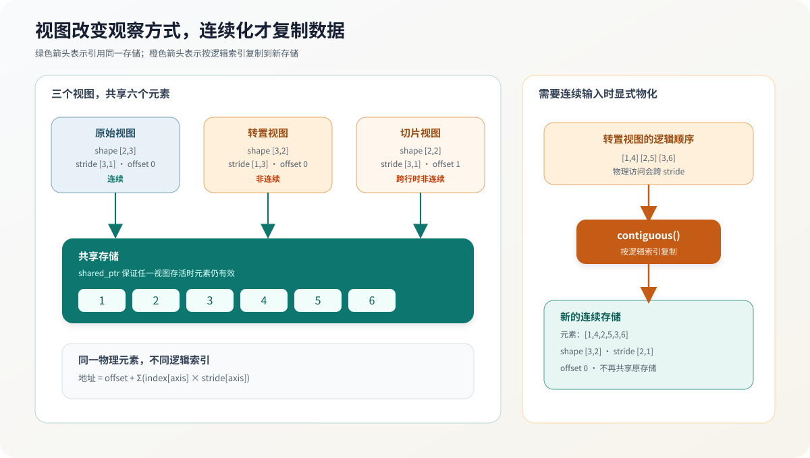

# 02.3 切片

`slice` 从已有张量中选择局部窗口。它与 `reshape` 的区别是：变形重新解释整个窗口，切片改变窗口起点和范围。

## 偏移与步长怎样定位窗口

通用 `slice(axis, start, count)` 只改变指定轴。新起点由父视图的偏移、该轴的起始位置和步长决定：

```cpp
new_offset = offset + start * strides[axis];
new_shape[axis] = count;
```

二维四参数 `slice` 是兼容接口，可以同时截取行列窗口。返回的视图更新形状和偏移，并保留父视图的步长，因此可以正确寻址，但不一定连续。

`try_slice` 和 `try_transpose` 同样允许输出参数指向源张量。实现先完成范围检查和新视图构造，成功后再替换；失败不会清空原对象。

## 从视图导出非拥有引用

<a href="../_code/chapter02_tensor_ops/src/tensor.cpp"><code>tensor.cpp</code></a> 中的 `try_slice()` 分别检查起点、长度、范围和地址计算溢出。`contract()` 将结果导出为：

```text
shape + strides + storage_offset_elements
      + storage_bytes + dtype + device
```

`TensorContract` 只描述布局。`view_ref()` 再把存储基址与契约组合为只读的非拥有 `TensorViewRef`；需要让算子写入已有存储时，`mutable_view_ref()` 返回对应的 `MutableTensorViewRef`：

```text
只读输入：const 存储基址 + shape/stride/offset/dtype/device
可写输出：      存储基址 + shape/stride/offset/dtype/device
```

两种引用都不会增加存储的共享计数，因此只能在原张量或其他共享视图存活期间使用。可写引用可以转成只读引用，但只读引用不能反向取得写权限。Chapter03 使用这些公共引用检查连续行优先布局，并根据偏移找到当前视图的第一个元素。

## 需要连续内存时显式物化

跨行切片会保留父张量的行步长，例如 `shape=[2,2]`、`stride=[3,1]`。两个逻辑行之间存在未选中的元素，因此不能直接交给只接受连续行优先输入的矩阵乘法算子。

`contiguous()` 按逻辑索引顺序复制到新存储，并把布局规范化为 `offset=0` 和连续步长；二维 `[rows,cols]` 的结果是 `[cols,1]`。如果源视图已经连续，该函数直接复用原存储。调用者主动选择连续化，因此复制成本不会隐藏在后续适配器中。

`data()` 只为状态正常且连续的视图返回当前首元素指针；非连续视图返回空指针。跨章算子通常使用 `view_ref()` 读取输入，用 `mutable_view_ref()` 接收输出，从而同时携带存储基址与布局契约。下图用同一组元素对比共享引用和显式复制，橙色路径才会分配新存储。



## 验证与衔接

运行 `bash code/chapter02_tensor_ops/scripts/run.sh`，确认子视图读取正确元素、共享父存储，并确认非连续视图物化后改用独立的连续存储。[`单元测试`](./04_unit_tests.md) 将这些语义固定为回归条件。
