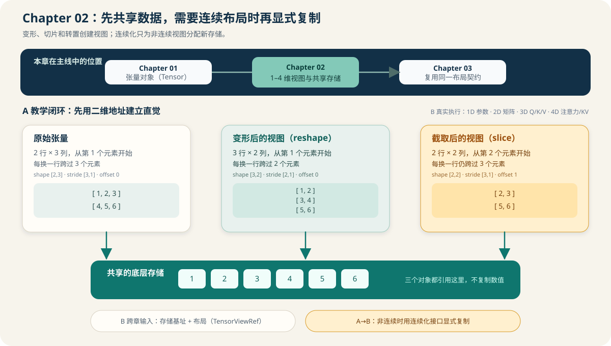

# 02.0 学习张量视图与共享存储

## 本章导读

Chapter 01 已经建立模型形状、数据类型和底层存储概念；本章用独立的 CPU Float32 教学张量实现 1–4 维形状、步长和偏移，并加入 `reshape`、按轴 `slice`、交换轴和 `contiguous()`。二维示例先建立地址直觉，再通过只读输入视图和可写输出视图进入矩阵乘法、解码器与量化线性层。

| 学习线 | 本章怎样学习 | 可验证产物 |
| --- | --- | --- |
| A 教学闭环 | 用二维小数组观察共享存储、变形、切片、转置和显式连续化 | 可直接打印的形状、步长、偏移与共享关系 |
| B 真实执行闭环 | 将同一地址公式扩展到 1–4 维，并通过 `TensorViewRef` 交给后续计算后端 | 3D/4D Q/K/V 布局、Chapter03–05 跨章测试 |
| G GPU 扩展坐标 | 保留 shape、stride 和连续性语义，由 `CudaTensor` 管理设备存储 | 当前没有 Host Tensor 自动迁移；上传和设备生命周期由 CUDA 模块验证 |
| M 多模态扩展坐标 | 用相同形状语言描述图像、patch 和 embedding 序列 | 当前多模态对象不直接依赖 Chapter02 Tensor 类型，只复用数据布局约定 |

本章先用中文概念建立直觉，再在正文中对应到代码变量：

| 本章新术语 | 先这样理解 | 首次解释 |
| --- | --- | --- |
| 形状（`shape`） | 数据按几个维度、每个维度多长来观察 | [`02.2 变形与转置`](./02_reshape.md) |
| 维数（`rank`） | 形状中包含多少个轴 | [`02.1 共享底层存储`](./01_shared_ptr_memory.md) |
| 轴（`axis`） | 形状中某个维度的位置 | [`02.3 切片`](./03_slice.md) |
| 步长（`stride`） | 某一维下标增加 1 时，要跨过多少个元素 | [`02.2 变形与转置`](./02_reshape.md) |
| 偏移（`offset`） | 当前视图从底层存储的第几个元素开始 | [`02.3 切片`](./03_slice.md) |
| 转置（`transpose`） | 交换行列的观察方式，不移动底层数值 | [`02.2 变形与转置`](./02_reshape.md) |
| 视图与底层存储（view / storage） | 多个张量对象可以观察同一份数据 | [`02.1 共享底层存储`](./01_shared_ptr_memory.md) |

## 开始学习

阅读时先用二维地址理解共享存储，再把同一套形状、步长和偏移公式推广到更多轴。最后通过公共只读/可写视图，把本章张量交给后续算子；跨章测试分别位于 Chapter03 的矩阵乘、Chapter04 的解码器组件和 Chapter05 的量化 Linear，不属于本章默认 CTest。

| 顺序 | 路线 | 页面 | 先看源码 | 读完后应看到什么 |
| --- | --- | --- | --- | --- |
| 1 | A/B 公共 | [`02.1 共享底层存储`](./01_shared_ptr_memory.md) | <a href="../_code/chapter02_tensor_ops/include/chapter02_tensor_ops/tensor.h"><code>tensor.h</code></a> | 视图元数据与存储所有权分开 |
| 2 | A | [`02.2 变形与转置`](./02_reshape.md)、[`02.3 切片`](./03_slice.md) | <a href="../_code/chapter02_tensor_ops/src/tensor.cpp"><code>tensor.cpp</code></a> | 二维地址变化、共享和显式复制可以直接观察 |
| 3 | B | [`02.4 单元测试`](./04_unit_tests.md) | <a href="../_code/chapter02_tensor_ops/tests/chapter02_nd_tensor_test.cpp"><code>chapter02_nd_tensor_test.cpp</code></a> | 1D、3D、4D 索引与公共视图规则成立 |
| 4 | B | [`02.5 张量与视图框架对照`](./05_framework_tensor_comparison.md) | [`教程资产索引`](../reference/tutorial_assets.md) | 在 ggml 和 vLLM 中定位视图与执行布局 |

## 验证与下一步

[`Chapter 03`](../chapter03_matmul/intro.md) 明确要求二维输入，把连续 CPU Float32 视图适配为 `MatmulRequest`；高维张量不会被自动展平或解释为批量矩阵乘法。

| 验收层级 | 执行入口 | 通过条件 | 本章要求 |
| --- | --- | --- | --- |
| L1 默认 CPU | `bash code/chapter02_tensor_ops/scripts/run.sh` | 示例输出布局与共享关系；两个 CTest 验证 1–4 维索引、变形、转置、切片、`contiguous()` 和失败路径 | 必做 |
| L2 相邻章节 | `bash code/chapter03_matmul/scripts/run.sh`、`bash code/chapter04_attention/scripts/run.sh`、`bash code/chapter05_quantization/scripts/run.sh` | Chapter02 公共视图进入 MatMul、Decoder 组件与量化 Linear，错误布局在计算前被拒绝 | 学到对应章节后执行 |
| L3 可选 CUDA | 不单独设置 Chapter02 CUDA 验收 | 本章只建立主机视图；设备存储由 `code/cuda` 的 `CudaTensor` 验证 | 不适用 |
