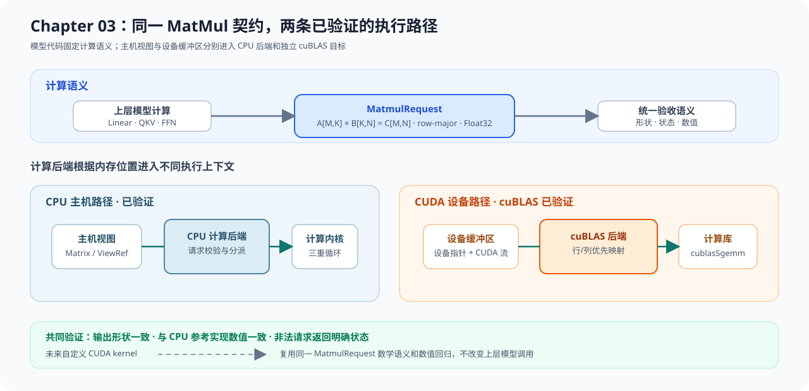

# 03.7 在成熟框架中寻找矩阵乘法路径

Chapter03 的调用路径可以顺着源码追踪：输入视图生成请求，计算后端选择实现，CPU 循环或 cuBLAS 完成计算。阅读生产框架时也可以沿着这条路径查找关键对象。

## 对象映射

| 要找的对象 | 教程入口 | 阅读问题 |
| --- | --- | --- |
| 输入和输出形状 | `MatmulRequest` | `M、N、K` 从哪里产生 |
| CPU 实现选择 | `CpuReferenceMatmulBackend` | 请求在哪里交给 CPU 内核 |
| 实际循环 | `cpu_kernel.cpp` | 行、列和累加维怎样映射到地址 |
| CUDA 库调用 | `CublasMatmulBackend` | 行优先数据怎样映射到 SGEMM 参数 |
| 正确性基线 | Chapter03 CPU 测试 | 替换实现后与什么结果比较 |

## 教学实现与生产实现

| 生产项目入口 | 先寻找什么 | 与本章对照什么 |
| --- | --- | --- |
| [llama.cpp CPU 计算后端](../reference/ecosystem/local_and_delivery.md#llama-cpp) | 图算子如何分派到 CPU 矩阵乘法或点积内核 | `MatMulOp → CpuReferenceMatmulBackend → 计算内核` |
| [llama.cpp CUDA 计算后端](../reference/ecosystem/local_and_delivery.md#llama-cpp) | 同一个图算子如何选择 CUDA 计算内核或计算库 | G 路线的设备指针、CUDA 流和结果对照 |
| [TensorRT-LLM 运行时与计算内核](../reference/ecosystem/production_frameworks.md#tensorrt-llm) | 缓冲区、执行上下文、GEMM 与工作区怎样连接 | 请求、计算后端和设备资源的分工 |
| PyTorch 复算 | 用独立张量实现计算同一固定输入 | 区分公式错误、CPU 索引错误和 CUDA 参数错误 |

## 继续阅读源码

打开项目卡中的官方源码入口，按下面的顺序记录：

1. 输入布局和矩阵形状由哪个对象决定；
2. CPU 与 GPU 在哪个位置分派；
3. 临时工作区、CUDA 流和设备缓冲区由谁持有；
4. 优化实现使用哪一份 CPU 或独立结果做回归。

回答这四个问题后，就能把 Chapter03 的小型调用路径映射到生产框架，再按需深入相关模块。
