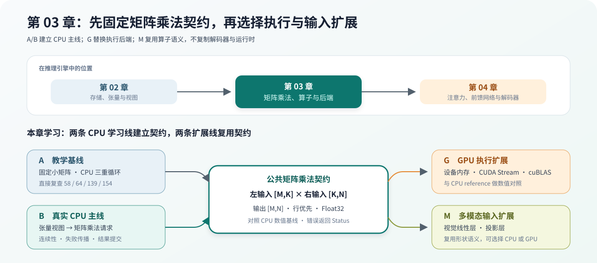

# 03.0 构建矩阵乘法算子与计算后端

## 本章导读

Chapter 02 已经能导出只读输入视图和可写输出视图；本章将连续 CPU Float32 视图适配为矩阵乘法（MatMul）请求。CPU 参考实现先给出正确结果，可选 CUDA 目标再用相同数学语义验证设备内存上的 cuBLAS 执行。多模态的 Vision Linear 和 Projector 也复用同一算子语义，具体权重和形状由多模态输入链路负责。Chapter 04 会沿用矩阵乘法的形状与布局语义组装线性层、注意力和前馈网络。

| 学习线 | 本章怎样学习 | 可验证产物 |
| --- | --- | --- |
| A 教学闭环 | 用固定小矩阵和 CPU 三重循环理解 `A[M,K] × B[K,N]` | `58/64/139/154` 固定结果与失败状态 |
| B 真实执行闭环 | 将 Chapter02 张量视图适配到稳定的矩阵乘法请求，并交给 CPU Backend 执行 | 跨章输入输出、连续性、失败传播和结果提交契约 |

| 扩展线 | 本章交接点 | 当前验证 |
| --- | --- | --- |
| G GPU 执行扩展 | 使用相同 MatMul 形状语义，把主机存储替换为设备内存和 cuBLAS | `cpp_llm_engine_cuda_cublas_matmul_test` 与 CPU reference 对照 |
| M 多模态输入扩展 | Vision Encoder 和 Projector 复用 Linear/MatMul 语义，不改变本章算子接口 | `code/multimodal` 的 Vision 与 Projector 测试负责真实形状验证 |

| 本章新术语 | 先这样理解 | 首次解释 |
| --- | --- | --- |
| 矩阵乘法（MatMul） | 用左矩阵的一行与右矩阵的一列计算一个输出元素 | [`03.2 矩阵乘法算子设计`](./02_matmul_design.md) |
| 算子（Operator） | 对调用方保持稳定的一次计算入口 | [`03.1 算子基类`](./01_operator_base.md) |
| 计算后端（Backend） | 在 CPU、CUDA 或外部库上完成同一计算的实现 | [`03.1 算子基类`](./01_operator_base.md) |
| CPU 参考实现 | 优先保证可读和正确，用来核对其他后端 | [`03.3 参考实现（CPU）`](./03_cpu_reference.md) |



## 开始学习

先运行本章脚本：

```bash
bash code/chapter03_matmul/scripts/run.sh
```

脚本会先运行 `chapter03_matmul_demo`，输出 `2x2` 矩阵、`value(0,0)=58` 和 `value(1,1)=154`；随后 CTest 验证形状、内存、数值和公共请求。阅读时沿着“算子入口 -> 计算后端 -> 具体循环或计算库”前进，CPU 结果始终作为其他后端的数值参照。

| 顺序 | 路线 | 页面 | 先看源码 | 读完后应看到什么 |
| --- | --- | --- | --- | --- |
| 1 | A/B 公共 | [`03.1 算子基类`](./01_operator_base.md)、[`03.2 矩阵乘法算子设计`](./02_matmul_design.md) | <a href="../_code/chapter03_matmul/src/matmul_op.cpp"><code>matmul_op.cpp</code></a> | 算子接口固定输入、输出、形状和布局 |
| 2 | A | [`03.3 参考实现（CPU）`](./03_cpu_reference.md)、[`03.6 建立复杂度直觉`](./06_complexity_intuition.md) | <a href="../_code/chapter03_matmul/src/cpu_backend.cpp"><code>cpu_backend.cpp</code></a> | 三重循环产生可复查数值和 `O(MNK)` 成本 |
| 3 | B | [`03.7 真实推理后端`](./07_runtime_backend_bridge.md) | <a href="../_code/chapter03_matmul/src/tensor_matmul_adapter.cpp"><code>tensor_matmul_adapter.cpp</code></a> | Chapter02 视图怎样进入稳定请求并由 CPU Backend 提交结果 |
| 4 | G | [`03.4 接入 cuBLAS 计算后端`](./04_cublas_implement.md) | <a href="../_code/cuda/src/cublas_matmul_backend.cpp"><code>cublas_matmul_backend.cpp</code></a> | 同一形状语义怎样迁移到设备内存和 cuBLAS |
| 5 | A/B/G 验证 | [`03.5 用 PyTorch 独立复算`](./05_test_with_pytorch.md) | <a href="../_code/chapter03_matmul/tests/chapter02_tensor_matmul_integration_test.cpp"><code>chapter02_tensor_matmul_integration_test.cpp</code></a> | 手算、CPU reference、可选 PyTorch/CUDA 结果怎样形成独立对照 |

## 验证与下一步

算子与计算后端分开后，进入 [`Chapter 04`](../chapter04_attention/intro.md)，把线性层、注意力、前馈网络和残差连接组合成单层解码器。

| 验收层级 | 执行入口 | 通过条件 | 本章要求 |
| --- | --- | --- | --- |
| L1 默认 CPU | `bash code/chapter03_matmul/scripts/run.sh` | 固定结果为 `58/64/139/154`，可写输出视图正确提交，非法、非连续或后端失败不覆盖已有输出 | 必做 |
| L2 真实模型 | 不单独执行真实模型 | 本章固定矩阵乘法语义与后端契约；真实低比特线性层从 Chapter05 接入 | 不适用 |
| L3 可选 CUDA | `CUDA_HOME=/usr/local/cuda-12.8 bash code/cuda/scripts/run.sh` | `cpp_llm_engine_cuda_cublas_matmul_test` 与 CPU 参考实现在容差内一致 | 有 NVIDIA GPU 时选做 |
