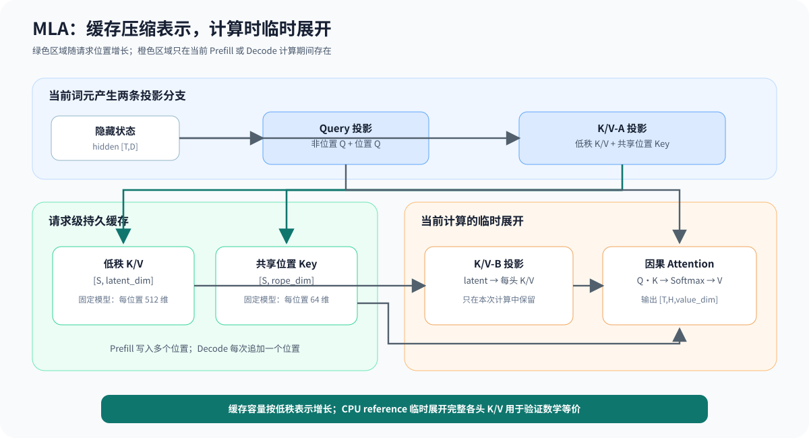
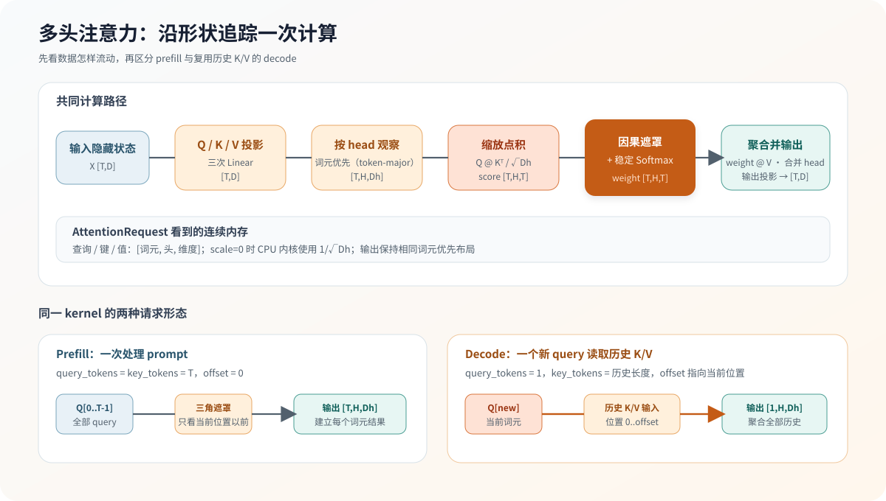
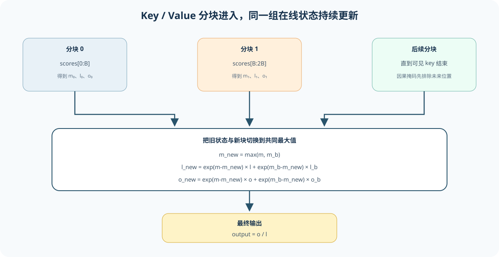

# 04.1 多头注意力

Chapter03 已经固定矩阵乘法的形状、布局和计算后端分层；本节把同样的计算语义放进第一个模型结构：输入先生成 Q、K、V，再按注意力头计算相关性并聚合 V。Chapter04 的教学线性层保留本地可读循环，注意力通过独立计算后端执行。学习时重点追踪每一步形状，而不是先记住公式名称。

教学 `MultiHeadAttention` 接收连续二维输入 `[T,D]`；跨章张量适配器接收 `[T,H,Dh]` 或 `[B,T,H,Dh]`。两条路径最终都把连续缓冲区交给同一个 `AttentionRequest`。

## Q、K、V 怎样产生输出

设词元数为 `T`、隐藏维度为 `D`、注意力头数为 `H`，每个头的宽度为 `Dh = D / H`。`D` 必须能被 `H` 整除。

```text
输入 X[T,D]
  -> Q/K/V 线性投影
  -> Q/K/V[T,H,Dh]
  -> score[T,H,T] = Q @ K^T / sqrt(Dh)
  -> causal mask
  -> softmax
  -> head output[T,H,Dh] = weight @ V
  -> 合并为 [T,D]
  -> 输出投影
```

生成模型使用因果掩码。第 `t` 个查询只能读取位置 `0..t` 的键和值，未来位置在 softmax 前写成负无穷：

```text
score = (Q @ K^T) / sqrt(Dh)
score = score + causal_mask
weight = softmax(score)
output = weight @ V
```

当前代码维护三种输入形态，它们表达同一套注意力语义：

| 路径 | 输入布局 | 当前用途 |
| --- | --- | --- |
| 教学 `MultiHeadAttention` | `[T,D]` | 串起 Q/K/V 投影、CPU 注意力和输出投影 |
| Chapter02 张量适配器 | `[T,H,Dh]`、`[B,T,H,Dh]` | 验证维数、连续布局和批次隔离 |
| TinyLlama CPU 执行上下文 | 词元隐藏向量与分层 KV | 执行 GQA、RoPE、KV Cache 和 22 个解码器块 |

## MLA 为什么保存低秩 K/V

标准 MHA 或 GQA 把每个历史词元的 K/V 按注意力头写入缓存。DeepSeek-V2-Lite 的多头潜在注意力（MLA）先把 K/V 信息压缩成低秩向量，并把带 RoPE 的 Key 位置分支单独保存。以当前固定模型为例，每个词元持久保存 512 维潜在 K/V 与 64 维位置 Key；计算 Attention 时，再把潜在向量展开成 16 个头各自使用的 128 维非位置 Key 和 128 维 Value。

```text
隐藏状态
  ├─ Q 投影 -> 每头 [非位置 Q 128 | 位置 Q 64]
  └─ K/V-A 投影 -> [潜在 K/V 512 | 位置 K 64]
                         │
                         ├─ 写入请求级压缩缓存
                         └─ K/V-B 投影 -> 每头非位置 K 128 与 V 128

score = (Q_nope · K_nope + Q_rope · K_rope) / sqrt(192)
output = softmax(score + causal_mask) @ V
```

位置 Key 对所有查询头共享，非位置 Key 和 Value 由每个头自己的上投影权重恢复。持久缓存因此按词元增长 `512 + 64` 个数，而完整展开缓存需要按头保存 K/V。这里节省的是请求生命周期内反复保留的缓存；CPU reference 为了清楚展示数学过程，仍会在一次调用内建立临时展开工作区。

| 对象 | 持久还是临时 | 当前代码布局 |
| --- | --- | --- |
| 潜在 K/V | 请求级持久状态 | `[S, latent_dim]` |
| 位置 Key | 请求级持久状态 | `[S, rope_dim]` |
| 非位置 K | CPU reference 临时工作区 | `[S,H,qk_nope_dim]` |
| Value | CPU reference 临时工作区 | `[S,H,value_dim]` |
| Query | 当前 Prefill/Decode 步骤 | `[T,H,qk_nope_dim]` 与 `[T,H,rope_dim]` |



<a href="https://github.com/datawhalechina/cpp-llm-engine/blob/main/code/chapter04_attention/src/mla_attention.cpp"><code>mla_attention.cpp</code></a> 接收已经投影并完成 RoPE 的 Query、低秩缓存和 K/V 上投影权重。测试先通过低秩路径计算结果，再显式展开完整 K/V 并交给标准 CPU Attention；两条路径逐元素一致。该入口固定 MLA 的算法语义，当前尚未读取真实量化权重，也没有实现生产框架常用的权重吸收与融合 kernel。

真实 DeepSeek-V2-Lite 对照由 `run_deepseek_v2_lite_layer_capture.sh` 提供。它通过 llama.cpp 回调捕获首层的归一化输入、Query、K/V-A、共享 RoPE Key、压缩 latent、Attention 输出、FFN 输入和层输出。算法测试回答“低秩路径是否正确”，真实捕获回答“固定 GGUF 的节点名称、shape 和参考数值是什么”；自研首层需要同时通过两类证据。

CUDA 路径继续保留这份压缩状态。`CudaMlaCache` 按请求保存 latent K/V 与共享位置 Key；K/V-B 展开矩阵由模型权重对象持有，避免每个请求重复反量化。首版 MLA kernel 按 head 直接读取压缩历史，在求最大值、Softmax 分母和每个 Value 维聚合时重复计算 score。它先固定了数学结果，但计算量随 Value 维数重复放大。

当前 CUDA 实现把计算拆成三个阶段：先为每个 `(head, token)` 计算一次 score，再按 head 原地归一化为概率，最后让 `(head, value)` 并行复用概率完成 Value 聚合。每层 Context 按最大上下文一次性创建 `[head, capacity]` 概率工作区，Decode 时不再动态分配。这样既保留压缩缓存，也避免在每个 Value 维重新执行非位置 Key 投影。

EXP-GPU-17 中，参考 kernel 占一次双请求 Decode 的 `99.9%` GPU kernel 时间；三阶段实现将完整 grouped Decode 从约 `31.8 s` 降到约 `0.45 s`。真实双词元 CPU/CUDA 层输出最大绝对误差为 `5.01e-6`，完整 27 层 logits 余弦为 `1`、贪心词元一致。优化后 score kernel 仍占 kernel 时间 `82.3%`，所以接下来应细分 score 内部的 latent 投影，而不是绕过数值门禁继续堆叠融合。

```bash
CUDA_HOME=/usr/local/cuda-12.8 \
bash code/engine/scripts/run_deepseek_v2_lite_cuda_dense_layer.sh
```

自研入口先在位置 0 验证量化投影、维度拆分、输出投影、SwiGLU 和双残差，再用位置 1 读取两项历史。请求 Context 持久保存归一化后的 512 维 latent K/V 和已旋转的 64 维共享 Key；Q 与共享 Key 都按照 GGUF 的 YaRN 参数执行 partial RoPE。双词元对照同时验证缓存追加、位置偏移和历史聚合，最终层输出与 llama.cpp 的余弦相似度为 `0.999883`。

通用资料常写 `[B,H,T,Dh]`。本教程的跨章适配器使用词元优先（token-major）布局 `[B,T,H,Dh]`，让同一个词元的所有注意力头连续存放。阅读下图时从左到右追踪形状，再在下半部分比较预填充与逐词元解码的请求差异。



## 从算法镜像进入 C++

下面的 Python 镜像 CPU 参考实现的循环顺序，帮助阅读后续 C++ 内核：

```python
def attention_reference(query, key, value, causal, offset):
    output = zeros_like(query)
    scale = 1.0 / sqrt(query.head_dim)

    for query_token in range(query.token_count):
        query_position = offset + query_token
        for head in range(query.head_count):
            scores = []
            for key_token in range(key.token_count):
                if causal and key_token > query_position:
                    scores.append(float("-inf"))
                else:
                    scores.append(dot(query[query_token, head],
                                      key[key_token, head]) * scale)

            probabilities = stable_softmax(scores)
            for key_token, probability in enumerate(probabilities):
                output[query_token, head] += (
                    probability * value[key_token, head])
    return output
```

对照源码时按下表逐项定位：

| 算法动作 | C++ 对象或位置 | 观察重点 |
| --- | --- | --- |
| Q/K/V 与输出投影 | <a href="https://github.com/datawhalechina/cpp-llm-engine/blob/main/code/chapter04_attention/src/attention.cpp"><code>attention.cpp</code></a> | `[T,D]` 怎样进入和离开计算后端 |
| 查询的绝对位置 | `query_position_offset` | 解码查询怎样读取历史 K/V |
| 因果判断 | `key_token > query_position` | 未来词元不进入 softmax |
| 缩放点积 | 注意力 CPU 内核 | 每个注意力头独立计算，默认缩放因子为 `1/sqrt(Dh)` |
| 稳定 softmax | 最大值、指数、分母三段循环 | 大分数不直接进入 `exp` |
| 3D/4D 视图适配 | <a href="https://github.com/datawhalechina/cpp-llm-engine/blob/main/code/chapter04_attention/src/tensor_attention_adapter.cpp"><code>tensor_attention_adapter.cpp</code></a> | 批次指针偏移与连续性检查 |

适配器不隐式复制非连续视图。Chapter02 的转置或切片如果破坏连续布局，调用者必须先执行 `contiguous()`，复制成本因此保持可见。`try_compute_tensor_attention_into()` 接收调用方提供的可写输出视图；它先完成全部批次计算，成功后统一提交，因此形状校验或计算后端失败不会覆盖已有输出。返回 Chapter02 张量的旧入口继续作为兼容外壳。

## 分块在线 Softmax 怎样合并状态

三段式实现为一个 query 保存全部 `S` 个 score，再求最大值、指数和与 Value 加权和。分块在线 Softmax 每次只处理 `B` 个 key，并为当前已处理前缀保存三个状态：最大分数 `m`、指数和 `l`、未归一化的 Value 累加向量 `o`。

当前状态与新分块使用不同最大值作为指数基准，不能直接相加。设新块状态为 `m_b、l_b、o_b`，先取共同最大值 `m_new`，再把两边缩放到同一基准：

```text
m_new = max(m, m_b)
l_new = exp(m - m_new) * l + exp(m_b - m_new) * l_b
o_new = exp(m - m_new) * o + exp(m_b - m_new) * o_b

output = o / l
```

每个分块内部仍使用稳定 Softmax：先求块最大值，再计算 `exp(score - m_b)`。因果掩码在 score 进入块状态前生效；不可见 key 不参与 `m_b、l_b、o_b`。CPU reference 保存一个分块 score 和一个 `Dh` 宽累加向量，工作集从随序列长度增长的 `O(S)` 变为 `O(B + Dh)`。

| 对象 | 三段式稳定 Softmax | 分块在线 Softmax |
| --- | --- | --- |
| score 临时空间 | 当前 query 的全部 `S` 个分数 | 最多 `B` 个分数 |
| 数值稳定性 | 全局最大值统一重标定 | 每次合并时重标定旧状态和新块 |
| Value 聚合 | 概率全部得到后再读取 V | 每个块得到指数权重后立即累加 V |
| CPU 教学目标 | 直接、易核对的数值基线 | 验证分块状态和有限工作集 |
| GPU 扩展方向 | 多 kernel 与全局 score workspace | tile、片上存储和融合 Attention kernel |



## 从在线 Softmax 到 FlashAttention

在线 Softmax 解决的是“分块后怎样得到与完整 Softmax 等价的结果”。FlashAttention 还要继续解决 Q/K/V 怎样分块、分块怎样留在片上存储、线程块和 Warp 怎样分工，以及计算和数据搬运怎样重叠。因此，本节的 CPU 分块实现是 FlashAttention 各代共享的数学基础，不等同于某一代 FlashAttention。

| 演进阶段 | 主要解决的问题 | 本教程处理方式 |
| --- | --- | --- |
| FlashAttention-1 | 用分块和在线 Softmax 避免物化完整注意力矩阵，减少 HBM 与片上存储之间的读写 | 完整讲解；先实现 CPU 等价参考，再建设 CUDA 教学内核 |
| FlashAttention-2 | 减少非矩阵运算，增加单头跨线程块并行，并调整 Warp 分工 | 完整讲解；CUDA 连续与分页 K/V 提供 `FA2-inspired` 推理前向实验 |
| FlashAttention-3 | 在 Hopper 上用异步执行、Warp specialization、TMA 和 FP8 提高利用率 | 讲解设计与硬件前提，不承诺本地实现 |
| FlashAttention-4 | 针对数据中心 Blackwell 的异步 MMA、Tensor Memory 和 2-CTA MMA 重构流水线 | 讲解硬件与算法协同演进，不作为消费级单卡实现目标 |

`FA2-inspired` 表示教学内核只吸收分块在线 Softmax、线程块并行和 Warp 工作划分等关键思想。它只覆盖本教程需要的推理前向、因果掩码和 GQA，不包含官方实现的反向传播、完整数据类型、变长序列、全部 head size 和跨架构调优，因此不能标记为“FlashAttention-2 实现”。

CUDA `compute_online()` 已把在线状态合并、key tile 和 Value 聚合放进一个 kernel，并消除完整 score workspace。第一版为每个 key 执行线程块归约，固定 workload 慢于三阶段路径；第二版改为 4 个 Warp 并行处理 4 个 key，并用 Warp shuffle 归约，三轮微基准均约为三阶段路径的 31%。因此第二版可以标记为 FA2-inspired 候选，并通过显式开关进入真实 Runtime A/B；它仍不是默认实现。

真实 TinyLlama 的 2 层和 22 层单-query 双步对照已经通过，融合路径保持 hidden、logits 和 greedy token。它验证带历史 K/V 的真实 Decode 数值；多 token Tensor Prefill 由下一个实验单独验证。

多 token Decoder Prefill 现已增加：连续 `[T,D]` embedding 经过批量投影、逐位置 RoPE、K/V 写入和因果 Attention。TinyLlama 22 层、2-token 结果与顺序执行一致。随后补入批量 embedding、最终 logits 和按 shape 复用的持久 workspace；连续 CUDA Executor 追加连续 K/V，分页 CUDA Executor 根据 BlockTable 写入物理槽位。分页寻址与事务进入 [`07.4 分页 Attention`](../chapter07_kv_cache/next/04_paged_attention.md)继续学习。

Chapter09 的[融合 Attention 端到端实验](../reference/experiment_assets.md#exp-gpu-04)用 32-token Prompt 分别测量完整 Tensor Prefill 和一次 Decode。融合路径通过 logits 与 greedy token 检查，但两轮独立中位数一次回退、一次改善，没有稳定端到端收益。因此三阶段路径继续作为默认实现；融合路径保留为可读算法、显存访问和 kernel 调优之间的教学对照。

| 实验版本 | QK 工作划分 | 固定 workload 结果 | 决策 |
| --- | --- | --- | --- |
| 三阶段 golden | score、Softmax、Value 三个 kernel | 约 `0.223–0.226 ms` | 保留正确性与回退基线 |
| 融合 v1 | 整个线程块逐 key 树形归约 | `0.296630 ms` | 拒绝接入 |
| 融合 v2 | 4 个 Warp 并行处理 4 个 key，Warp shuffle 归约 | 约 `0.0697–0.0699 ms` | 进入真实模型候选验证 |

Prefill 同时处理多个 query，二维分块和融合计算可以避免较大的 score workspace，是本路线的主要性能实验。单 token decode 只有一个 query，瓶颈通常转向读取不断增长的 K/V；此时分页布局、GQA 和内存访问比照搬 Prefill tile 更重要。Chapter09 必须分别记录两种 workload，不能用 Prefill 的加速结果代表 Decode。

论文入口：[FlashAttention-1](https://arxiv.org/abs/2205.14135)、[FlashAttention-2](https://arxiv.org/abs/2307.08691)、[FlashAttention-3](https://arxiv.org/abs/2407.08608)、[FlashAttention-4](https://arxiv.org/abs/2603.05451)。

## 从单次 Attention 进入 KV Cache

Prefill 可以同时产生多个位置的 Q/K/V；decode 每次只产生一个新位置。连续缓存把新 K/V 追加到 `[S,Hkv,Dh]` 尾部，再让当前 query 读取更新后的 `S+1` 个位置。分页缓存改变存储和寻址方式，但不改变这套注意力语义。

Chapter04 的 `KvCache` 用固定容量连续数组保存 K/V。`MultiHeadAttention::try_forward_with_cache()` 先投影当前输入，再把新 K/V 追加到候选缓存，并将完整历史交给 Attention backend。`DecoderLayerContext` 为单个请求保存当前解码层的缓存；只有整层计算成功，候选 Context 和输出才一起提交。真实 TinyLlama Context 为 22 层分别保存 K/V。Block 分配和逻辑位置映射由 Chapter07 负责，Chapter10 在请求终态触发释放。

| 观察点 | 连续 CPU 路径 | 分页路径目标 |
| --- | --- | --- |
| 写入新 K/V | 追加到每层连续数组尾部 | 写入页表给出的 physical block/slot |
| 读取历史 | 按连续位置 `0..S` 遍历 | 按 block table 定位 `0..S` |
| 序列增长 | `size: S -> S+1` | committed tokens: `S -> S+1` |
| 计算结果 | 当前 query 聚合历史 value | 与连续路径 logits 一致 |

### 用双词元证明 Attention 确实读取历史

Qwen1.5-MoE 的 position 0 只能看到一个 K/V，Softmax 权重恒为 1，因此单词元对照不能单独证明 RoPE、因果掩码和历史聚合正确。双词元入口使用位置 0 和 1：第一个查询只读取位置 0，第二个查询读取位置 0..1。每个位置都先对 Q/K 执行 NeoX 前后半维配对旋转，再把旋转后的 K 和原始 V 写入连续负载。

```bash
bash code/chapter04_attention/scripts/run_qwen15_moe_prefill_compare.sh
```

固定模型含 16 个 K/V 头、每头 128 维，因此两个词元的单层 K 和 V 负载各有 `2 × 16 × 128 = 4096` 个元素。layer-0 Attention 残差 MAE 为 `0.0002315`、层输出 MAE 为 `0.0005157`。继续执行 layer-1 后，两层最终输出 MAE 为 `0.0019475`、余弦相似度为 `0.999999`，证明 hidden 和分层 K/V 已能跨层交接。

24 层入口进一步区分局部误差与累计误差：局部路径每层都使用 llama.cpp 的上一层输出，可以判断当前层的 Attention、MoE 和 Top-K 是否正确；累计路径继续使用教程自己的输出，可以观察量化误差是否跨过 Router 的 Top-K 边界。固定模型的局部 Top-K 全部一致，24 层 K/V 各有 `24 × 4096 = 98304` 个元素。累计路径有 3 个词元位置选择了不同专家，最终 hidden 仍保持 `0.997824` 的余弦相似度。最终 RMSNorm 和 Q6_K LM Head 把末词元转换为 151936 维 logits；累计 logits 余弦相似度为 `0.999401`，贪心词元 `151643` 与 llama.cpp 一致。llama.cpp 在模型最后一层只保留末词元隐藏状态用于计算 logits，因此最终层核对 2048 个元素，其余层核对两个词元的 4096 个元素。

```bash
bash code/chapter04_attention/scripts/run_qwen15_moe_decoder_compare.sh
```

## 验证与衔接

从仓库根目录运行：

```bash
bash code/chapter04_attention/scripts/run.sh
```

测试提供七组可观察证据：因果预填充的首个输出只能读取首个 V；`query_position_offset=1` 的逐词元解码可以读取两项历史 V，并得到 `51`；缓存路径向 backend 报告 `key_tokens: 2 -> 3` 和解码偏移 `2`；4D 输入中的两个批次分别保持数值 `3` 和 `7`；非连续视图在显式连续化前被拒绝；分块在线 Softmax 在不同 tile、因果位置和极端 score 下与三段式 CPU golden 一致；MLA 低秩缓存与显式展开路径逐元素一致。

验证还应看到 `MultiHeadAttention(4,2)` 保持输入输出形状 `[2,4]`，计算后端类型为 CPU。下一节将补上解码器中围绕注意力和 FFN 使用的归一化与激活函数。
