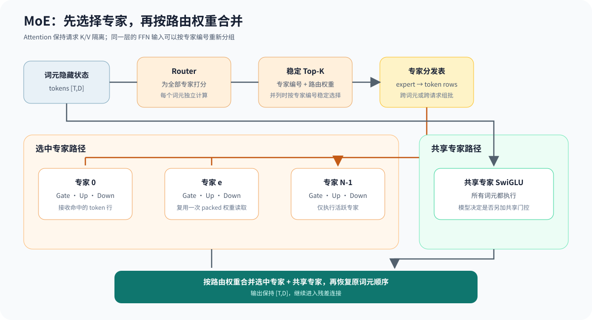

# 04.3 前馈网络

注意力在词元之间传递信息，FFN 则独立变换每个词元的特征。教学实现先用两个线性层和 ReLU 建立可运行结构，真实 TinyLlama 再用门控、升维、降维投影和 SwiGLU 对齐模型权重。

## 从隐藏维升维再降维

设输入为 `[T,D]`，中间维度为 `F`。标准两层 FFN 的形状流程是：

```text
输入 [T,D]
  -> fc1[D,F]
  -> hidden [T,F]
  -> ReLU
  -> activated [T,F]
  -> fc2[F,D]
  -> 输出 [T,D]
```

中间维度扩大了单个词元可使用的特征空间，但不会改变词元数。`FeedForward(4,8)` 因此把 `[2,4]` 暂时变为 `[2,8]`，再恢复为 `[2,4]`，以便与残差分支逐元素相加。

<a href="https://github.com/datawhalechina/cpp-llm-engine/blob/main/code/chapter04_attention/src/feed_forward.cpp"><code>feed_forward.cpp</code></a> 直接表达这三个步骤：

```cpp
Tensor hidden = fc1_.forward(input);
Tensor activated = apply_activation(hidden, ActivationKind::Relu);
return fc2_.forward(activated);
```

两个线性层复用 <a href="https://github.com/datawhalechina/cpp-llm-engine/blob/main/code/chapter04_attention/src/linear_layer.cpp"><code>linear_layer.cpp</code></a>。`forward()` 保留 Chapter04 的教学张量接口；`try_forward()` 接收公共只读输入视图和可写输出视图，因此 Chapter02 张量可以直接进入同一线性计算。两条入口都要求 CPU Float32、二维连续布局和匹配的输入输出形状，不会替调用者隐式连续化。

线性层、LayerNorm、ReLU、残差相加和完整 FFN 均提供公共视图接口。Chapter04 教学张量仍负责旧入口和中间结果的存储所有权，公共视图只负责跨章传递布局与数据引用。

## 从教学 FFN 到真实 SwiGLU

TinyLlama 的 FFN 不是简单地把 ReLU 换成 SiLU。它使用三组权重并在两个升维分支之间执行逐元素门控：

```text
gate = gate_proj(x)
up = up_proj(x)
hidden = SiLU(gate) * up
output = down_proj(hidden)
```

| 对照项 | 教学 `FeedForward` | TinyLlama 真实 FFN |
| --- | --- | --- |
| 升维投影 | `fc1` | `gate_proj`、`up_proj` |
| 激活 | ReLU | SiLU |
| 门控乘法 | 无 | `SiLU(gate) * up` |
| 降维投影 | `fc2` | `down_proj` |
| 权重数据 | 教学 Float32 参数 | GGUF Q4_K/Q6_K 权重 |

两条路径保留的共同约束是：词元数不变，最终隐藏维恢复为 `D`，输出才能进入残差加法。真实路径位于 `RealLlamaCpuContext`，量化线性层复用 Chapter05 计算后端；教学 `FeedForward` 保持小尺寸和可读性。

## 从稠密 FFN 到混合专家 FFN

稠密 FFN 让每个词元经过同一组 Gate、Up 和 Down 权重。混合专家（Mixture of Experts，MoE）保留 SwiGLU 计算，但先让 Router 为每个词元打分，只执行分数最高的 `K` 个专家：

```text
router_logits = x @ router_weight
selected = stable_top_k(router_logits, K)
route_weights = softmax(router_logits[selected])
selected_output = sum(route_weights[i] * expert_i(x))
shared_output = sigmoid(shared_router(x)) * shared_expert(x)
output = selected_output + shared_output
```

这里的稳定 Top-K 表示分数相同时优先选择编号较小的专家，使测试和不同运行环境得到相同路由。教学实现对选中专家重新归一化，便于观察加权和；Qwen1.5-MoE 和 DeepSeek-V2-Lite 都先对全部专家做 Softmax，再保留 Top-K 概率，因此选中权重之和通常小于 1。Qwen1.5-MoE 用单独门控控制共享专家贡献，DeepSeek-V2-Lite 则把共享专家输出直接相加。真实适配器根据模型元数据选择这两种共享专家语义。

<a href="https://github.com/datawhalechina/cpp-llm-engine/blob/main/code/chapter04_attention/src/moe_feed_forward.cpp"><code>moe_feed_forward.cpp</code></a> 使用小尺寸 Float32 权重完整执行这条语义链，并把每个词元的专家编号和路由权重保存在 `MoeRoute` 中。真实路径由 <a href="https://github.com/datawhalechina/cpp-llm-engine/blob/main/code/model/src/real_moe_feed_forward.cpp"><code>real_moe_feed_forward.cpp</code></a> 连接 Chapter01 的三维 packed expert 权重与 Chapter05 的量化 Linear。Qwen1.5-MoE 使用 60 选 4 和 Q3_K/Q5_K 等格式；DeepSeek-V2-Lite 使用 64 选 6，专家 Gate/Up 为 Q2_K、Down 为 IQ4_NL，共享专家输出不经过额外门控。



## 多词元怎样按专家分组

逐词元执行时，每个词元都可以独立完成 Top-K 和专家计算，但会反复定位相同专家的权重。多词元路径先计算所有路由，再建立 `expert -> [(token, route_slot)]` 分发表：

```text
token hidden
  -> Router + Top-K
  -> 按 expert_id 分组
  -> 每个活跃专家处理自己的 token
  -> 乘路由权重并合并回原 token 顺序
  -> 加入每个 token 的共享专家输出
```

`run_real_moe_feed_forward_batch()` 返回 assignment 数、活跃专家数和单个专家接收的最大 token 数。CPU 实现复用每个专家的 packed 权重 View，并把同一专家接收的输入交给 batch Linear。Q3_K/Q5_K 后端每次解码一个量化块，再同时累加多个输入行；这与生产系统的 grouped GEMM 目标一致，但当前仍是标量 CPU 教学实现，不等同于 GPU grouped GEMM。

多个请求一起 Decode 时，每个请求保持独立序列，并从自己的历史 K/V 计算 Attention。教程先按请求完成当前解码层的 Attention，再把同一解码层的 FFN 输入放进共同的专家分发表；专家输出随后按请求拆回。这样可以跨请求复用专家权重，同时保持请求之间的 K/V 隔离。

在解码器中，注意力和 FFN 各自位于一条残差支路：

```text
x = x + Attention(Norm(x))
x = x + FFN(Norm(x))
```

因此 FFN 的输入输出形状是否一致不是实现细节，而是残差连接成立的前提。

## 验证与衔接

从仓库根目录运行：

```bash
bash code/chapter04_attention/scripts/run.sh
```

`chapter04_attention_test` 构造 `FeedForward(4,8)`，输入 `[2,4]` 后检查输出仍为 `[2,4]`。跨章测试还把 Chapter02 的 `[1,2]` 张量送入 `LinearLayer(2,3)` 和 `FeedForward(2,3)`，分别验证 `[0.05,0.10,0.15]` 与 `[0.007,0.014]`。`chapter04_moe_feed_forward_test` 使用三个专家、Top-2 和共享专家，固定检查并列分数的选择顺序、归一化权重、合并结果与失败时输出不变。模型组件测试另外要求分组执行与逐词元执行一致，并核对专家分发表统计和失败原子性。

准备 Qwen1.5-MoE 后，可继续运行：

```bash
bash code/chapter04_attention/scripts/run_qwen15_moe_ffn.sh
bash code/chapter04_attention/scripts/run_qwen15_moe_ffn_compare.sh
bash code/chapter04_attention/scripts/run_qwen15_moe_decoder_compare.sh
```

第一个入口加载 layer-0 的真实 Router、packed experts 和共享专家，检查全专家 Softmax 后的 Top-4 权重、2048 维输出与有限性。第二个入口从 llama.cpp 捕获 layer-0 Attention、FFN 和层输出。第三个入口扩展到 24 层，并把两种误差分开报告：局部路径使用 llama.cpp 上一层输出，验证当前层 Top-K 与数值；累计路径使用教程自己的上一层输出，观察量化误差跨过 Top-K 边界后怎样改变后续专家选择。局部路径的 24 层专家集合全部一致，最大局部 MAE 为 `0.0418066`。

准备 DeepSeek-V2-Lite 后，运行同一捕获入口可同时检查第 0 层稠密 FFN 和第 1 层 MoE：

```bash
bash code/chapter04_attention/scripts/run_deepseek_v2_lite_layer_capture.sh
```

第 1 层从第 0 层输出开始，自行执行 MLA、两条残差支路、64 选 6 路由专家和共享专家。固定双词元最终层输出 MAE 为 `0.001289`、余弦相似度为 `0.999859`；其中 MoE 合并输出 MAE 为 `0.001043`。同一入口继续执行完整 27 层和 LM Head，最终 logits 余弦相似度为 `0.999616`，教程实现与 llama.cpp 的贪心词元同为 `185`。

下一节将把两条残差支路、两个 LayerNorm、注意力和 FFN 组装成一个完整的教学 `DecoderLayer`。
