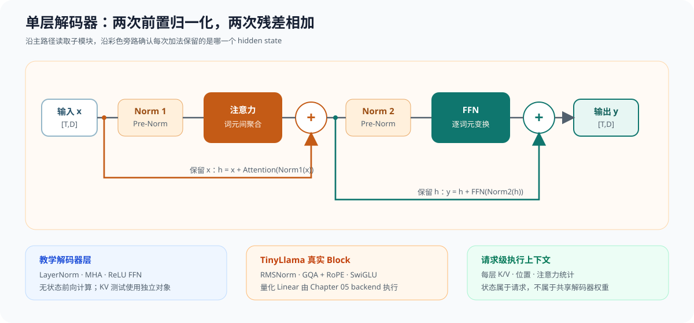

# 04.4 解码器层（`DecoderLayer`）

注意力、归一化和 FFN 单独通过测试后，还需要按照模型结构组合成一个解码器块（Decoder Block）。组合过程必须保持隐藏状态形状、残差来源和模块顺序一致。

## 一层解码器的数据流

一层前置归一化（Pre-Norm）解码器先归一化输入，再执行注意力和第一次残差相加；随后再次归一化，执行 FFN 和第二次残差相加。



最小控制流可以写成：

```cpp
Tensor hidden = input;
hidden = hidden + attention(norm1(hidden));
hidden = hidden + ffn(norm2(hidden));
```

输入和输出都保持 `[token_count, hidden_size]`。注意力在词元之间交换信息，FFN 独立变换每个词元，残差路径把子模块输入直接送到加法节点。

教学实现使用 LayerNorm、普通多头注意力和 ReLU FFN；TinyLlama 使用 RMSNorm、RoPE、GQA 和 SwiGLU。两者共享相同的前置归一化与双残差骨架，具体算子和权重形状不同。

## 前置产物怎样进入 Decoder

Chapter04 同时消费前三章的稳定产物：

| 输入来源 | Chapter04 使用的对象 | 用途 |
| --- | --- | --- |
| Chapter01 | `ModelConfig`、张量映射、Llama 权重布局 | 确定层数、维度和各层权重 |
| Chapter02 | 形状、步长、偏移、底层存储 | 表达注意力和残差使用的张量 |
| Chapter03 | 矩阵乘法形状、布局和计算后端分层 | 为投影计算提供语义与架构参照 |

教学线性层当前通过 Chapter04 本地循环执行，没有直接调用 Chapter03 `MatmulBackend`。两章共享公共视图和行优先计算规则；真实量化投影由 Chapter05 计算后端执行。

线性层、LayerNorm、ReLU、残差相加、FFN、`MultiHeadAttention` 和 `DecoderLayer` 均能接收公共只读/可写视图。`DecoderLayer::forward()` 保留教学张量入口，但内部复用同一条视图执行链。跨章测试使用 Chapter02 张量执行完整单层，并与教学入口逐元素比较。

`DecoderLayer::forward()` 保留无状态单次前向，方便单独检查双残差结构。需要序列状态时，`try_prefill()` 和 `try_decode()` 接收 `DecoderLayerContext`：预填充从空缓存开始写入多个位置，逐词元解码要求已有序列并追加一个位置。Context 先复制为候选状态；容量、形状或计算失败时不提交缓存和输出。

## Model 与 Context 为什么分开

模型对象（Model）保存所有请求共用的配置和只读权重，模型执行上下文（Context）保存一个请求推进时会变化的状态。这里的 Context 是 C++ 运行时对象，不是“上下文窗口”：上下文窗口表示模型最多能接收多少词元，Context 则记录某个请求已经执行到哪里。

多个请求可以同时读取同一个 Model，但不能共用同一个 Context。否则一个请求推进位置或追加 K/V 时，会破坏另一个请求的历史。分页缓存接入后，Context 可以只保存请求到物理块的绑定，而不必直接拥有连续 K/V 存储；“每请求独立”的要求保持不变。

模型结构和请求执行状态由两类对象分别描述：

| 对象 | 保存的信息 | 使用位置 |
| --- | --- | --- |
| `DecoderLayerContract` | 隐藏维度、注意力头、FFN、归一化、RoPE 和 KV 能力 | 教学层与真实模型的结构检查 |
| `DecoderLayerContext` | 当前教学层的连续 K/V 和已处理词元数 | Chapter04 单层 prefill/decode |
| `DecoderExecutionContext` | 位置、分层 K/V、`prefill()` 和 `decode()` | 单个请求的模型执行 |
| `RequestModelExecutor` | 请求怎样取得下一步候选分数 | Chapter06 生成运行时 |

结构对象回答“一层由什么组成”，请求 Context 回答“当前序列已经处理到哪里”。Chapter04 用单层 Context 讲清连续 K/V 的数值语义，真实模型再用 Core `DecoderExecutionContext` 管理全部层。共享权重不随请求变化，位置和 K/V 由每个请求独占。

实现入口是 <a href="../_code/chapter04_attention/src/decoder_layer.cpp"><code>decoder_layer.cpp</code></a> 和 <a href="../_code/chapter04_attention/src/decoder_context.cpp"><code>decoder_context.cpp</code></a>，注意力与组合测试分别位于 <a href="../_code/chapter04_attention/src/attention.cpp"><code>attention.cpp</code></a> 和 <a href="../_code/chapter04_attention/tests/chapter04_attention_test.cpp"><code>chapter04_attention_test.cpp</code></a>。

## 验证与衔接

```bash
bash code/chapter04_attention/scripts/run.sh
```

测试应确认输入输出形状一致、两次残差使用正确输入，并能区分教学层与 TinyLlama 的归一化、注意力和 FFN 规则。状态路径还要确认预填充后缓存长度为 2，解码后增长到 3；两个 Context 互不影响，超出容量时缓存长度和已有输出保持不变。

单层结构成立后，[`接入首层权重`](./05_load_first_layer.md) 使用 Chapter01 的真实权重布局核对并绑定 TinyLlama 第一个解码器块所需的九个权重；数值执行在 Chapter05 接入量化线性层后完成。
