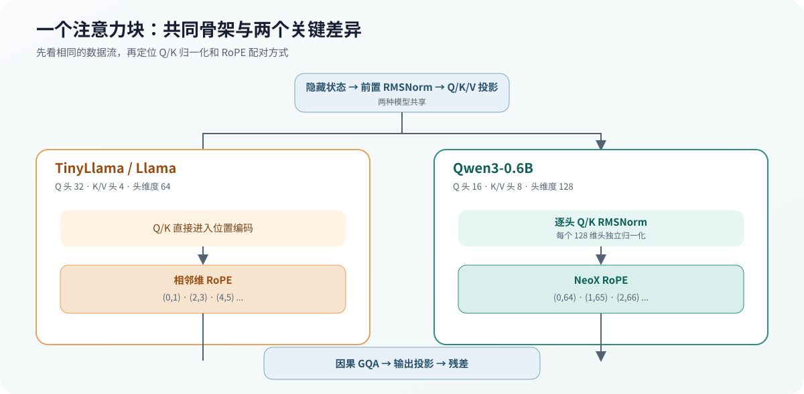

# 04.5 接入首层权重

Chapter01 已经把 TinyLlama 和 Qwen3 的模型配置、张量映射与稠密 Decoder 布局整理成可读取对象。本节沿这些对象追踪 `blk.0` 的权重怎样进入 RMSNorm、注意力、FFN 和残差计算；结构检查通过 Chapter04 脚本调用 Chapter01 的加载 target，不在 Chapter04 复制一套加载实现。

## Chapter01 交付的模型材料

首层计算不再解析 GGUF 字段或拼接文件偏移。加载章提供的对象分别回答配置、位置和数据三个问题：

| Chapter01 产物 | Chapter04 使用方式 |
| --- | --- |
| `ModelConfig` / `ModelMetadata` | 读取隐藏维度、注意力头数、RoPE 和 RMSNorm 参数 |
| `DenseDecoderTensorLayout` | 找到 `blk.0` 对应的主体张量和架构附加张量 |
| 张量映射 / 权重数据加载器 | 取得权重形状、数据类型和原始数据 |
| `RealDenseLayerWeights` | 向首层计算提供已绑定字段的权重集合 |

真实权重的读取入口位于 <a href="../_code/chapter01_tensor_loader/src/real_layer_weights.cpp"><code>real_layer_weights.cpp</code></a>。本章脚本调用 <a href="../_code/chapter01_tensor_loader/examples/gguf_first_layer_inspect.cpp"><code>gguf_first_layer_inspect.cpp</code></a> 核对结构；接入 Chapter05 量化计算后的首层数值入口位于 <a href="../_code/model/examples/gguf_first_layer_forward.cpp"><code>gguf_first_layer_forward.cpp</code></a>，多词元增量路径位于 <a href="../_code/model/examples/gguf_first_layer_multitoken.cpp"><code>gguf_first_layer_multitoken.cpp</code></a>。

## 主体权重怎样进入解码器块

TinyLlama 和 Qwen3 都使用 `blk.0.*` 主体名称。`RealDenseLayerWeights` 将稳定字段连接到具体计算位置：

| 权重字段 | GGUF 张量 | 计算位置 |
| --- | --- | --- |
| `attn_norm` | `blk.0.attn_norm.weight` | 注意力前 RMSNorm |
| `attn_q` / `attn_k` / `attn_v` | `blk.0.attn_q/k/v.weight` | Q、K、V 投影 |
| `attn_q_norm` / `attn_k_norm` | `blk.0.attn_q/k_norm.weight` | Qwen3 投影后的按头 RMSNorm；TinyLlama 不使用 |
| `attn_output` | `blk.0.attn_output.weight` | 注意力输出投影 |
| `ffn_norm` | `blk.0.ffn_norm.weight` | FFN 前 RMSNorm |
| `ffn_gate` / `ffn_up` | `blk.0.ffn_gate/up.weight` | SwiGLU 两条输入投影 |
| `ffn_down` | `blk.0.ffn_down.weight` | FFN 输出投影 |

一次首层前向按以下顺序消费这些权重：

```text
token embedding
  -> RMSNorm
  -> Q/K/V projection
  -> Q/K per-head RMSNorm (Qwen3)
  -> RoPE + GQA attention
  -> output projection + residual
  -> RMSNorm
  -> gate/up projection + SwiGLU
  -> down projection + residual
  -> layer-0 hidden state
```

Q4_K、Q6_K 和 Q8_0 投影由 Chapter05 的量化线性计算后端执行；Chapter04 只决定这些投影在解码器块中的顺序和数据流。

Qwen3 的 Q/K Norm 不能对整个投影向量一次归一化。以 0.6B 模型为例，Q 的 2048 个数值要拆成 16 个 128 维头，K 的 1024 个数值拆成 8 个 128 维头；每个头分别计算均方、乘逆均方根，再乘同一组 128 维权重。归一化完成后才执行 RoPE。若把 2048 维 Q 整体归一化，即使形状和内存都正确，注意力分数仍会偏离真实模型。

TinyLlama 与 Qwen3 的 RoPE 配对方式也不同。TinyLlama 旋转相邻维 `(0,1)、(2,3)`；Qwen3 使用 NeoX 布局，旋转前半维与后半维 `(0,64)、(1,65)`。频率公式相同，数据配对不同；Loader 识别架构后，Decoder 必须选择对应布局。

## 注意力组件对比

两种模型共享前置 RMSNorm、Q/K/V 投影、因果 GQA、输出投影和残差。差异集中在投影宽度、Q/K Norm 和 RoPE 数据布局；这些参数由 Chapter01 的模型元数据进入 Decoder。

| 组件 | TinyLlama 1.1B | Qwen3-0.6B | 代码需要怎样处理 |
| --- | --- | --- | --- |
| Q / K/V 头数 | 32 / 4 | 16 / 8 | 从模型配置计算 GQA 分组 |
| 头维度 | 64 | 128 | 独立于 residual hidden width 保存 |
| Q/K Norm | 无 | 每个 Q/K 头独立 RMSNorm | Q/K 投影后、RoPE 前执行 |
| RoPE 类型 | 相邻维配对 | NeoX 半维配对 | 根据 `general.architecture` 选择索引布局 |
| RoPE 频率基数 | 10,000 | 1,000,000 | 从 GGUF 元数据读取 |



## 验证与衔接

运行本章真实结构测试：

```bash
bash code/chapter04_attention/scripts/run_real_structure.sh
```

准备好固定 Qwen3 GGUF 后，可运行首层执行闭环：

```bash
bash code/chapter04_attention/scripts/run_qwen3_first_layer.sh
```

TinyLlama 结构脚本构建 `gguf_first_layer_inspect`，检查首层九个主体权重。Qwen3 首层脚本进一步执行单词元和多词元路径，要求 Q/K Norm、NeoX RoPE、4 个位置的增量 K/V 和 160 个因果注意力分数全部成立。完成首层后运行完整 CPU Decoder 对照：

```bash
bash code/chapter04_attention/scripts/run_qwen3_decoder.sh
```

该脚本执行 28 层 Qwen3，使用 llama.cpp 核对 logits 误差、前五候选与连续四步贪心词元。它验证 Chapter04 的 Decoder；请求循环、采样和停止条件仍由 Chapter06 接入。
