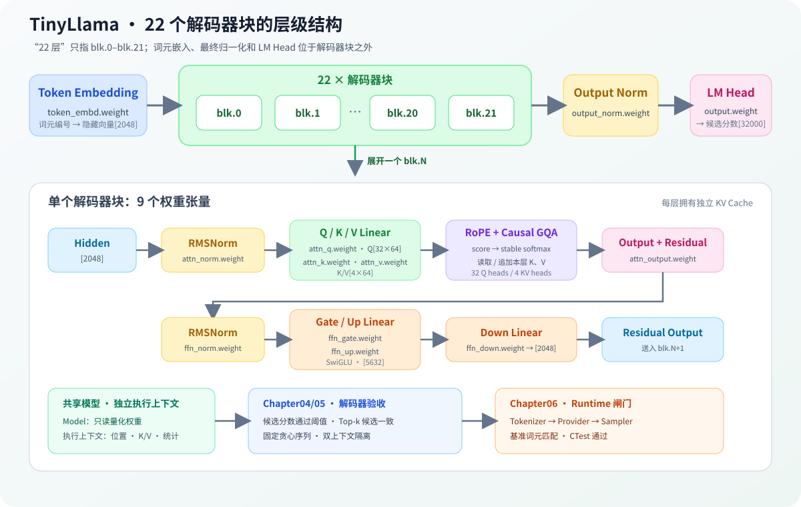

# 04.6 连接真实 TinyLlama 解码器

Chapter01 已把 TinyLlama GGUF 转换为模型配置、张量映射和 Llama 权重布局。本节把这些对象映射到共享 Model、请求 Context、22 个解码器块、最终 RMSNorm 和 LM Head。量化 Linear 接通后的候选分数对照归 Chapter05 验收。

## 从权重布局到多层解码器

TinyLlama 的 `block_count=22` 对应 `blk.0` 到 `blk.21`。每个解码器块包含注意力和 FFN 的九个权重张量；`token_embd.weight`、`output_norm.weight` 和 `output.weight` 位于解码器块堆栈之外。



真实执行代码独立放在 <a href="../_code/model/src/real_llama_cpu_decoder.cpp"><code>code/model/real_llama_cpu_decoder.cpp</code></a>，避免 Chapter01 模型加载器和 Chapter04 教学算子互相承担对方职责。`RealLlamaCpuModel` 持有共享只读权重，`RealLlamaCpuContext` 保存单个请求的位置、分层 K/V 和注意力统计。

| 对象 | 保存内容 | 生命周期 |
| --- | --- | --- |
| `RealLlamaCpuModel` | 词元嵌入、22 层权重、最终归一化、LM Head | 模型加载到服务卸载 |
| `RealLlamaCpuContext` | 位置、每层 K/V、注意力统计 | 单个请求或序列 |
| Chapter06 `Request` | 输入文本、生成词元、阶段和停止原因 | 准入到终态清理 |

同一个模型可以创建多个执行上下文。销毁请求只释放所属上下文，不卸载共享权重，也不影响其他请求的 K/V。

## 完成 Chapter05 后的跨章数值证据

以下结果使用同一组 6 个词元分别运行自研 CPU 解码器和 llama.cpp。它证明 Chapter05 量化后端接入本章结构后能够保持数值方向，不作为 Chapter04 的独立完成条件。

| 指标 | 当前结果 | 验收门槛 |
| --- | --- | --- |
| 余弦相似度 | `0.99952` | 不低于 `0.999` |
| 平均绝对误差 | `0.117456` | 不高于 `0.15` |
| RMSE | `0.148398` | 不高于 `0.20` |
| Top-1 | 词元 `29892`，双方一致 | 候选一致 |
| Top-5 重合数 | `5/5` | 至少 `4/5` |
| 4 词元贪心序列 | `29892 306 29915 29885` | 双方序列一致 |

22 层会累积不同矩阵乘加顺序造成的浮点误差，因此不能只用单个最大绝对误差判断完整模型。整体方向、平均误差、候选集合和连续贪心结果共同组成数值证据。

## 验证与衔接

完成 Chapter05 后，可运行量化 Decoder 的跨章验收：

```bash
bash code/chapter05_quantization/scripts/run_real_decoder.sh
```

该入口只构建 22 层量化 Decoder 对照，不运行 Generation、batch 或 Serving。Chapter04 的独立验收仍是教学 Decoder 和真实结构映射。

这些结果向 [`Chapter06`](../chapter06_generation/next/intro.md) 提供可执行的解码器上下文和候选分数；生成运行时只推进请求，不重新实现模型数学。
