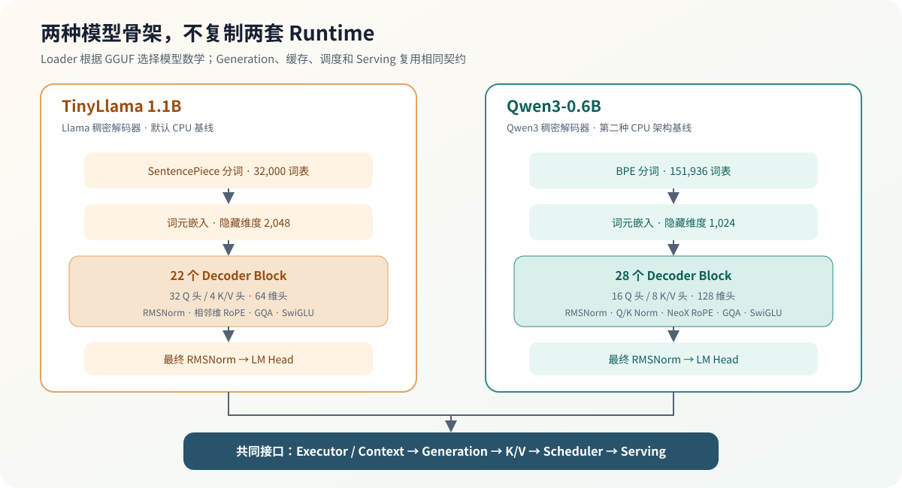

# 04.6 连接真实 TinyLlama 与 Qwen3 解码器

Chapter01 已把 TinyLlama 和 Qwen3 GGUF 转换为模型配置、张量映射和稠密 Decoder 权重布局。本节把这些对象映射到共享 Model、请求 Context、多层解码器块、最终 RMSNorm 和 LM Head。量化 Linear 接通后的候选分数对照归 Chapter05 验收。

## 全模型架构对比

两种模型都使用“Tokenizer → Embedding → Decoder Block 堆栈 → 最终 RMSNorm → LM Head”的生成骨架。模型差异留在 Loader、配置和 Decoder 数学中；Chapter06 之后继续复用同一组 Executor、Context、缓存、调度和服务契约。

| 结构 | TinyLlama 1.1B | Qwen3-0.6B |
| --- | ---: | ---: |
| 分词模型 / 词表 | SentencePiece / 32,000 | BPE / 151,936 |
| Decoder Block 数 | 22 | 28 |
| 隐藏维度 | 2,048 | 1,024 |
| FFN 中间维度 | 5,632 | 3,072 |
| Q 头 / K/V 头 | 32 / 4 | 16 / 8 |
| 头维度 | 64 | 128 |
| Q/K Norm | 无 | 有 |
| RoPE | 相邻维，基数 10,000 | NeoX 半维，基数 1,000,000 |



## 从权重布局到多层解码器

TinyLlama 的 `block_count=22` 对应 `blk.0` 到 `blk.21`。每个解码器块包含注意力和 FFN 的九个权重张量；`token_embd.weight`、`output_norm.weight` 和 `output.weight` 位于解码器块堆栈之外。


真实执行代码位于 <a href="https://github.com/datawhalechina/cpp-llm-engine/blob/main/code/model/src/real_llama_cpu_decoder.cpp"><code>code/model/real_llama_cpu_decoder.cpp</code></a>。`RealLlamaCpuModel` 持有共享只读权重，`RealLlamaCpuContext` 保存单个请求的位置、分层 K/V 和注意力统计。

| 对象 | 保存内容 | 生命周期 |
| --- | --- | --- |
| `RealLlamaCpuModel` | 词元嵌入、22 或 28 层权重、最终归一化、LM Head | 模型加载到服务卸载 |
| `RealLlamaCpuContext` | 位置、每层 K/V、注意力统计 | 单个请求或序列 |
| Chapter06 `Request` | 输入文本、生成词元、阶段和停止原因 | 准入到终态清理 |

同一个模型可以创建多个执行上下文。销毁请求只释放所属上下文，不卸载共享权重，也不影响其他请求的 K/V。

## 完成 Chapter05 后的跨章数值证据

跨章验收使用同一组 6 个词元分别运行自研 CPU 解码器和 llama.cpp。程序在每次运行时计算下列指标并打印实际值；正文只保存稳定门槛，避免把某台机器的一次输出当成长期结论。判定实现位于 <a href="https://github.com/datawhalechina/cpp-llm-engine/blob/main/code/model/examples/gguf_decoder_multilayer.cpp"><code>gguf_decoder_multilayer.cpp</code></a>。

| 指标 | 验收门槛 | 回答的问题 |
| --- | --- | --- |
| 余弦相似度 | 不低于 `0.998` | 两组 logits 的整体方向是否一致 |
| 平均绝对误差 | 不高于 `0.15` | 词表范围内的平均偏差是否受控 |
| RMSE | 不高于 `0.20` | 较大误差是否被均方统计放大后仍可接受 |
| Top-1 | 候选一致 | 下一步贪心选择是否一致 |
| Top-5 重合数 | 至少 `4/5` | 高分候选集合是否稳定 |
| 4 词元贪心序列 | 双方序列一致 | 误差是否在连续解码中改变生成路径 |

完整 22/28 层会累积不同矩阵乘加顺序以及 K-quant 激活处理方式造成的数值差异，因此不能只用单个最大绝对误差判断完整模型。整体方向、平均误差、候选集合和连续贪心结果共同组成数值证据。

## 验证与衔接

完成 Chapter05 后，可运行量化 Decoder 的跨章验收：

```bash
bash code/chapter05_quantization/scripts/run_real_decoder.sh
```

该入口验证 22 层量化 Decoder 的 logits 和连续贪心结果。Chapter04 的本章入口验证教学 Decoder、连续 KV Context 和真实权重结构。

Qwen3 使用独立的 28 层验收入口：

```bash
bash code/chapter04_attention/scripts/run_qwen3_decoder.sh
```

通过后的解码器上下文和候选分数进入 [`Chapter06`](../chapter06_generation/next/intro.md)；生成运行时只推进请求，不重新实现模型数学。
