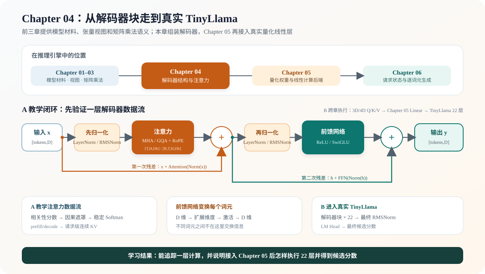
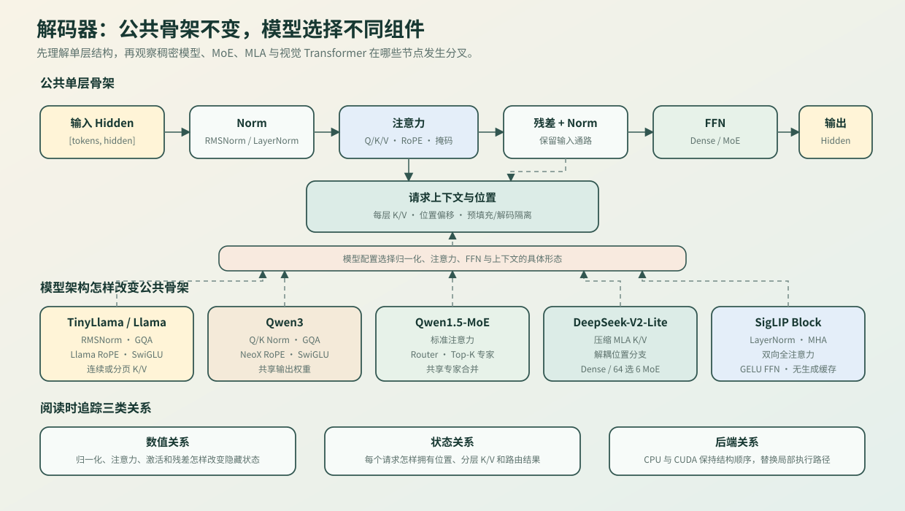

# 04.0 组装解码器块与注意力

## 本章导读

Chapter 03 已经固定矩阵乘法的形状、布局和计算后端分层；本章在同一乘加公式上实现教学线性层，并把 Chapter02 的公共视图接入归一化、前馈网络、残差和完整 `DecoderLayer`。Chapter 05 将真实 GGUF 低比特权重接入量化线性层，Chapter 06 再为请求加入逐词元生成状态。

| 学习线 | 本章怎样学习 | 可验证产物 |
| --- | --- | --- |
| A 单层验证 | 用小尺寸 MHA、LayerNorm、稠密/MoE FFN 和双残差学习单层数据流，再用请求上下文连接预填充与逐词元解码 | 单层输出、MoE 路由、因果掩码、连续 K/V 追加、请求隔离和失败后状态测试 |
| B 真实 CPU | 先用 3D/4D Q/K/V 适配器核对通用注意力布局，再比较 TinyLlama/Qwen3 稠密 Decoder、Qwen1.5-MoE 专家路由和 DeepSeek-V2-Lite MLA | 稠密、MoE、MLA 三类结构的分层 K/V、路由、logits 与真实模型证据 |
| G GPU 扩展 | 保持解码器顺序和请求状态不变，把线性层、RoPE、GQA、归一化和 FFN 换成 CUDA 后端 | TinyLlama、Qwen3 与 DeepSeek 分层对照，张量预填充、融合在线注意力与端到端 A/B |
| M 多模态扩展 | 视觉编码器复用归一化、注意力、FFN 和双残差结构；视觉向量进入语言解码器后复用请求上下文 | SigLIP 块、视觉投影和统一嵌入序列测试 |

| 本章新术语 | 先这样理解 | 首次解释 |
| --- | --- | --- |
| 多头注意力（Multi-head Attention） | 让每个词元按相关程度读取当前及历史词元的信息 | [`04.1 多头注意力`](./01_multihead_attention.md) |
| 多头潜在注意力（MLA） | 持久保存低秩 K/V 与位置分支，计算时再恢复各头需要的 K/V | [`04.1 多头注意力`](./01_multihead_attention.md) |
| 在线 Softmax | 分块读取 K/V 时持续更新最大值、指数和与 Value 累加，不保存完整分数矩阵 | [`04.1 多头注意力`](./01_multihead_attention.md) |
| FA2-inspired | 只吸收 FlashAttention-2 的在线状态与 Warp 分工思想，不等同于官方完整实现 | [`04.1 多头注意力`](./01_multihead_attention.md) |
| 残差连接（Residual） | 把子模块输出加回原输入，保留一条直接数据通路 | [`04.4 解码器层`](./04_decoder_layer.md) |
| 前馈网络（FFN） | 对每个词元独立执行“扩展、激活、投影回原维度” | [`04.3 前馈网络`](./03_feedforward.md) |
| 混合专家前馈网络（MoE FFN） | 先用 Router 为每个词元选择少量专家，再合并专家与共享专家输出 | [`04.3 前馈网络`](./03_feedforward.md) |
| 解码器层（`DecoderLayer`） | 按固定顺序组合注意力、前馈网络、归一化和残差连接 | [`04.4 解码器层`](./04_decoder_layer.md) |

下图把公共 Decoder 骨架与不同模型的结构选择放在一起。先定位发生变化的组件，再进入对应实现。

## 开始学习

先沿 Q/K/V、双残差和请求状态三条数据流阅读。共享 `DecoderLayer` 保存权重；每个 `DecoderLayerContext` 独占连续 K/V，预填充写入多个位置，逐词元解码再追加一个位置。教学 FFN 使用 ReLU 固定两层结构，真实稠密与 MoE 模型再换成 SwiGLU 和专家路由；两者共享输入输出形状与双残差骨架，不共享具体权重结构。

| 顺序 | 路线 | 页面 | 先看源码 | 读完后应看到什么 |
| --- | --- | --- | --- | --- |
| 1 | A/B/G 公共 | [`04.1 多头注意力`](./01_multihead_attention.md) | <a href="https://github.com/datawhalechina/cpp-llm-engine/blob/main/code/chapter04_attention/src/attention_kernel.cpp"><code>attention_kernel.cpp</code></a>、<a href="https://github.com/datawhalechina/cpp-llm-engine/blob/main/code/chapter04_attention/src/mla_attention.cpp"><code>mla_attention.cpp</code></a>、<a href="https://github.com/datawhalechina/cpp-llm-engine/blob/main/code/cuda/src/gqa_attention_backend.cu"><code>gqa_attention_backend.cu</code></a> | 标准 Attention、MLA、在线 Softmax 与融合 kernel 怎样逐层建立证据 |
| 2 | A | [`04.2 层归一化与激活函数`](./02_layernorm_and_activation.md)、[`04.3 前馈网络`](./03_feedforward.md)、[`04.4 解码器层`](./04_decoder_layer.md) | <a href="https://github.com/datawhalechina/cpp-llm-engine/blob/main/code/chapter04_attention/src/decoder_layer.cpp"><code>decoder_layer.cpp</code></a>、<a href="https://github.com/datawhalechina/cpp-llm-engine/blob/main/code/chapter04_attention/src/decoder_context.cpp"><code>decoder_context.cpp</code></a> | 归一化、注意力、残差和 FFN 组成可执行解码器层，请求上下文连接预填充与解码 |
| 3 | B | [`04.5 接入首层权重`](./05_load_first_layer.md)、[`04.6 连接真实 TinyLlama 解码器`](./06_real_tinyllama_decoder.md) | <a href="https://github.com/datawhalechina/cpp-llm-engine/blob/main/code/model/src/real_llama_cpu_decoder.cpp"><code>real_llama_cpu_decoder.cpp</code></a> | Chapter01 权重怎样映射到 22 层 Model 与请求 Context |
| 4 | B | [`04.7 解码器框架对照`](./07_framework_comparison.md) | [`解码器数据流图`](./04_decoder_layer.md) | 将教学层和真实模型映射到生产执行器与 GPU 计算后端 |
| 5 | G/M | [`GPU 学习计划`](../guides/gpu_learning_plan.md)、[`多模态视觉编码器`](../extensions/multimodal/02_vision_encoder.md) | <a href="https://github.com/datawhalechina/cpp-llm-engine/blob/main/code/cuda/src/cuda_decoder_layer.cpp"><code>cuda_decoder_layer.cpp</code></a>、<a href="https://github.com/datawhalechina/cpp-llm-engine/blob/main/code/multimodal/src/vision_encoder.cpp"><code>vision_encoder.cpp</code></a> | 同一解码器骨架怎样替换计算后端或接收视觉输入 |

## 验证与下一步

单层解码器数据流成立后，进入 [`Chapter 05`](../chapter05_quantization/intro.md)，让真实模型的九种 GGUF 量化格式在同一 Linear 语义下完成计算。

| 验收层级 | 执行入口 | 通过条件 | 适用阶段 |
| --- | --- | --- | --- |
| L1 教学单层 | `bash code/chapter04_attention/scripts/run.sh` | 归一化、双残差、稠密/MoE FFN、在线 Softmax、MLA、连续 K/V 与跨章张量接口测试通过 | 学完本章必做 |
| L2 真实结构 | `bash code/chapter04_attention/scripts/run_real_structure.sh` | TinyLlama 配置及首层权重名称、形状、类型和载荷通过检查 | 本地有模型时执行 |
| L3 模型扩展 | 按[代码 README](https://github.com/datawhalechina/cpp-llm-engine/blob/main/code/chapter04_attention/README.md#运行与验证)选择 Qwen3、Qwen1.5-MoE 或 DeepSeek 入口 | 所选模型的归一化、注意力、FFN、K/V、候选分数和词元符合参考结果 | 学习模型差异时选做 |
| L4 设备与多模态扩展 | 选择 CUDA 解码器、Attention A/B 或 SmolVLM Encoder 入口 | CPU/CUDA 数值门禁通过，性能结论具有独立端到端样本 | 学习 GPU 或多模态路线时选做 |

具体模型命令见代码 README，模型覆盖范围见[模型支持矩阵](../reference/model_support.md)，性能样本见[实验资产登记表](../reference/experiment_assets.md)。
