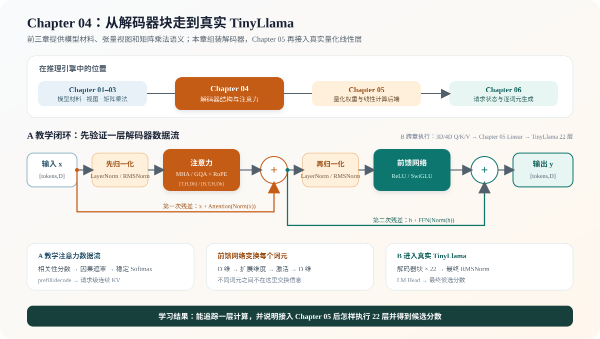

# 04.0 组装解码器块与注意力

## 本章导读

Chapter 03 已经固定矩阵乘法的形状、布局和计算后端分层；本章在这些语义上实现教学线性层，并把 Chapter02 的公共视图接入归一化、前馈网络、残差和完整 `DecoderLayer`。Chapter 05 将真实 GGUF 低比特权重接入量化线性层，Chapter 06 再为请求加入逐词元生成状态。

| 学习线 | 本章怎样学习 | 可验证产物 |
| --- | --- | --- |
| A 教学闭环 | 用小尺寸 MHA、LayerNorm、FFN 和双残差组装一个 `DecoderLayer` | 单层输出、因果掩码、KV 追加与结构测试 |
| B 真实结构线 | 用 3D/4D Q/K/V 契约理解 TinyLlama 的 RMSNorm、RoPE、GQA、SwiGLU、22 层拓扑和请求 Context | 真实 shape、首层权重映射和 22 层结构契约 |

| 本章新术语 | 先这样理解 | 首次解释 |
| --- | --- | --- |
| 多头注意力（Multi-head Attention） | 让每个词元按相关程度读取当前及历史词元的信息 | [`04.1 多头注意力`](./01_multihead_attention.md) |
| 残差连接（Residual） | 把子模块输出加回原输入，保留一条直接数据通路 | [`04.4 解码器层`](./04_decoder_layer.md) |
| 前馈网络（FFN） | 对每个词元独立执行“扩展、激活、投影回原维度” | [`04.3 前馈网络`](./03_feedforward.md) |
| 解码器层（`DecoderLayer`） | 按固定顺序组合注意力、前馈网络、归一化和残差连接 | [`04.4 解码器层`](./04_decoder_layer.md) |



## 开始学习

先运行本章脚本：

```bash
bash code/chapter04_attention/scripts/run.sh
```

脚本会先运行 `chapter04_attention_demo`，输出 `ready: true` 和 `output shape: 2x4`；随后两个 CTest 验证公共视图上的基础算子与解码器、3D 预填充/逐词元解码、4D 批次、历史 K/V 和失败保持。阅读时先确认 Q/K/V 布局，再沿主图的数据流组装完整的一层。

| 顺序 | 路线 | 页面 | 先看源码 | 读完后应看到什么 |
| --- | --- | --- | --- | --- |
| 1 | A/B 公共 | [`04.1 多头注意力`](./01_multihead_attention.md) | <a href="../_code/chapter04_attention/src/tensor_attention_adapter.cpp"><code>tensor_attention_adapter.cpp</code></a>、<a href="../_code/chapter04_attention/src/attention.cpp"><code>attention.cpp</code></a> | Q/K/V 布局、因果掩码、softmax 和输出合并顺序 |
| 2 | A | [`04.2 层归一化与激活函数`](./02_layernorm_and_activation.md)、[`04.3 前馈网络`](./03_feedforward.md)、[`04.4 解码器层`](./04_decoder_layer.md) | <a href="../_code/chapter04_attention/src/decoder_layer.cpp"><code>decoder_layer.cpp</code></a> | 归一化、注意力、残差和 FFN 形成单层闭环 |
| 3 | B | [`04.5 接入首层权重`](./05_load_first_layer.md)、[`04.6 连接真实 TinyLlama 解码器`](./06_real_tinyllama_decoder.md) | <a href="../_code/model/src/real_llama_cpu_decoder.cpp"><code>real_llama_cpu_decoder.cpp</code></a> | Chapter01 权重怎样映射到 22 层 Model 与请求 Context |
| 4 | B | [`04.7 解码器成熟框架对照`](./07_framework_comparison.md) | [`解码器数据流图`](./04_decoder_layer.md) | 将教学层和真实模型映射到成熟执行器与 GPU 计算后端 |

## 验证与下一步

单层解码器数据流成立后，进入 [`Chapter 05`](../chapter05_quantization/intro.md)，让真实 Q4_K/Q6_K 权重在同一结构中完成线性计算。

| 验收层级 | 执行入口 | 通过条件 | 本章要求 |
| --- | --- | --- | --- |
| L1 默认 CPU | `bash code/chapter04_attention/scripts/run.sh` | 公共视图上的归一化、残差、FFN、解码器与 3D/4D 注意力通过 CTest，失败不覆盖输出 | 必做 |
| L2 真实结构 | `bash code/chapter04_attention/scripts/run_real_structure.sh` | 22 层配置、首层九个权重的名称、shape、dtype 和 payload 通过 CTest；不执行完整 Decoder | 有模型时必做 |
| L3 可选 CUDA | `CUDA_HOME=/usr/local/cuda-12.8 bash code/cuda/scripts/run.sh` | CUDA GQA、RoPE、KV Cache、RMSNorm、SwiGLU 和单层解码器分别匹配 CPU 参考实现 | 有 NVIDIA GPU 时选做 |
