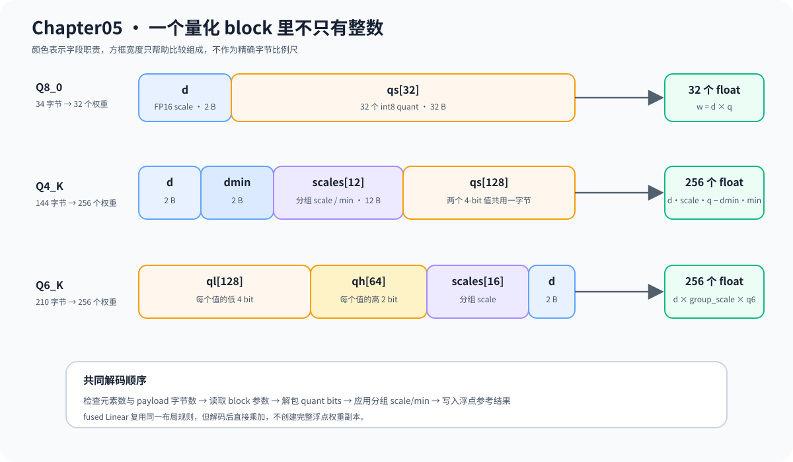
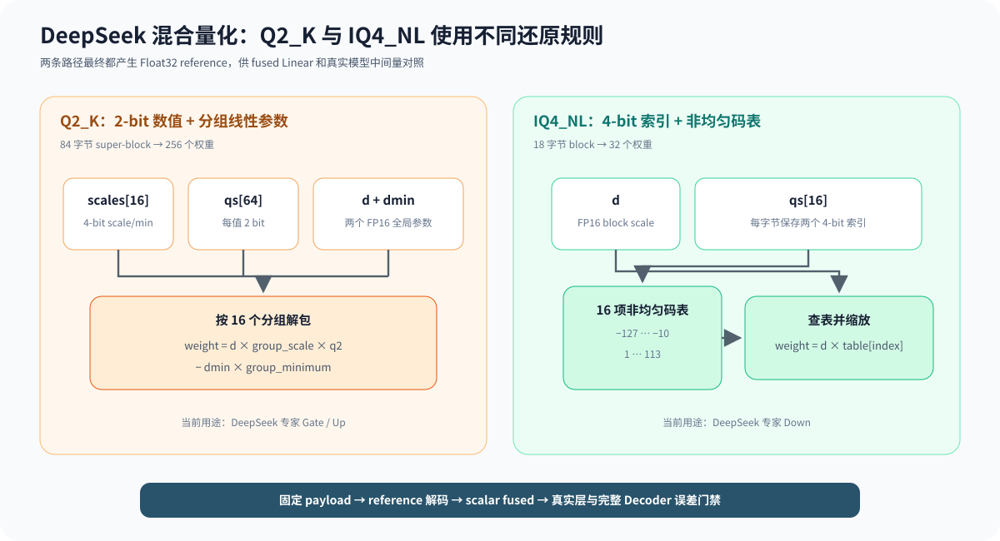

# 05.4 按格式还原量化权重

量化权重进入计算前，必须按格式规则还原数值。这里先用 INT8 加标量 scale 固定反量化语义，再比较九种 GGUF block 解码；这些路径共享“读取量化表示、应用参数、产生浮点参考值”这一结果约定。

## INT8 与 GGUF Block 的还原规则

对称 INT8 的每个元素满足 `x_hat = q * scale`。GGUF block 则把一组权重和它们的缩放参数保存在固定字节布局中，不能被解释成普通整数数组。

| 格式 | 每个 block 的权重数 | 当前布局重点 | 参考实现 |
| --- | ---: | --- | --- |
| Q8_0 | 32 | 2 字节 half scale 与 32 个 8-bit quant | <a href="../_code/chapter05_quantization/src/q8_0_dequantize.cpp"><code>q8_0_dequantize.cpp</code></a> |
| Q4_K | 256 | 144 字节内保存总 scale、minimum、分组参数和 4-bit quant | <a href="../_code/chapter05_quantization/src/q4k_dequantize.cpp"><code>q4k_dequantize.cpp</code></a> |
| Q6_K | 256 | 210 字节内组合低 4 bit、高 2 bit、分组 scale 和总 scale | <a href="../_code/chapter05_quantization/src/q6k_dequantize.cpp"><code>q6k_dequantize.cpp</code></a> |
| Q3_K | 256 | 110 字节内组合低 2 bit、高位掩码、6-bit 分组 scale 和总 scale | <a href="../_code/chapter05_quantization/src/q3k_dequantize.cpp"><code>q3k_dequantize.cpp</code></a> |
| Q5_0 | 32 | 22 字节内保存 scale、低 4 bit 和第五位表，恢复后减 16 | <a href="../_code/chapter05_quantization/src/q5_0_dequantize.cpp"><code>q5_0_dequantize.cpp</code></a> |
| Q5_1 | 32 | 24 字节内保存 scale、minimum、低 4 bit 和第五位表 | <a href="../_code/chapter05_quantization/src/q5_1_dequantize.cpp"><code>q5_1_dequantize.cpp</code></a> |
| Q5_K | 256 | 176 字节内保存总 scale/minimum、八组参数、低 4 bit 和第五位表 | <a href="../_code/chapter05_quantization/src/q5k_linear.cpp"><code>q5k_linear.cpp</code></a> |
| Q2_K | 256 | 84 字节内保存 2-bit quant、16 组 scale/minimum 和两个全局缩放参数 | <a href="../_code/chapter05_quantization/src/q2k_dequantize.cpp"><code>q2k_dequantize.cpp</code></a> |
| IQ4_NL | 32 | 18 字节内保存 half scale 与 16 个 4-bit 索引，索引查非均匀码表 | <a href="../_code/chapter05_quantization/src/iq4nl_dequantize.cpp"><code>iq4nl_dequantize.cpp</code></a> |

下图用 Q8_0、Q4_K 和 Q6_K 展示三类典型 block 字段。量化码必须与同一 block 内的 scale、minimum 或高位数据一起解释，不能把 payload 当作普通整数数组逐元素读取。

各格式可以先用概念公式区分；实际代码还要负责 half 转换、bit unpack、分组索引和边界检查：

```text
Q8_0:  weight = block_scale * signed_q8
Q4_K:  weight = block_scale * group_scale * q4
                 - block_min * group_min
Q6_K:  weight = block_scale * group_scale * signed_q6
Q3_K:  weight = block_scale * group_scale * signed_q3
Q5_0:  weight = block_scale * (unsigned_q5 - 16)
Q5_1:  weight = block_scale * unsigned_q5 + block_minimum
Q5_K:  weight = block_scale * group_scale * unsigned_q5 - block_minimum * group_minimum
Q2_K:  weight = block_scale * group_scale * unsigned_q2 - block_minimum * group_minimum
IQ4_NL: weight = block_scale * nonlinear_codebook[q4_index]
```

Q8_0 的 8-bit 值可直接解释为有符号整数。Q4_K 需要组合 4-bit 量化码、分组 scale 和 minimum；Q6_K 则把低 4 bit 与高 2 bit 合成有符号 6-bit 值，再应用分组与 block scale。相同的 `weight` 结果契约让各格式 reference 可以被同一 Linear 测试比较，但它们的 payload 不能共用一套解包代码。



Q2_K 与 IQ4_NL 分别代表“更低位宽的分组线性量化”和“用非均匀码表表示 4-bit 索引”。下图把两者的解码动作并列，帮助阅读 DeepSeek-V2-Lite 的专家 Gate/Up 与 Down 权重。



Q4_K 同时具有分组 scale 和 minimum，适合用来观察完整的 block 解码顺序。下面的算法镜像省略字节对齐、half 转换、边界检查和输出内存所有权；Q6_K 与 Q8_0 复用相同的“读取参数、解包 quant、应用 scale”结构，但字段布局不同。

```python
def dequantize_q4k(super_block):
    block_scale = read_half(super_block.scale)
    block_min = read_half(super_block.minimum)
    group_params = decode_group_scales(super_block.scales)
    output = []

    for group_id in range(8):
        group_scale, group_min = group_params[group_id]
        packed_values = read_group_quants(super_block, group_id)
        for quant_value in unpack_low_high_nibbles(packed_values):
            weight = block_scale * group_scale * quant_value
            weight -= block_min * group_min
            output.append(weight)

    return output
```

| 算法动作 | C++ 对象或源码 | 验证重点 |
| --- | --- | --- |
| 读取 block 参数 | `Q4KBlock`、`q4k_dequantize.cpp` | 144 字节对应 256 个权重 |
| 解包 4-bit 数值 | `dequantize_q4_k()` | 低四位、高四位和分组顺序 |
| 应用 scale/min | Q4_K reference 循环 | 固定 payload 的逐元素浮点结果 |
| 提交输出 | `dequantize_q4_k()` | 输出长度、错误状态和 block 边界 |

## 参考实现与线性层接口

INT8 教学路径由 <a href="../_code/chapter05_quantization/src/dequantize_op.cpp"><code>dequantize_op.cpp</code></a> 输出 Float32 Tensor。Q2_K、Q3_K、Q4_K、Q5_0、Q5_1、Q5_K、Q6_K、Q8_0 和 IQ4_NL reference 路径则按 block 还原完整浮点权重或等价参考结果，为 fused backend 提供独立数值基线。

反量化保持为独立 reference 的原因不是要求生产路径始终创建完整浮点权重，而是让格式解析可以单独验证。下一节的 fused Linear 会边解码边累加，省去中间数组，但每个量化值的还原规则不能改变。

| 路径 | 输入 | 输出或消费方式 | 用途 |
| --- | --- | --- | --- |
| INT8 `DequantizeOp` | 整数 Tensor、标量 scale | Float32 Tensor | 建立最小公式与 dtype 契约 |
| 九种 GGUF block reference | GGUF packed blocks | 完整浮点权重或等价参考结果 | 校验格式和 fused 结果 |
| fused Linear | packed blocks、激活向量 | 直接累加输出 | 避免完整反量化中间量 |

量化格式、shape 或 payload 长度不匹配时，接口必须返回明确错误，不能静默按其他 dtype 读取。成熟框架怎样组织格式与 kernel 的对应关系，集中在 [`05.7 量化实现与成熟框架对照`](./07_tensorrt_gemma_vllm_comparison.md)。

## 验证与衔接

```bash
bash code/chapter05_quantization/scripts/run.sh
```

测试用固定 INT8 样本检查 `q * scale`，并用九种 GGUF 格式的固定 payload 比较 block reference 与预期值。通过标准包括输出元素数正确、误差落在容差内、非法 shape/payload 被拒绝。下一节 [`05.5 量化线性层`](./05_linear_with_quant.md) 将同一解码规则放进矩阵向量乘加。
