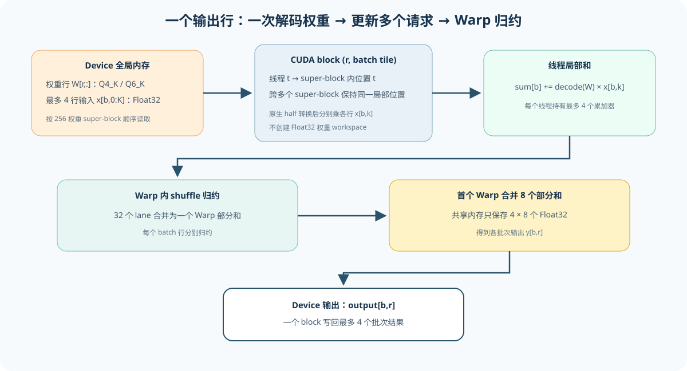
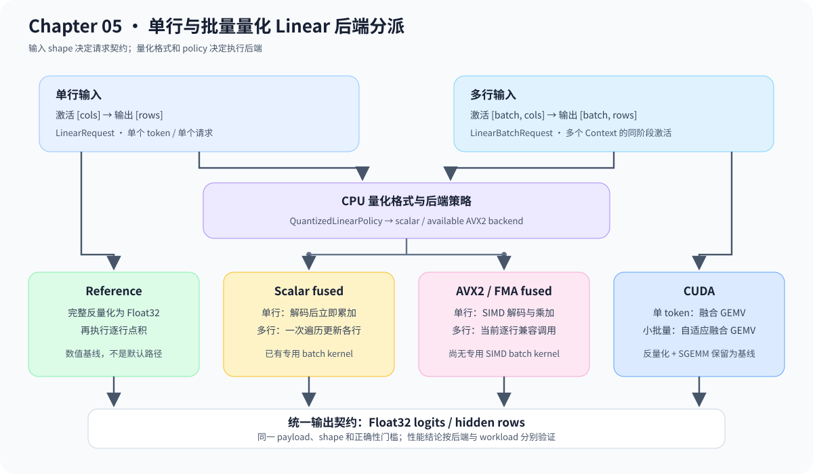

# 05.5 在量化权重上执行线性计算

Decoder 上层只需要提交激活、权重格式和输出空间，不应因权重采用 Float32、Q4_K、Q6_K 或 Q8_0 而改变调用方式。本节用 reference 与 fused 两条路径证明：执行策略可以变化，Linear 的 shape 和数值契约保持不变。

## 从参考路径到融合线性层

reference 路径先还原完整浮点权重，再执行 `W * input`；fused 路径读取一个量化 block 后立即完成乘加，不创建完整权重数组。下面的算法镜像省略 backend 注册、SIMD 指令、CUDA workspace 和错误恢复，只比较两条路径决定结果的动作。

```python
def linear_reference(packed_weight, input_vector):
    float_weight = dequantize_all_blocks(packed_weight)
    return matrix_vector_product(float_weight, input_vector)


def linear_fused(packed_weight, input_vector):
    output = zeros(packed_weight.output_rows)
    for output_row in range(packed_weight.output_rows):
        for block in packed_weight.row_blocks(output_row):
            for column, weight in decode_block(block):
                output[output_row] += weight * input_vector[column]
    return output
```

| 算法动作 | C++ 对象或源码 | 验证重点 |
| --- | --- | --- |
| 建立浮点基线 | `Q4KLinearReference`、`Q6KLinearReference` | 输出 shape 与固定数值 |
| block 内直接乘加 | `q4k_kernel.cpp`、`q6k_kernel.cpp` | 不创建完整 float 权重数组 |
| 选择执行路径 | `QuantizedLinearPolicy` | 格式、backend 与硬件能力匹配 |
| 返回统一结果 | `compute_quantized_linear()`、`compute_quantized_linear_batch()` | reference、单行与 batch 容差一致 |

实现顺序为 `Scalar reference -> fused scalar -> SIMD fused -> CUDA dequantize + SGEMM baseline -> CUDA fused GEMV -> CUDA batched fused GEMV`。每增加一条路径，先与上一层做数值回归，再进入 benchmark。

## CUDA 融合 GEMV 怎样访问内存和归约

GEMV 是通用矩阵向量乘法（General Matrix-Vector Multiplication）。Decode 每次只提交一个激活向量，Linear 因而呈现 GEMV 形状。对于权重矩阵 `W[N,K]` 和输入 `x[K]`，第 `r` 个输出为：

```text
y[r] = sum(W[r,k] * x[k]), k = 0 ... K-1
```

基线路径先把整个 packed 权重矩阵写成 Float32 workspace，再由 cuBLAS 重新读取；融合路径让一个 CUDA block 负责一个输出行。线程从该行的 Q4_K/Q6_K block 读取量化值，在寄存器中完成解码和乘加，只把最终的 `y[r]` 写回显存。

批量 Decode 的输入是 `[B,K]`，数学上已经是矩阵矩阵乘法。这里仍称 batched GEMV，是因为代码从单向量 kernel 扩展而来，只让少量输入行共享权重读取与解码；它没有采用面向大矩阵的通用 GEMM 分块策略。批量融合路径把最多 4 个输入行组成一个 tile，一个 block 负责同一输出行在该 tile 内的多个结果。同一线程解码一个 packed 权重后，连续更新各输入行的累加器；这样既省去完整 Float32 权重副本和后续 SGEMM，也避免在相邻请求之间重复读取和解码权重。

固定 4 行 tile 在 batch=4 时能完整复用一次权重解码，但 batch=1/2 仍会为 4 行准备累加器、共享归约空间和条件判断。自适应路径在运行期只选择已经编译好的 `tile=1/2/4` kernel：batch=1 用 1 行，batch=2 用 2 行，其余小批量用 4 行。它没有在 kernel 内动态改变数组大小，而是在提交 kernel 前按 batch 形状分派模板实例。

Q4_K 和 Q6_K 的一个 super-block 都表示 256 个权重。当前映射使用 256 个线程，每个线程负责 super-block 中一个固定列位置，并跨该行的多个 super-block 累加局部和。相邻线程读取相邻输入位置；packed 权重则按各格式的 nibble、high-bit 和 scale 布局解码。

点积结束后，每个 Warp 先用 shuffle 合并 32 个局部和，8 个 Warp 只把各自结果写入共享内存；首个 Warp 再完成最终归约并写回。线程数仍为 256，但不再执行 8 轮整块共享内存树形归约。当前 128 线程候选没有改善 TinyLlama profile，因此只替换归约方法，不缩小线程块。

批量输入按最多 4 行组成一个 tile。同一线程解码一个权重后，分别与 tile 中各行对应的激活相乘，随后对每行独立做 Warp 归约。这样 batch=2 时同一 packed 权重只读取和解码一次；代价是每个线程持有多个累加器，因此 tile 继续增大前需要用 Nsight Compute 检查寄存器压力和占用率。

EXP-GPU-08 后的 NCU 基线显示：Q4_K kernel 的 Compute/L1 吞吐约为 `72.1%/76.5%`，DRAM 吞吐仅 `4.7%`，40 个寄存器/线程，实际 occupancy 约 `90.9%`。Warp 平均约 `32.8%` 的指令间周期在等待 L1TEX scoreboard。元数据广播、shared payload 和显式 FMA 三个候选分别回退约 `10.1%`、`1.6%` 和 `4.3%` cycles，均未保留。EXP-GPU-12 用 CUDA 原生 half 指令替换手写 FP16 位解码后，cycles 从 `140,093` 降至 `99,725`，约减少 `28.8%`；瓶颈随之转移到 L1/TEX，下一轮才适合继续研究 payload 布局。

EXP-GPU-14 继续检查 batch 形状造成的无效工作。自适应 tile 将 batch=1/2 的共享内存从 `128 B` 降为 `32/64 B`，执行指令减少约 `21%`～`37%`。L1 命中率基本不变，占用率只小幅提高，说明 cycles 下降主要来自不再为不存在的输入行执行展开后的累加与归约。EXP-GPU-15 随后确认真实双请求 Tensor Batch Decode 两轮均改善且 logits 不变，因此默认执行路径采用自适应 tile；固定 4 行实现只用于 A/B 基线。

| 阶段 | 数据位置 | 发生的动作 | 避免的成本 |
| --- | --- | --- | --- |
| 读取 | device packed 权重、Float32 输入 | 线程定位量化 block 和固定列位置 | 不生成完整 Float32 权重矩阵 |
| 局部乘加 | 线程寄存器 | 跨多个 super-block 解码并累加 | 不把中间权重写回显存 |
| Warp 与 block 归约 | shuffle + 8 个共享部分和 | Warp 内归约后由首个 Warp 合并 | 减少整块同步和共享内存流量 |
| 写回 | `output[b,r]` | 每个 block 写回 tile 内各请求的 Float32 结果 | 避免额外矩阵读取 |

EXP-GPU-08 在两个不同长度请求、一次分页 Decode 上复测该设计。两轮 `batch/sequential` 中位数比例为 `0.466/0.612`，逐请求 logits 完全一致；Nsight Systems 中 Q4_K/Q6_K kernel 仍占 GPU kernel 时间约 `96.5%`。结果支持保留 4 行 tile 和 Warp 归约，也说明后续仍需继续减少量化解码与权重读取成本。



## 计算后端策略与统一接口

`Q4KLinearAvx2` 和 `Q6KLinearAvx2` 在读取 block 时直接用 AVX2/FMA 累加。CUDA 由 `CudaQuantizedMatrix` 保存 packed payload；单 token 和小批量 Decode 都直接读取 Q4_K/Q6_K block，完整反量化加 cuBLAS 保留为数值与性能对照。Q8_0 当前只有 portable scalar fused；请求不存在的 AVX2 实现会返回明确 `Status`，不会静默回退。

```cpp
chapter05_quantization::QuantizedLinearPolicy policy{
    chapter05_quantization::QuantizedLinearBackendKind::Avx2Fused,
    chapter05_quantization::QuantizedLinearBackendKind::ScalarFused,
    chapter05_quantization::QuantizedLinearBackendKind::ScalarFused
};
auto status = chapter05_quantization::compute_quantized_linear(
    request, policy, registry);
```

| 路径 | 中间权重 buffer | 计算方式 | 当前用途 |
| --- | --- | --- | --- |
| Reference | 完整 float 数组 | 先反量化，再标量点积 | 格式与数值基线 |
| Scalar fused | 无 | 按 block 解码并标量累加 | 默认可移植路径 |
| AVX2/FMA fused | 无 | 分组解码并向量乘加 | 显式 CPU 性能实验 |
| CUDA batch baseline | Float32 workspace | CUDA 解码后调用 cuBLAS SGEMM | batch correctness 与后续融合基线 |
| CUDA fused GEMV | 无完整浮点权重副本 | 解码、点积与行归约在同一 kernel | 单 token Decode 与真实生成优化 |
| CUDA batched fused GEMV | 无完整浮点权重副本 | 一个二维网格计算 `[B,N]` | 小批量多请求 Decode |

真实 Decoder 按 Attention、FFN 和 LM Head 分别保存 policy。Q4_K gate/up、Q6_K down、Q4_K QKV/out 复用同一 dispatcher，只改变对应作用域的策略。生产框架怎样把 quant method、硬件和 kernel 绑定，见 [`05.7 量化实现与成熟框架对照`](./07_tensorrt_gemma_vllm_comparison.md)。

下图从公共线性层请求开始，展示格式分派、CPU/CUDA 路径和共同的数值基线。并列后端是可替换实现，不表示按顺序全部执行。



## Packed 权重与激活视图

`QuantizedMatrixView` 保存 packed payload 指针、字节数、权重行列和 Q4_K/Q6_K/Q8_0 格式；它不提供普通 Float32 Tensor 的索引语义。`compute_quantized_linear_views()` 让 Chapter02 的 Float32 激活通过公共只读/可写 View 进入现有 policy 和 backend：rank-1 表示单 token，rank-2 表示多个 token 行。

rank-2 会构造 `LinearBatchRequest`。Q4_K、Q6_K 和 Q8_0 的 scalar fused backend 只遍历一次 packed 权重，把同一个解码值分别累加到各输入行；这样得到的是 CPU 单线程批量 GEMV，而不是逐行重复解码权重。AVX2 backend 目前通过公共兼容路径逐行执行，尚未提供专用多行 SIMD kernel。

所有 batch 行必须连续且宽度相同，输出采用 `[batch, output_rows]`。适配器先写临时结果，整批成功后才提交到输出 View；非连续激活必须由调用方显式 `contiguous()`，packed 权重也必须严格匹配格式对应的 block 字节数。

## 验证与衔接

```bash
bash code/chapter05_quantization/scripts/run.sh
```

测试比较 reference、scalar fused 和可用的 AVX2 路径，检查输出 shape、数值容差、非法 backend 请求和真实 TinyLlama contiguous Q4_K row。跨章测试还验证 Q4_K、Q6_K、Q8_0 的多行 scalar batch、非连续输入拒绝和失败不覆盖输出。真实 Decoder 使用固定 prompt 检查 Context 隔离和 embedding-prefill，并与同轮 llama.cpp 输出比较 logits 数值指标和 greedy 序列。下一节 [`05.6 精度验证`](./06_accuracy_validation.md) 将局部误差扩展到中间 Tensor 与最终输出。
