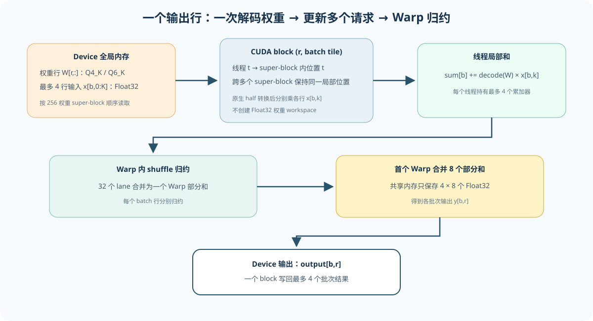
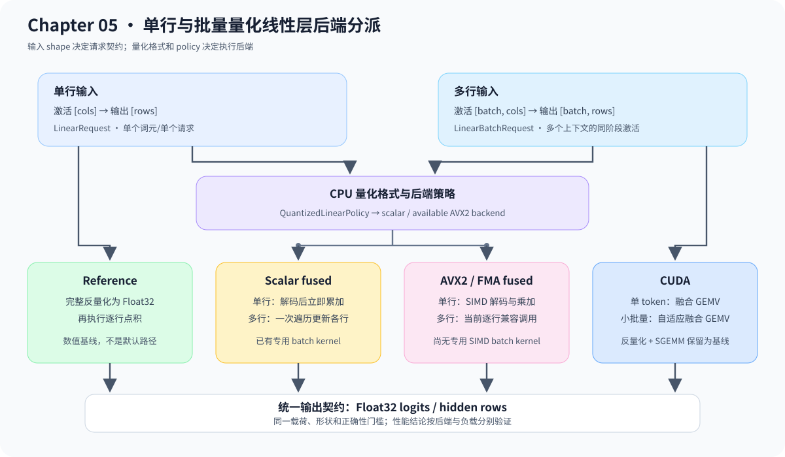

# 05.5 在量化权重上执行线性计算

解码器上层提交激活、权重格式和输出空间。Q2_K、Q4_K、Q6_K、Q8_0 或 IQ4_NL 由线性层内部选择对应实现。本节比较参考实现与融合路径：执行方法可以变化，线性层的输入输出形状保持一致。

## 从参考路径到融合线性层

参考路径先还原完整浮点权重，再执行 `W * input`；融合路径读取一个量化分块后立即完成乘加，省去完整权重数组。下面的算法镜像省略计算后端注册、SIMD 指令、CUDA 工作区和错误恢复，只比较两条路径决定结果的动作。

```python
def linear_reference(packed_weight, input_vector):
    float_weight = dequantize_all_blocks(packed_weight)
    return matrix_vector_product(float_weight, input_vector)


def linear_fused(packed_weight, input_vector):
    output = zeros(packed_weight.output_rows)
    for output_row in range(packed_weight.output_rows):
        for block in packed_weight.row_blocks(output_row):
            for column, weight in decode_block(block):
                output[output_row] += weight * input_vector[column]
    return output
```

| 算法动作 | C++ 对象或源码 | 验证重点 |
| --- | --- | --- |
| 建立浮点基线 | `Q4KLinearReference`、`Q6KLinearReference` | 输出 shape 与固定数值 |
| block 内直接乘加 | `q4k_kernel.cpp`、`q6k_kernel.cpp` | 不创建完整 float 权重数组 |
| 选择执行路径 | `QuantizedLinearPolicy` | 格式、backend 与硬件能力匹配 |
| 返回统一结果 | `compute_quantized_linear()`、`compute_quantized_linear_batch()` | reference、单行与 batch 容差一致 |

学习顺序为“标量参考 → 标量融合 → SIMD 融合 → CUDA 反量化加 SGEMM 基线 → CUDA 融合 GEMV → CUDA 批量融合 GEMV”。每条路径先与参考结果做数值比较，再进入性能实验。

## CUDA 融合 GEMV 怎样访问内存和归约

一维 CUDA 线程索引、Grid 向上取整和尾部边界保护见 [`F-CUDA-01`](../reference/formulas.md#f-cuda-01)。本节在该基础上继续讨论量化 block、Warp 归约和批量权重复用。

GEMV 是通用矩阵向量乘法（General Matrix-Vector Multiplication）。Decode 每次只提交一个激活向量，Linear 因而呈现 GEMV 形状。对于权重矩阵 `W[N,K]` 和输入 `x[K]`，第 `r` 个输出为：

```text
y[r] = sum(W[r,k] * x[k]), k = 0 ... K-1
```

基线路径先把整个 packed 权重矩阵写成 Float32 workspace，再由 cuBLAS 重新读取；融合路径让一个 CUDA block 负责一个输出行。线程从该行的 packed block 读取量化值，在寄存器中完成解码和乘加，只把最终的 `y[r]` 写回显存。Q4_K/Q6_K 是 TinyLlama 与 Qwen3 的性能主线；Q2_K/Q3_K/IQ4_NL 通过 DeepSeek-V2-Lite 接入同一输出契约，其中 IQ4_NL 已继续完成专用线程组织和真实模型 A/B。

批量 Decode 的输入是 `[B,K]`，数学上已经是矩阵矩阵乘法。这里仍称 batched GEMV，是因为代码从单向量 kernel 扩展而来，只让少量输入行共享权重读取与解码；它没有采用面向大矩阵的通用 GEMM 分块策略。批量融合路径把最多 4 个输入行组成一个 tile，一个 block 负责同一输出行在该 tile 内的多个结果。同一线程解码一个 packed 权重后，连续更新各输入行的累加器；这样既省去完整 Float32 权重副本和后续 SGEMM，也避免在相邻请求之间重复读取和解码权重。

固定 4 行 tile 在 batch=4 时能完整复用一次权重解码，但 batch=1/2 仍会为 4 行准备累加器、共享归约空间和条件判断。自适应路径在运行期只选择已经编译好的 `tile=1/2/4` kernel：batch=1 用 1 行，batch=2 用 2 行，其余小批量用 4 行。它没有在 kernel 内动态改变数组大小，而是在提交 kernel 前按 batch 形状分派模板实例。

Q2_K、Q4_K 和 Q6_K 的一个 super-block 都表示 256 个权重。当前映射使用 256 个线程，每个线程负责 super-block 中一个固定列位置，并跨该行的多个 super-block 累加局部和。相邻线程读取相邻输入位置；packed 权重则按各格式的 nibble、high-bit 和 scale 布局解码。

点积结束后，每个 Warp 先用 shuffle 合并 32 个局部和，8 个 Warp 只把各自结果写入共享内存；首个 Warp 再完成最终归约并写回。线程数仍为 256，但不再执行 8 轮整块共享内存树形归约。Q4_K 的 128 线程候选没有改善 TinyLlama profile，因此 256 元素格式只替换归约方法，不缩小线程块。

IQ4_NL 的一个 block 只有 32 个权重。若继续启动 256 个线程，只有首个 Warp 能对应这 32 个元素，其余 Warp 仍要参与同步和最终归约。[格式基线实验](../reference/experiment_assets.md#exp-gpu-22)显示，IQ4_NL batch=1 的 Warp 周期约 `80%` 消耗在 barrier 等待；这不是量化公式的问题，而是线程块形状与数据块形状不匹配。专用路径改为每个输出行只启动一个 32 线程 Warp，每个 lane 解码一个元素，跨 block 累加后用 shuffle 归约，不再申请共享部分和或执行 block barrier。

[单线程束微基准](../reference/experiment_assets.md#exp-gpu-23)先证明专用线程组织减少了无效指令和同步；[真实 DeepSeek 实验](../reference/experiment_assets.md#exp-gpu-24)再固定 MLA 与 MoE 路径，只替换 IQ4_NL GEMV。局部原因与完整 27 层预填充均通过门禁后，DeepSeek CUDA 工厂才默认选择单线程束 IQ4_NL；通用路径继续作为 A/B 基线。

Q2_K 虽然表示 256 个权重，但一个 super-block 只保存 64-byte 量化 payload、16-byte scale/min 和 4-byte 全局系数。通用 256 线程映射让四组线程重复读取同一批 packed quant，并让许多线程请求相同的 scale。单 Warp 路径改为每个 lane 在一个半块中只读取一个 packed byte，再依次提取其中四个 2-bit quant；lane 0 和 16 加载两组 scale 后用 shuffle 广播。一个 Warp 仍覆盖全部 256 个权重，只是把并行的重复读取改成 lane 内的四次乘加。

[Q2_K 单线程束微基准](../reference/experiment_assets.md#exp-gpu-25)验证载荷复用减少了指令、等待和重复读取；[真实模型实验](../reference/experiment_assets.md#exp-gpu-26)固定 IQ4_NL 路径后只切换 Q2_K。完整预填充与候选分数门禁同时通过后，DeepSeek CUDA 工厂采用覆盖 Q2_K 与 IQ4_NL 的分块感知路径；旧路径用于分离格式影响。

Q3_K 的 256 个权重由三部分组成：64-byte low-2-bit payload、32-byte high-bit mask 和 12-byte packed group scale。通用路径让每个线程重复解析 scale 字节；单 Warp 路径则让每个 lane 读取一个 low-bit byte 与一个 mask byte，依次处理两个 half 中的四个 group。lane 0 和 16 解码 6-bit scale 后广播，最终仍覆盖全部 256 个权重。

[Q3_K 单线程束微基准](../reference/experiment_assets.md#exp-gpu-28)先检查位平面与分组缩放复用，[真实模型实验](../reference/experiment_assets.md#exp-gpu-29)再固定 Q2_K 与 IQ4_NL 路径，只切换 Q3_K。端到端收益与候选分数门禁成立后，工厂默认路径扩展到 Q3_K；旧的分块感知路径保留为单变量基线。

批量输入按最多 4 行组成一个 tile。同一线程解码一个权重后，分别与 tile 中各行对应的激活相乘，随后对每行独立做 Warp 归约。这样 batch=2 时同一 packed 权重只读取和解码一次；代价是每个线程持有多个累加器，因此 tile 继续增大前需要用 Nsight Compute 检查寄存器压力和占用率。

[批量权重复用实验](../reference/experiment_assets.md#exp-gpu-08)使用 Nsight Compute 区分计算、缓存、寄存器与线程束停顿。元数据广播、共享载荷和显式 FMA 候选增加了额外指令或同步，因此没有保留；[原生 FP16 解码实验](../reference/experiment_assets.md#exp-gpu-12)删除手写位解码后通过门禁，热点随之转移到 L1/TEX。正文保留优化因果，具体计数器与周期记录由实验资产表维护。

[自适应分块局部实验](../reference/experiment_assets.md#exp-gpu-14)检查批量形状造成的无效工作。批量为 1 或 2 时，较小分块减少空输入行的累加、共享内存和归约；[真实双请求实验](../reference/experiment_assets.md#exp-gpu-15)随后确认张量组批解码和候选分数门禁成立，因此默认执行路径采用自适应分块，固定 4 行实现只用于 A/B 基线。

| 阶段 | 数据位置 | 发生的动作 | 避免的成本 |
| --- | --- | --- | --- |
| 读取 | device packed 权重、Float32 输入 | 线程定位量化 block 和固定列位置 | 不生成完整 Float32 权重矩阵 |
| 局部乘加 | 线程寄存器 | 跨多个 super-block 解码并累加 | 不把中间权重写回显存 |
| Warp 与 block 归约 | shuffle + 8 个共享部分和 | Warp 内归约后由首个 Warp 合并 | 减少整块同步和共享内存流量 |
| 写回 | `output[b,r]` | 每个 block 写回 tile 内各请求的 Float32 结果 | 避免额外矩阵读取 |

同一[批量权重复用实验](../reference/experiment_assets.md#exp-gpu-08)还在不同长度请求和分页解码上复测该设计。逐请求候选分数保持一致，端到端样本支持保留批量权重复用和线程束归约；性能剖析同时表明量化解码与权重读取仍是主要热点。



## 计算后端策略与统一接口

`Q4KLinearAvx2` 和 `Q6KLinearAvx2` 在读取 block 时直接用 AVX2/FMA 累加。CUDA 由 `CudaQuantizedMatrix` 保存 packed payload；单 token 和小批量 Decode 可直接读取 Q2_K/Q3_K/Q4_K/Q6_K/Q8_0/IQ4_NL block，完整反量化路径保留为独立数值对照。Q8_0 CUDA fused GEMV 先由真实 SmolVLM mmproj 第 0 个 SigLIP Block 定位局部数值，再由 32 层语言 Context 验证模型权重上传和最终 logits。Q2_K、Q3_K、IQ4_NL 与 Q8_0 的 CPU 路径当前使用 portable scalar fused；请求不存在的 AVX2 实现会返回明确 `Status`，不会静默回退。

```cpp
chapter05_quantization::QuantizedLinearPolicy policy{
    chapter05_quantization::QuantizedLinearBackendKind::Avx2Fused,
    chapter05_quantization::QuantizedLinearBackendKind::ScalarFused,
    chapter05_quantization::QuantizedLinearBackendKind::ScalarFused
};
auto status = chapter05_quantization::compute_quantized_linear(
    request, policy, registry);
```

| 路径 | 中间权重 buffer | 计算方式 | 当前用途 |
| --- | --- | --- | --- |
| Reference | 完整 float 数组 | 先反量化，再标量点积 | 格式与数值基线 |
| Scalar fused | 无 | 按 block 解码并标量累加 | 默认可移植路径 |
| AVX2/FMA fused | 无 | 分组解码并向量乘加 | 显式 CPU 性能实验 |
| CUDA batch baseline | Float32 workspace | CUDA 解码后调用 cuBLAS SGEMM | batch correctness 与后续融合基线 |
| CUDA fused GEMV | 无完整浮点权重副本 | 解码、点积与行归约在同一 kernel | 单 token Decode 与真实生成优化 |
| CUDA batched fused GEMV | 无完整浮点权重副本 | 一个二维网格计算 `[B,N]` | 小批量多请求 Decode |

真实解码器按注意力、FFN 和 LM Head 分别保存执行策略。Q4_K gate/up、Q6_K down、Q4_K QKV/out 复用同一分派器，只改变对应作用域的策略。生产框架怎样把量化方法、硬件和计算内核绑定，见 [`05.7 量化实现与框架对照`](./07_tensorrt_gemma_vllm_comparison.md)。

下图从公共线性层请求开始，展示格式分派、CPU/CUDA 路径和共同的数值基线。并列后端是可替换实现，不表示按顺序全部执行。



## Packed 权重与激活视图

`QuantizedMatrixView` 保存打包载荷指针、字节数、权重行列和量化格式。`compute_quantized_linear_views()` 让 Chapter02 的 Float32 激活通过公共只读/可写视图进入执行策略和计算后端：一维表示单词元，二维表示多个词元行。

rank-2 会构造 `LinearBatchRequest`。Q3_K、Q4_K、Q5_K、Q6_K 和 Q8_0 的标量批量后端只遍历一次打包权重，把同一个解码值分别累加到各输入行；Q5_K 使用完整块临时值，其余格式在各自后端中组织解码与点积。这样得到的是 CPU 单线程批量 GEMV，而不是逐行重复解码权重。Qwen1.5-MoE 先按专家分组，再用该接口执行组内 Gate、Up 和 Down。`RealMoeBatchMode` 保留逐行路径作为同一二进制中的实验基线；[真实首层专家分组实验](../reference/experiment_assets.md#exp-cpu-13)验证分组路径保持路由和输出一致，并减少重复解码。AVX2 后端目前通过公共兼容路径逐行执行，尚未提供专用多行 SIMD 计算核。

所有 batch 行必须连续且宽度相同，输出采用 `[batch, output_rows]`。适配器先写临时结果，整批成功后才提交到输出 View；非连续激活必须由调用方显式 `contiguous()`，packed 权重也必须严格匹配格式对应的 block 字节数。

## 验证与衔接

```bash
bash code/chapter05_quantization/scripts/run.sh
```

测试比较 reference、scalar fused 和可用的 AVX2 路径，检查输出 shape、数值容差、非法 backend 请求和真实 TinyLlama contiguous Q4_K row。跨章测试还验证 Q4_K、Q6_K、Q8_0 的多行 scalar batch、非连续输入拒绝和失败不覆盖输出。真实 Decoder 使用固定 prompt 检查 Context 隔离和 embedding-prefill，并与同轮 llama.cpp 输出比较 logits 数值指标和 greedy 序列。下一节 [`05.6 精度验证`](./06_accuracy_validation.md) 将局部误差扩展到中间 Tensor 与最终输出。
