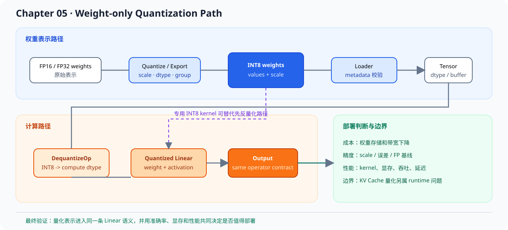
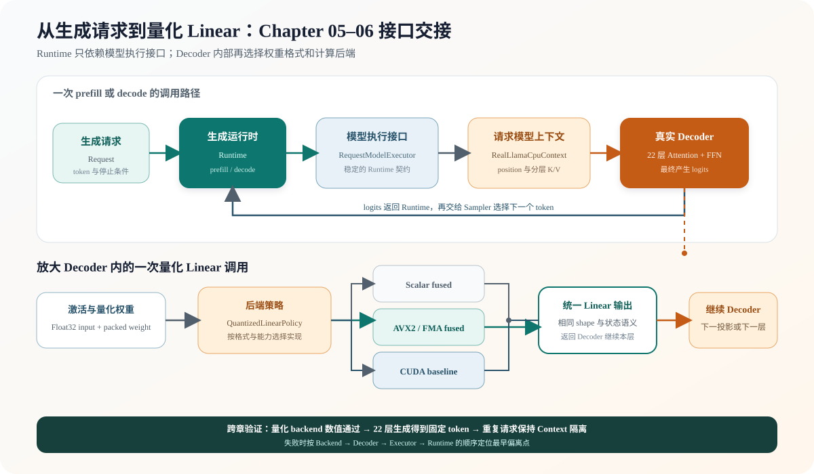

# 05.8 量化在生成运行时中的位置

前面几个小节已经把 INT8 权重、反量化和精度验证连起来。本节继续追踪量化选择怎样进入真实 Decoder，以及 Generation Runtime 为什么不需要感知具体权重格式。

## 权重量化进入运行时的路径

| 层次 | 量化带来的变化 | 读源码时看什么 |
| --- | --- | --- |
| 权重加载 | 文件里不再只有 FP16 权重，还会有 scale、group size 或量化类型 | loader 如何识别 dtype 和 metadata |
| 模型配置 | 不同层可能使用不同量化策略 | config 如何把量化方案传给 model runner |
| kernel 选择 | INT8 / INT4 / FP8 可能走不同计算 kernel | Linear 或 attention backend 如何分派实现 |
| KV cache | 有些系统会继续量化 KV cache，以降低长上下文显存压力 | cache dtype、block 大小和精度影响 |
| benchmark | 显存下降不等于吞吐一定提升 | latency、throughput、精度和显存要一起看 |

权重量化主要改变模型参数的存储和 Linear 计算路径。Loader 提供 packed payload，Decoder 提交激活和输出空间，`QuantizedLinearPolicy` 在已注册的 scalar 与 AVX2 CPU backend 之间选择实现。CUDA 由独立的 `CudaExecutionContext` 分派单 token 融合 GEMV 或 batch 反量化加 cuBLAS，不进入这项 CPU policy。KV Cache 量化发生在请求运行过程中，连接 Attention backend、缓存布局和 decode 精度；当前主线实现的是权重量化。

## 激活量化改变哪条数据流

激活量化处理运行时产生的输入和中间 Tensor，不是读取 GGUF packed 权重。静态量化使用校准数据预先确定 scale；动态量化在请求执行时根据当前 Tensor 计算 scale。前者减少运行时统计开销，后者能跟随输入范围变化，但会增加归约和量化操作。

权重和激活都量化后，Linear 可以进入 W8A8、INT4/INT8 或 FP8 矩阵 kernel。若 kernel 先把激活还原成浮点再计算，主要收益仍停留在存储或搬运；只有算子真正消费低精度输入，才可能同时减少计算成本。SmoothQuant 一类方法还会在离线阶段重分配权重与激活中的异常值，说明激活量化不仅是给 Tensor 增加一个 dtype。

当前 Chapter05 只实现权重量化：输入激活和累加结果保持 Float32。后续接入激活量化时，需要新增激活 scale 契约、校准或动态统计、低精度 GEMM backend，以及 Linear/Decoder/最终 logits 的独立误差门禁。

| 观察点 | 仅权重量化主线 | 激活量化扩展 |
| --- | --- | --- |
| scale 来源 | GGUF 权重 block | 校准结果或当前激活动态统计 |
| 数据生命周期 | 模型加载后长期只读 | 每次 Prefill/Decode 都会变化 |
| kernel 输入 | packed 权重 + Float32 激活 | 低精度权重 + 低精度激活 |
| 当前状态 | CPU/CUDA 已实现 | 原理介绍，代码未实现 |

## 从 Runtime 进入量化 Decoder

Chapter06 的 `Runtime` 只调用 `RequestModelExecutor::prefill()` 和 `decode()`。真实模型适配器为每个请求创建独立 `RealLlamaCpuContext`，Context 保存 position 和分层 K/V；22 层 Decoder 内部遇到 Linear 时，再由 Chapter05 的 policy 选择具体后端。这样替换权重格式或 CPU/CUDA 实现时，Request、Sampler 和停止条件不需要改变。

返回路径同样稳定：Decoder 产生 logits，Executor 把 logits 交还 Runtime，Sampler 选择下一个 token。图中的三种 backend 是可替换分支，不会在一次 Linear 中依次执行；CUDA 已接入真实 TinyLlama Runtime，单 token 与 batch 根据输入形状选择不同量化路径。

## KV Cache 与端到端收益

量化首先降低存储和带宽成本，速度收益由真实 kernel 和硬件路径决定：

- 先反量化成 FP16 再计算的路径主要节省加载和存储。
- 专用 INT8 / INT4 kernel 才能进一步减少计算成本。
- KV cache、调度或采样占主导时，端到端优化应转向对应阶段。

量化链路先用 reference 和真实 Decoder 证明数值正确。固定 workload、延迟、吞吐、热点归因和真实服务内存口径随后进入 Chapter09 的性能证据链。K/V Cache 量化的布局与生命周期继续在 [`07.6 前缀复用与生产扩展`](../chapter07_kv_cache/next/06_production_extensions.md) 说明。

## 验证与衔接

先运行 Chapter05 默认测试确认格式、Linear policy 和 backend 数值，再运行真实 Decoder 学习入口验证 22 层生成和双请求隔离。成熟框架中的对象映射见 [`05.7 量化实现与成熟框架对照`](./07_tensorrt_gemma_vllm_comparison.md)；[`Chapter06 Generation Runtime`](../chapter06_generation/next/intro.md) 继续使用相同 Executor 契约组织请求生命周期。

| 验收层级 | 执行入口 | 通过条件 |
| --- | --- | --- |
| 量化 backend | `bash code/chapter05_quantization/scripts/run.sh` | reference、scalar、可用的 AVX2 与错误路径通过 |
| 真实 Decoder | `bash code/chapter05_quantization/scripts/run_real_decoder.sh` | 22 层 Decoder 满足与 llama.cpp 的数值阈值并生成相同 greedy token 序列 |
