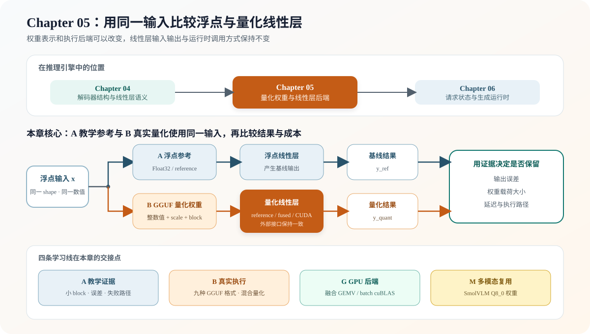
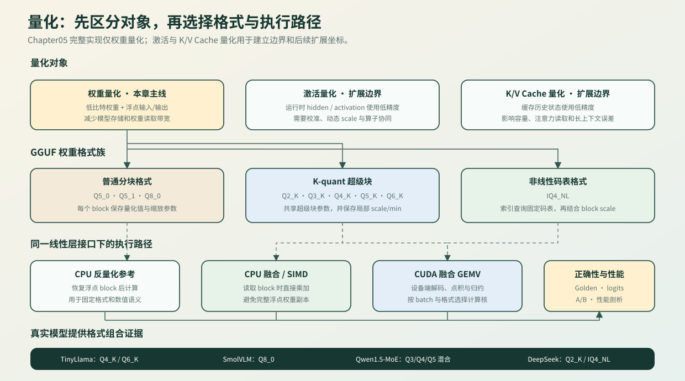

# 05.0 用仅权重量化减少权重存储并建立计算路径

## 本章导读

Chapter 04 已经固定解码器、注意力和 FFN 的计算结构；本章在线性层内部用低比特格式保存真实权重，并比较浮点路径与量化路径的输出误差、存储大小和执行时间。Chapter 06 通过同一模型执行接口持续调用这条路径。

| 本章实现 | 后续扩展 | 深入入口 |
| --- | --- | --- |
| INT8 教学路径、九种 GGUF 量化格式的 CPU 解码与 Linear、可选 SIMD，以及 Q2_K/Q3_K/Q4_K/Q6_K/Q8_0/IQ4_NL CUDA GEMV | 激活校准、K/V Cache 量化、更高吞吐量化 GEMM 和多格式自动调度 | [`05.7 量化框架对照`](./07_tensorrt_gemma_vllm_comparison.md)、[`05.8 运行时位置`](./08_quantization_in_serving_runtime.md) |

本章先区分权重、激活和 K/V Cache 三类量化对象，再沿五个实现层次进入代码。可运行路径采用仅权重量化；激活量化和 K/V Cache 量化用于解释需要新增的数据与验证方法。

| 量化对象 | 学习深度 | 本章关注点 |
| --- | --- | --- |
| 模型权重 | 代码、测试与真实模型 | GGUF 分块载荷、九种 CPU 格式、六种 CUDA 格式与真实模型验证 |
| 中间激活 | 原理与接口分析 | 校准或动态缩放、激活数据类型、低精度矩阵计算和误差门禁 |
| K/V Cache | 原理与 Chapter07 入口 | 请求级缓存布局、注意力读取和长上下文误差 |
| 模型内混合量化 | 真实模型验证 | 加载器按每个张量的 GGML 类型选择既定格式 |

| 实现层次 | 解决的问题 | 代码或证据 |
| --- | --- | --- |
| 格式与存储 | 一个 block 表示多少权重、占多少字节、怎样解释打包位 | `WeightFormat`、block 常量、`QuantizedMatrixView` |
| 数值参考 | 每种格式怎样恢复近似浮点值 | 独立反量化或 reference 实现与固定结果测试 |
| 计算后端 | 怎样组织解码与点积并利用 CPU/CUDA | 标量 Linear、Q4_K/Q6_K AVX2、六种 CUDA fused GEMV |
| 运行时接入 | 怎样让模型按格式和设备选择实现 | CPU `QuantizedLinearPolicy`、CUDA `CudaExecutionContext`、模型适配器 |
| 验证证据 | 怎样判断公式、组件、真实模型和优化是否成立 | block golden、跨章测试、llama.cpp 对照与 Chapter09 A/B |

| 学习线 | 本章怎样学习 | 可验证产物 |
| --- | --- | --- |
| A 教学证据线 | 用小型 INT8 与九种 GGUF 分块的 CPU 解码证据看清缩放、反量化与误差 | 固定反量化数值、浮点/量化输出误差和失败状态 |
| B 真实执行线 | 读取 GGUF 打包权重，将 TinyLlama、Qwen1.5-MoE 和 DeepSeek-V2-Lite 所需格式接入统一线性层 | 与 llama.cpp 对照候选分数、专家选择和贪心词元序列 |
| G GPU 执行线 | 保持打包权重和线性层输入输出不变，单词元与小批量路径融合解码、点积和归约 | Q2_K/Q3_K/Q4_K/Q6_K/Q8_0/IQ4_NL 设备端结果；真实生成与性能证据 |
| M 多模态复用线 | 复用 Q8_0 解码与线性层接口处理 SmolVLM 视觉权重 | 视觉编码器、投影器和语言模型权重通过真实模型测试 |

| 本章新术语 | 先这样理解 | 首次解释 |
| --- | --- | --- |
| 量化（quantization） | 用较少的整数位保存近似权重，减少模型体积和内存带宽 | [`05.1 用整数近似浮点权重`](./01_quantization_basics.md) |
| 缩放因子（`scale`） | 把整数值映射回近似浮点范围的比例 | [`05.1 用整数近似浮点权重`](./01_quantization_basics.md) |
| 反量化（dequantization） | 根据整数值和 scale 恢复近似浮点值 | [`05.4 反量化算子`](./04_dequantize_op.md) |
| 仅权重量化（weight-only） | 权重使用低比特格式，输入与输出仍按浮点计算 | [`05.5 量化线性层`](./05_linear_with_quant.md) |
| 混合量化（mixed quantization） | 不同 Tensor 根据精度和执行需求使用不同量化格式 | [`05.1 用整数近似浮点权重`](./01_quantization_basics.md) |
| K-quant | ggml 的分块量化格式族，其中 `K` 与 K/V Cache 无关 | [`05.1 用整数近似浮点权重`](./01_quantization_basics.md) |
| 融合路径（fused path） | 读取量化 block 时直接乘加，不生成完整浮点权重副本 | [`05.5 量化线性层`](./05_linear_with_quant.md) |

下图从量化对象进入格式族、执行路径和真实模型证据，并标出本章深入实现的权重量化路径。

## 开始学习

先区分权重量化、激活量化和 K/V Cache 量化，再从 INT8 的整数、缩放因子和反量化关系入手，沿着 GGUF 分块、量化线性层和后端策略进入真实解码器。TinyLlama 提供 Q4_K/Q6_K 证据，SmolVLM 提供 Q8_0 证据，Qwen1.5-MoE 验证 Q3_K/Q4_K/Q5_0/Q5_1/Q5_K 混合量化，DeepSeek-V2-Lite 再引入 Q2_K 与 IQ4_NL。

| 顺序 | 路线 | 页面 | 先看源码 | 读完后应看到什么 |
| --- | --- | --- | --- | --- |
| 1 | A/B 公共 | [`05.1 量化基础`](./01_quantization_basics.md)、[`05.2 量化 Tensor`](./02_extend_tensor.md) | <a href="https://github.com/datawhalechina/cpp-llm-engine/blob/main/code/chapter05_quantization/src/tensor.cpp"><code>tensor.cpp</code></a> | 浮点值怎样变成整数、scale 和量化误差 |
| 2 | A→B | [`05.3 接收量化权重`](./03_load_quantized_weights.md)、[`05.4 反量化算子`](./04_dequantize_op.md) | <a href="https://github.com/datawhalechina/cpp-llm-engine/blob/main/code/chapter05_quantization/src/q2k_dequantize.cpp"><code>q2k_dequantize.cpp</code></a>、<a href="https://github.com/datawhalechina/cpp-llm-engine/blob/main/code/chapter05_quantization/src/iq4nl_dequantize.cpp"><code>iq4nl_dequantize.cpp</code></a> | super-block、普通 block 与非线性码表怎样恢复数值 |
| 3 | B/G/M | [`05.5 量化线性层`](./05_linear_with_quant.md) | <a href="https://github.com/datawhalechina/cpp-llm-engine/blob/main/code/chapter05_quantization/src/quantized_linear_view_adapter.cpp"><code>quantized_linear_view_adapter.cpp</code></a>、<a href="https://github.com/datawhalechina/cpp-llm-engine/blob/main/code/chapter05_quantization/src/quantized_linear_policy.cpp"><code>quantized_linear_policy.cpp</code></a> | 相同线性层接口怎样连接 CPU 策略、CUDA 执行上下文和多模态 Q8_0 权重 |
| 4 | A/B 验证 | [`05.6 精度验证`](./06_accuracy_validation.md) | <a href="https://github.com/datawhalechina/cpp-llm-engine/blob/main/code/chapter05_quantization/tests/chapter05_quantization_test.cpp"><code>chapter05_quantization_test.cpp</code></a> | 同一输入下量化输出与浮点基线的误差是否可接受 |
| 5 | B | [`05.7 框架对照`](./07_tensorrt_gemma_vllm_comparison.md)、[`05.8 Serving Runtime 中的位置`](./08_quantization_in_serving_runtime.md) | <a href="https://github.com/datawhalechina/cpp-llm-engine/blob/main/code/core/include/cpp_llm_engine/core/quantization_contract.h"><code>quantization_contract.h</code></a> | 量化后端怎样保持上层 Linear 和 Runtime 接口不变 |

## 验证与下一步

本章运行结束后会得到可与浮点基线对照的量化线性层后端；[`Chapter 06`](../chapter06_generation/next/intro.md) 将把真实解码器接入“预填充 → 逐词元解码 → 输出”生成循环。

| 验收层级 | 执行入口 | 通过条件 | 本章要求 |
| --- | --- | --- | --- |
| L1 默认 CPU | `bash code/chapter05_quantization/scripts/run.sh` | 四个 CTest 覆盖本章 backend、DeepSeek 格式、Chapter02 激活 View 集成和 Core Tensor 契约 | 必做 |
| L2 真实模型 | `bash code/chapter05_quantization/scripts/run_real_decoder.sh` | TinyLlama 22 层输出满足与 llama.cpp 约定的余弦相似度、误差和 greedy 序列条件 | 有模型时必做 |
| L3 可选 CUDA | `CUDA_HOME=/usr/local/cuda-12.8 bash code/cuda/scripts/run.sh` | 单 token 与批量融合 GEMV 均匹配 CPU reference | 有 NVIDIA GPU 时选做 |
