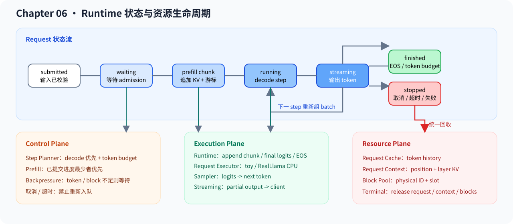

# 06.9 管理请求生命周期

Generation Runtime 需要让一个请求跨越多个 step，并在完成、取消、超时、拒绝或失败后释放资源。`Request` 保存外部可观察状态，模型 Context 保存分层 K/V，BlockTable 保存物理 block ownership；三者不能用一个“缓存”概念代替。

源码阅读从 <a href="../_code/chapter06_generation/src/request.cpp"><code>request.cpp</code></a> 的状态转换开始，再进入 <a href="../_code/chapter06_generation/src/scheduler.cpp"><code>scheduler.cpp</code></a> 观察 Scheduler 怎样跳过 terminal 请求。

## 请求字段与所有者

| 字段或对象 | 保存内容 | 主要所有者 |
| --- | --- | --- |
| prompt / generated tokens | 输入与已提交输出 | `Request` |
| prefill offset | 已成功写入 Context 的 prompt 数量 | `Request` |
| max tokens / stop tokens | 终止条件 | `Request` / Generation config |
| sampling params | logits 到 token 的决策参数 | Sampler config |
| status / finish reason | 能否继续推进及结束原因 | `Request` |
| Model Context | position 与真实分层 K/V | 请求专属 Executor |
| BlockTable | 逻辑 token 到物理 block/slot 的映射 | Scheduler / ServiceCore |

服务层把外部输入转换成这些字段，不直接修改模型内部 K/V。Scheduler 读取状态和预算决定下一步，Executor 只推进所属请求的模型 Context。

## 状态转换与资源释放

1. `Initial`：请求已创建；chunked prefill 用 `prefill_offset` 记录部分进度。
2. `Prefilled`：prompt 已全部提交，首个 logits 可用于采样。
3. `Decoding`：每个 step 消费一个 token 并产生下一组 logits。
4. `Finished`：EOS、token budget 或 context limit 正常结束。
5. `Cancelled` / `TimedOut`：外部终止，Scheduler 不再推进。
6. `Rejected`：admission budget 不满足，不能占有已提交资源。
7. `Failed`：模型执行失败，保留 failure reason，不产生占位 token。

任意 terminal 状态都必须进入统一释放路径：停止调度，结束 streaming，清理 Request token cache，释放 Executor/Context，并把 BlockTable 的物理 block 归还 pool。部分 prefill 后取消时，同样要释放已经提交的 block。

| 当前状态 | 触发事件 | 下一状态 | 同步发生的资源动作 |
| --- | --- | --- | --- |
| `Initial` | 中间 prefill chunk 成功 | `Initial` | 增加 `prefill_offset`，Context 和 BlockTable 提交本段 token |
| `Initial` | final prefill 成功 | `Prefilled`，随后进入 `Decoding` 或 `Finished` | 取得首组 logits 并采样首 token |
| `Prefilled` / `Decoding` | decode 成功且未命中停止条件 | `Decoding` | Context 追加输入 token 的 K/V，Request 追加新采样 token |
| `Prefilled` / `Decoding` | EOS、生成上限或上下文上限 | `Finished` | 停止进入后续 step，等待统一释放 |
| 任意非终态 | 取消或 deadline 到达 | `Cancelled` / `TimedOut` | 停止执行；已占资源等待统一释放 |
| `Initial` | 上下文预算不满足 | `Rejected` | 不进入模型执行，不提交新 block |
| 任意非终态 | Executor 失败或返回空 logits | `Failed` | 保留失败原因，撤销本 step 未提交预留 |
| 任意终态 | 再次推进或切换 phase | 保持原终态 | 不增加 prefill 游标或生成 token |

`Request` 自身保证终态不能被 `mark_prefilled()`、`mark_decoding()` 或 `mark_finished()` 恢复，也不会在终态后继续追加生成 token 或 prefill 进度。Scheduler 和 Runtime 仍会在调用前检查 `terminal()`；两层检查共同防止已结束请求再次进入模型。Request 内的教学 token cache 由 ServiceCore 在统一释放阶段清空，不能把“状态不可恢复”理解为资源已经自动释放。

## 验证与衔接

测试需要覆盖正常完成、取消、超时、拒绝和执行失败，检查 terminal 请求不再调用 Executor、finish reason 可观察、两个请求资源互不影响、释放后 block 数恢复。成熟框架对同类对象的组织方式集中在 [`06.8 Runtime 框架对照`](./08_vllm_comparison.md)。下一节 [`06.10 Continuous Batching`](./10_continuous_batching.md) 会在这些状态上构造每个 step 的可执行集合。
