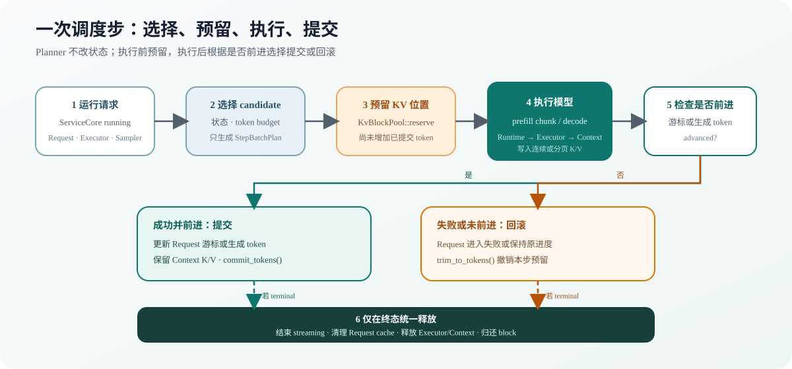

# 06.10 在每个调度步重新选择请求

朴素生成通常按“一个请求跑完再跑下一个”理解，Serving Runtime 还要兼顾吞吐和等待时间。Continuous Batching 在每个 decode step 重新组织可运行请求，让新请求插入并让完成请求及时离开。

实现入口是 <a href="../_code/chapter06_generation/src/serving_preview.cpp"><code>serving_preview.cpp</code></a>。阅读时先跟踪一个 step 选择了谁，再判断这些请求是逐个执行还是合成 Tensor batch。

## 每个 Step 重新选择请求

如果 batch 在请求开始时固定，短请求会被长请求拖住，新请求也要等整批结束后才能进入。Continuous Batching 把 batch 的边界从“请求集合”改成“每个 step 的可执行集合”。

这样 runtime 每一步都可以做三件事：

- 把新请求放进 prefill
- 让正在 decode 的请求继续生成一个 token
- 把结束、取消或资源不足的请求移出运行集合

一个便于入门的循环可以写成下面这个形状：

```text
while has_work:
  admit_waiting_requests()
  run_prefill_for_new_requests()
  run_one_decode_step_for_active_requests()
  sample_next_tokens()
  update_request_status()
  release_finished_requests()
```

成熟框架还要处理 token budget、block budget、prefill/decode 混排、抢占、streaming output 和 GPU batch 形状。本节先固定一个调度单位：scheduler 每个 step 选择要推进的 token，不会一次调度完整请求直到结束。

最小 admission 规则应保持明确：先检查 token/cache budget，再把 waiting 请求加入当前 step；预算不足时回压、延迟或拒绝，而不是让 batch 无限增长。取消和超时请求必须在下一次 step 前移出运行集合，已完成请求先发出最终结果，再进入 cache 和 workspace 回收路径。

## Step batch 与 Tensor batch

Continuous Batching 先解决“本轮选择哪些请求”，Tensor batch 再解决“怎样把这些请求合成一次模型计算”。两者不能用同一个 `batch` 名称含混带过。

当前 `StepBatchPlanner` 和 `ContinuousBatchScheduler::run_step()` 负责动态加入、退出、token budget 与 chunked prefill。它们产出的 candidate 仍然保留各自的 token、position 和资源归属；是否逐请求执行或合并计算，由下一层执行路径决定。

| 问题 | 本节回答 | 下一节回答 |
| --- | --- | --- |
| 当前 step 推进谁 | admission、预算、prefill/decode 混排和公平性 | 复用本节选择结果 |
| 选中后怎样计算 | 保持 Executor 调用和事务语义 | 教学 Tensor batch 与真实 scalar Linear batch |
| KV 写到哪里 | 预留、提交和失败回滚 | 06.12 继续解释 BlockTable 与物理 block |

真实模型怎样共享权重、合并 Linear 激活并保持 Context 隔离，见 [`06.11 合并真实模型批量计算`](./11_real_model_batch.md)。

## 一次 Step 的事务顺序

一次调度步先读取请求状态和预算生成 `StepBatchPlan`，此时不修改 Request、Context 或 BlockTable。Scheduler 随后为每个 candidate 预留 K/V 容量，再调用 Runtime 和 Executor。执行后只有两条路径：请求游标或生成 token 已前进时提交 block token；没有前进时撤销本步预留。请求进入终态后，Chapter09 的 ServiceCore 再统一释放 Request cache、Executor/Context 和物理 block。



## 执行、提交与公平性

`StepBatchPlanner::build()` 每次重新扫描请求状态。没有可分块 prefill 请求时，decode 可以使用全部 token budget；存在可分块 prefill 请求时，planner 先为 prefill 保留 1 个 token budget，再让 decode 使用其余预算。设置 `max_requests` 时也会为 prefill 保留 1 个请求槽。这样即使 `max_batch_tokens=1`、`max_requests=1`，等待中的 chunked prefill 仍有一次推进机会，而不会被活跃 decode 长期占满。

decode 阶段结束后，planner 用保留预算和剩余预算选择 prefill。支持 chunk 的 executor 可以只消费 prompt 的一部分，`Request::prefill_offset()` 记录已经提交的 token 数；不支持 chunk 的 executor 仍要求完整 prompt 能放入预算，不会被调度器强行拆分。

中间 chunk 只向 Context 追加 token 和分层 K/V，不请求 logits，也不采样 token。最后一个 chunk 才请求 logits、把 Request 标记为 prefilled，并采样首个输出 token。这样可避免每段重置 Context，也不会把中间位置误当成生成起点。

| 输入状态 | 本 step 动作 | 预算计数 |
| --- | --- | --- |
| 已 prefill、未终止 | 执行一次 decode | 1 token |
| 未 prefill、executor 支持 chunk | 从 `prefill_offset` 追加一段；仅 final chunk 采样首 token | 本段 prompt token 数 |
| 未 prefill、executor 不支持 chunk | 仅在完整 prompt 可放入预算时执行 | 剩余 prompt token 数 |
| 取消、失败或完成 | 跳过 | 0 |
| 超出剩余预算 | 留到下一 step | 0 |

在预留规则之外，decode 仍然优先。prefill 请求按已提交的 `prefill_offset` 从小到大稳定排序：长 prompt 消费一个 chunk 后，进度更少的请求会在下一 step 排到前面；进度相同则保持 admission 顺序。

当前公平性保证有明确范围：它保证 chunked prefill 获得调度机会，并在多个 prefill 请求之间优先推进进度较少者；它不保证本 step 一定执行成功。物理 block 不足、executor 失败或不可分块 prompt 大于剩余预算时，请求仍会延后。当前实现也没有优先级、deadline 和抢占策略。

## 用五个 Step 跟踪两个请求

`chunked_prefill_test.cpp` 固定了一个可以逐步核对的场景：请求 A、B 各有 5 个 prompt token，token budget 为 2，物理 block size 为 2，pool 一共有 6 个 block。两个 executor 都支持 chunked prefill，生成上限为 1 个 token。

| Step | 本轮 candidate | A / B `prefill_offset` | A / B 已提交 block token | 已用 block | 是否采样 |
| --- | --- | --- | --- | --- | --- |
| 1 | A prefill 2 token | `2 / 0` | `2 / 0` | 1 | 否 |
| 2 | B prefill 2 token | `2 / 2` | `2 / 2` | 2 | 否 |
| 3 | A prefill 2 token | `4 / 2` | `4 / 2` | 3 | 否 |
| 4 | B prefill 2 token | `4 / 4` | `4 / 4` | 4 | 否 |
| 5 | A、B 各 prefill 1 token | `5 / 5` | `5 / 5` | 6 | 各采样首 token |

前四步是中间 chunk，只追加 Context K/V 和提交 block token。第五步同时放入两个 1-token final chunk，两个请求分别得到首组 logits，并各采样一个输出 token。此时每个 Request 的 token history 都是 6，但模型 K/V 与 BlockTable 都提交了 5 个 token；新采样的 token 要到下一次 decode 才写入模型 K/V。由于本例的生成上限是 1，两个请求采样后直接结束。

这个例子同时展示了两个调度规则：进度较少的 prefill 请求先执行，两个 final chunk 的 token 数之和没有超过本步预算。对应检查位于 <a href="../_code/chapter06_generation/tests/chunked_prefill_test.cpp"><code>chunked_prefill_test.cpp</code></a>。

Scheduler 在执行前预留 candidate 所需的物理 block。只有 Request 游标或生成 token 实际前进时才提交 token count；executor 失败时撤销本 step 的预留。Chapter09 的 `ServingCore::dispatch_step()` 负责从 waiting 补充 running，取消部分 prefill 请求后由 `release_completed()` 释放已经提交的 block。

| 场景 | Request 进度 | logits / 采样 | Block Pool |
| --- | --- | --- | --- |
| 中间 chunk 成功 | `prefill_offset += chunk_size` | 不产生 | 提交本段 token count |
| final chunk 成功 | 游标等于 prompt 长度 | 产生 logits 并采样首 token | 提交最后一段 prompt token |
| executor 失败 | 游标不变，进入 `Failed` | 不采样 | 回滚本 step 预留 |
| 部分 prefill 后取消 | 保留终态供回收检查 | 不再执行 | release 时归还全部 block |

## 验证与衔接

验证同时保留原子 prefill 兼容路径，并增加两条 5-token prompt 在 2-token budget 下的轮换推进。真实 TinyLlama 服务 smoke 使用 3-token budget，使 `Hello TinyLlama` 必须分段 prefill，再核对原有 golden token 和 22 层 Context 隔离。

| 验证项 | 固定证据 |
| --- | --- |
| 中间 chunk | 不生成 token，`prefill_offset` 与 block token count 同步增加 |
| 防饥饿 | 请求 A 推进后，请求 B 在下一 step 先获得预算 |
| decode/prefill 混排 | budget 和请求槽都为 1 时，暂停 decode 并推进 1 个 chunked prefill token |
| final chunk | 两个剩余 1-token chunk 可在同一步完成并各采样一次 |
| 失败回滚 | Request 游标为 0，pool 恢复全部 free block |
| 真实模型 | `chunked_prefill_match: true`，两组 golden token 不变 |
| 教学 Tensor batch | 两请求三步结果与 Round-robin 一致，模型调用为一次 prefill 加三次 decode |
| 真实 batch 交接 | 未预留 slot 时拒绝；预留后 token、position 与 physical block/slot 一致 |
| 真实分层 batch | 不同 prompt 的顺序与 batch logits 一致；position 错误不推进状态；两组 golden token 不变 |
