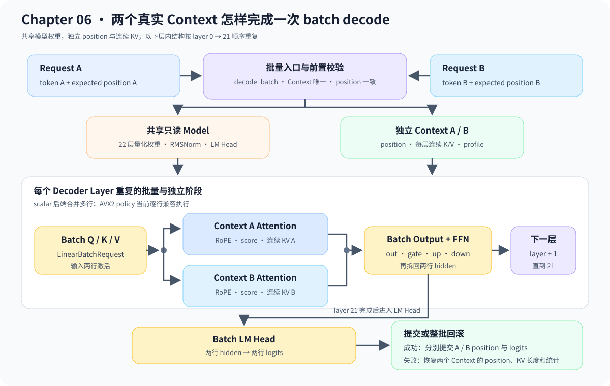

# 06.11 合并真实模型批量计算

上一节得到当前 step 的请求集合，本节把它变成模型执行输入。目标不是把多个请求放进多个 CPU 线程，而是在共享一份只读权重的前提下合并 Linear 计算，同时保持每个请求的 Context、KV Cache 和输出归属独立。

实现入口是 <a href="../_code/model/src/real_llama_cpu_decoder.cpp"><code>real_llama_cpu_decoder.cpp</code></a> 和 <a href="../_code/engine/src/real_llama_executor_factory.cpp"><code>real_llama_executor_factory.cpp</code></a>。阅读时先跟踪 batch 输入怎样校验，再观察 22 层循环中共享了什么、隔离了什么。

## 从调度结果到模型输入

教学路径使用 `RaggedBatch.values` 保存连续值，`row_offsets` 标记不同长度请求的行边界。Embedding、位置编码和每个 DecoderLayer 都接收一次 batch 调用，Runtime 按 batch index 拆回 logits，再分别采样和提交状态。

真实模型路径使用 `ExecutorBatchInput` 保存各请求的 token、position、request ID 和下一 KV 写入槽。构建输入时要求 Context committed position 等于 BlockTable 已提交 token 数，并要求目标 slot 已预留但尚未提交。

```text
StepBatchPlan
    -> ExecutorBatchInput(tokens, positions, slots)
    -> RealLlamaCpuModel.decode_batch()
    -> split logits by request
```

| 能力 | 顺序路径 | 当前批量路径 |
| --- | --- | --- |
| 调度输入 | 每个请求保留独立 token、position 和 slot | 复用同一 step 选择结果组织执行批次 |
| Linear 激活 | 每个请求分别构造 | 多个输入行进入 `LinearBatchRequest` |
| Decoder 调用 | 一个 Context 跑完所有层 | 按 `layer -> context` 推进多个 Context |
| KV 数据 | 每个 Context 持有连续 K/V | 仍按请求独立，尚未接入 Paged KV payload |
| 输出 | 调用结果天然属于单个请求 | 按 request ID 拆分 logits 和状态 |

## 共享权重但不共享请求状态

`RealLlamaExecutorFactory::decode_batch()` 接收多个真实 Executor、token 和预期 position，拒绝重复 Context 或位置不一致的输入。`RealLlamaCpuModel::decode_batch()` 共享同一份只读权重，先取得各请求的 embedding，再逐层推进 22 个 Decoder Layer，最后分别产生 logits。

Q/K/V、Attention 输出、FFN gate/up/down 和 LM Head 已使用 `LinearBatchRequest`。Q4_K、Q6_K、Q8_0 scalar backend 在一次权重遍历中累加多个输入行；AVX2 policy 暂时逐行调用已有 SIMD kernel。任一请求失败时，所有参与 Context 的 position、连续 KV 长度和统计都会回滚。

## 正确性先于性能结论

测试比较顺序执行与 batch 执行的逐请求 logits、greedy token 和 Context position，并注入错误 position 检查全批回滚。固定双请求实验的配对加速比为 `0.8541x`，说明当前 scalar batch 比顺序路径慢，因此它只作为正确性路径，不作为默认性能优化。

实验条件与结果见 [`07.8 服务负载评测`](../chapter07_benchmark/08_service_workloads.md#scalar-batch-配对结果)。Chapter08 的分段计时已经把回退定位到 scalar batch kernel，而不是输入整理或输出拆分；下一步应实现专用 SIMD batch kernel，再以相同 workload 复测。


