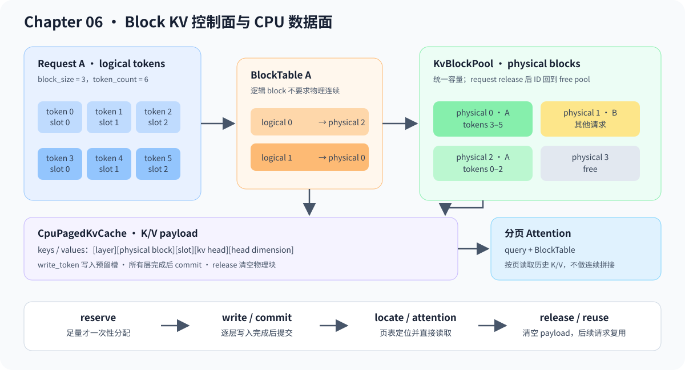

# 06.12 管理分块 KV Cache 的控制面与数据面

前两节已经区分“每步选择哪些请求”和“怎样合并模型计算”。本节继续处理资源定位：把逻辑 token 位置映射到可分配、可回收的物理 block ID。

<a href="../_code/chapter06_generation/src/serving_preview.cpp"><code>serving_preview.cpp</code></a> 实现 block 控制面，<a href="../_code/chapter06_generation/src/paged_kv_cache.cpp"><code>paged_kv_cache.cpp</code></a> 实现 CPU 教学数据面。两者已经能完成分页写读和参考 Attention，但尚未替换真实 TinyLlama Context 中的连续 K/V。

## Block Allocator 与三个对象

连续缓存最容易理解，但它会带来两个问题：

- 请求长度不同，连续分配容易产生浪费或搬迁
- Continuous Batching 需要请求动态进出，cache 必须能被更灵活地分配和释放

Block KV Cache 的思想是把 cache 分成固定大小的块。请求看到的是逻辑 token 序列，runtime 内部用 block table 找到每段 token 对应的物理块。

| 对象 | 作用 |
| --- | --- |
| `KvBlockPool` | 管理固定数量物理 block ID 的空闲、预留、提交和释放 |
| `BlockTable` | 保存一个请求的物理 block ID，并映射逻辑 token 位置 |
| `BlockLocation` | 返回 Attention 需要访问或下一次写入的 `physical block + slot` |



## Block metadata 与 KV payload

分页缓存同时包含控制面和数据面。控制面回答“请求分到了哪些 block”，数据面回答“每层、每个 KV head 的数值实际写在哪里，Attention 怎样读出来”。

`KvBlockPool` 和 `BlockTable` 保存物理 block ID、已提交 token 数和逻辑位置映射。`CpuPagedKvCache` 组合这套控制面，预分配独立的 key/value payload，并按 `layer -> physical block -> slot -> kv head -> head dimension` 寻址。一个 token 的所有层都写入后才能提交；请求释放时，对应物理块的数值和写入标记一起清空。

`CpuPagedKvCache::attention()` 根据请求页表直接读取离散 block，不先拼回连续数组。专项测试让三个 token 跨越两个 block，并使用 GQA query 同时计算连续参考和分页输出；逐元素一致后，再释放请求并让下一请求复用同一物理块。

| 组成 | CPU 教学实现 | 接入真实模型还需要什么 |
| --- | --- | --- |
| 物理 block ID | `KvBlockPool` 分配、回收和复用 | 继续复用 allocator |
| 请求页表 | `BlockTable` 映射逻辑 token 到 block/slot | 作为 Attention 输入 metadata |
| K/V 数值存储 | `CpuPagedKvCache` 持有固定容量分层 payload | RealLlama Context 改为引用共享 cache engine |
| 写入路径 | `write_token()` 根据预留 slot 写入 | Q/K/V projection 后直接写入该 slot |
| 读取路径 | CPU reference 按 block table 执行 GQA | Decoder Attention 使用相同 metadata |
| 请求释放 | 清空 payload，并把 block ID 归还 pool | ServiceCore 终态释放同时通知 cache engine |
| 正确性门槛 | 连续/分页 Attention 输出一致，复用无串扰 | TinyLlama logits、greedy token 与连续基线一致 |

## 分配、验证与 PagedAttention 衔接

`ContinuousBatchScheduler` 先根据 candidate 将要消费的 prompt chunk 或 decode token 计算目标容量，再调用 `reserve()`。申请成功后才执行模型；Request 的 `prefill_offset` 或 generated token 实际推进后调用 `commit_tokens()`，未推进则用 `trim_to_tokens()` 撤销多余 block。容量不足的 candidate 计入 `deferred_requests`，不会调用 executor。

`ServingCore` 持有可选的共享 pool。配置 pool 后使用 `dispatch_step()`；`release_completed()` 同时清理 Request cache、Executor/Context 和 block table。旧 `dispatch()` 用于无 block pool 的完整 round-robin 路径。

| 时机 | Pool 动作 | 可观察结果 |
| --- | --- | --- |
| prefill chunk / decode 前 | `reserve(request_id, target_tokens)` | 足量时增加本 step 所需 block；不足时零修改 |
| 模型推进成功 | `commit_tokens()` | token count 可用于 `locate()` |
| 模型未推进 | `trim_to_tokens()` | 撤销本 step 的未提交 block |
| terminal release | `release()` | block ID 回到 free pool，后续请求可复用 |

`locate()` 只允许读取已提交 token；`locate_reserved()` 可以在模型执行前定位已预留容量中的下一写入位置。`build_decode_executor_batch_input()` 只有在 Executor 的 `committed_tokens`、BlockTable 已提交 token 数和预留容量三者一致时，才输出 token、position 和 KV write slot。

BlockTable 提交的是模型已经消费并写入 K/V 的 token，不是 Request 已经采样出的全部 token。final prefill 后新采样的 token 是下一次 decode 的输入：执行前先为 `position = committed_tokens` 定位预留槽，模型成功写入后再提交该位置。

Paged Attention 接收 query、block table、有效 token 数和 physical KV pool，不需要先把离散 block 拼回一段连续缓存：

```text
request logical tokens -> block table -> physical KV blocks -> attention reads K/V
```

这条链路对应 vLLM/nano-vLLM 的 block manager、cache engine 和 attention metadata。教程当前完成了 CPU 教学 payload 与 Attention 输出对照；后续先把真实 TinyLlama 单请求切换为分页 K/V，验证 logits 和 greedy token，再接入 ServiceCore，最后考虑 CUDA kernel 和性能优化。
