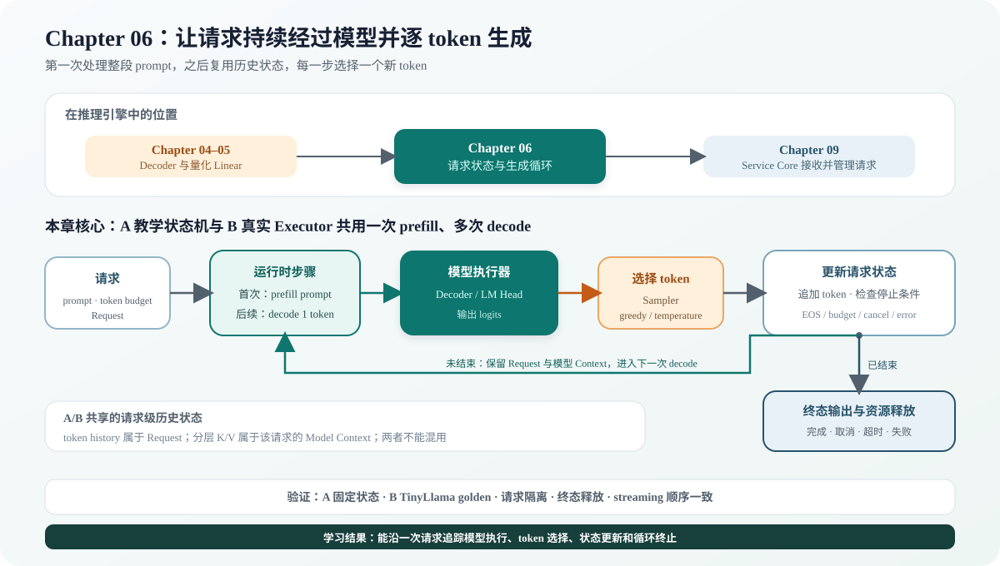

# 06.0 构建逐词元生成运行时

## 本章导读

Chapter 04 已经固定 Decoder 计算结构，Chapter 05 让真实低比特权重能够执行；[`05.8 模型执行接口交接`](../chapter05_quantization/08_quantization_in_serving_runtime.md#从-runtime-进入量化-decoder)说明 Runtime 怎样通过 Executor 调用这条路径。本章增加请求状态和循环控制，让模型先处理整段 prompt，再复用历史状态逐 token 生成，直到遇到 EOS、取消、错误或 token 上限。

| 本章实现 | 成熟系统继续增加 | 深入入口 |
| --- | --- | --- |
| Request、prefill/decode、Sampler、教学 Tensor batch、真实 scalar Linear batch、请求级缓存、调度 step 和终态释放 | 专用 SIMD/GPU batch kernel、抢占、优先级、PagedAttention、分布式执行和异步输出 | [`06.8 Runtime 框架对照`](./08_vllm_comparison.md) |

| 学习线 | 本章怎样学习 | 可验证产物 |
| --- | --- | --- |
| A 教学证据线 | 用确定性 Transformer、Request、Sampler 和 Scheduler 跑通 prefill/decode 状态机 | 固定 token、停止条件、Tensor batch 和 streaming 状态 |
| B 真实执行线 | 通过 Executor 接入 TinyLlama Context、真实 batch 和分页 K/V 教学数据面 | 22 层 greedy token、Context 隔离、batch 等价与分页 Attention 对照 |

| 本章新术语 | 先这样理解 | 首次解释 |
| --- | --- | --- |
| 请求（`Request`） | 保存 prompt、已生成 token、当前阶段和停止原因 | [`06.9 Request 生命周期`](./09_request_lifecycle.md) |
| 预填充（`prefill`） | 一次处理 prompt，并建立后续生成需要的历史状态 | [`06.3 Naive Generation`](./03_naive_generation.md) |
| 逐 token 解码（`decode`） | 复用已有历史，每一步只生成一个新 token | [`06.3 Naive Generation`](./03_naive_generation.md) |
| KV Cache | 保存 Attention 已计算的历史 key/value，避免每步重算全部 token | [`06.4 KV Cache`](./04_kv_cache.md) |
| 采样器（`Sampler`） | 从模型输出的 logits 中选择下一个 token | [`06.6 Sampler`](./06_sampler.md) |

学习 KV Cache 时按计算、数据和系统三层向下追踪。算子层先确认新 K/V 写在哪里、Attention 怎样读取历史；数据层再观察已缓存序列长度怎样从 `S` 增长到 `S+1`；系统层最后把逻辑位置映射到固定大小物理块。生产框架通常把三层连接在同一条 decode 路径上。本教程已经完成真实模型的连续 K/V，以及独立的 CPU 分页 payload 和参考 Attention；下一步是让真实 TinyLlama Context 使用分页数据面。

| 层次 | 核心问题 | 教程入口 | 当前可验证产物 |
| --- | --- | --- | --- |
| 算子层 | 当前 token 的 K/V 怎样写入，query 怎样读取全部历史 | [`04.1 多头注意力`](../chapter04_attention/01_multihead_attention.md)、[`06.4 KV Cache`](./04_kv_cache.md) | 连续 Attention 与 CPU 分页参考 Attention 输出一致 |
| 数据层 | `Seq_Len` 怎样在 prefill/decode 中从 `S` 增长到 `S+1` | [`06.3 逐词元生成`](./03_naive_generation.md)、[`06.4 KV Cache`](./04_kv_cache.md) | Context position、分页 payload 和 BlockTable token count |
| 系统层 | 不同长度请求怎样分块、定位、回收并减少连续分配压力 | [`06.10 连续批处理`](./10_continuous_batching.md)、[`06.12 分块 KV Cache`](./12_block_kv_cache.md) | 预留、逐层写入、提交、回滚、清空与 block 复用 |



## 开始学习

先运行本章默认入口：

```bash
bash code/chapter06_generation/scripts/run.sh
```

脚本依次运行 `chapter06_generation_demo`、CTest 和 `chapter06_streaming_demo`。第一个程序应输出 `ready: true`、`prefills: 3`、`generated steps: 2`、`request cache size: 5` 和 `request phase: finished`；streaming 程序应按顺序写出两个请求的生成 token。

| 顺序 | 路线 | 页面 | 先看源码 | 读完后应看到什么 |
| --- | --- | --- | --- | --- |
| 1 | A/B 公共 | [`06.1 输入表示`](./01_embedding_and_position.md)、[`06.2 多层模型组装`](./02_transformer_assembly.md)、[`06.3 逐词元生成`](./03_naive_generation.md) | <a href="../_code/chapter06_generation/src/runtime.cpp"><code>runtime.cpp</code></a> | 一个请求完成 `prefill -> decode -> output` |
| 2 | A | [`06.9 Request 生命周期`](./09_request_lifecycle.md)、[`06.6 Sampler`](./06_sampler.md) | <a href="../_code/chapter06_generation/src/request.cpp"><code>request.cpp</code></a>、<a href="../_code/chapter06_generation/src/sampler.cpp"><code>sampler.cpp</code></a> | 请求何时可以推进、何时终止，以及 logits 怎样变成下一个 token |
| 3 | A | [`06.5 Scheduler`](./05_scheduler.md) | <a href="../_code/chapter06_generation/src/scheduler.cpp"><code>scheduler.cpp</code></a> | 多个请求怎样按固定轮转顺序进入 Runtime |
| 4 | A→B | [`06.4 KV Cache`](./04_kv_cache.md) | <a href="../_code/chapter06_generation/src/kv_cache.cpp"><code>kv_cache.cpp</code></a>、<a href="../_code/model/include/cpp_llm_engine/model/real_llama_cpu_decoder.h"><code>real_llama_cpu_decoder.h</code></a> | token 历史、连续模型 K/V 和 BlockTable 分别保存什么 |
| 5 | A/B 验证 | [`06.7 End-to-End Generation`](./07_end_to_end_generation.md) | <a href="../_code/chapter06_generation/tests/chapter06_generation_test.cpp"><code>chapter06_generation_test.cpp</code></a> | 多请求隔离、EOS/token budget 和 streaming 输出可测试 |
| 6 | B | [`06.10 连续批处理`](./10_continuous_batching.md)、[`06.11 真实模型批量执行`](./11_real_model_batch.md)、[`06.12 分块 KV Cache`](./12_block_kv_cache.md) | <a href="../_code/chapter06_generation/tests/continuous_batch_scheduler_test.cpp"><code>continuous_batch_scheduler_test.cpp</code></a>、<a href="../_code/chapter06_generation/tests/chunked_prefill_test.cpp"><code>chunked_prefill_test.cpp</code></a>、<a href="../_code/chapter06_generation/src/paged_kv_cache.cpp"><code>paged_kv_cache.cpp</code></a> | 动态 step、批量计算与 block 数据面怎样协作 |
| 7 | A/B 对照 | [`06.8 Runtime 框架对照`](./08_vllm_comparison.md) | [框架项目卡](../reference/ecosystem/README.md) | 教学对象怎样映射到成熟框架的调度器、执行器和缓存管理器 |

## 验证与下一步

本章留下了可持续推进并能释放资源的 Generation Runtime；[`Chapter 07`](../chapter07_benchmark/intro.md) 将固定输入、正确性和运行条件，比较延迟、吞吐与资源成本。

| 验收层级 | 执行入口 | 通过条件 | 本章要求 |
| --- | --- | --- | --- |
| L1 默认 CPU | `bash code/chapter06_generation/scripts/run.sh` | prefill/decode、教学 Tensor batch、CPU 分页 K/V、预算、失败终态、多请求隔离和 streaming 通过 CTest | 必做 |
| L2 真实模型 | `bash scripts/run_real_decoder_learning.sh`；真实 batch 见 Engine CTest | TinyLlama 固定生成通过；双请求分层 batch 与顺序 logits/golden 一致，错误 position 不改变状态 | 有模型时必做 |
| L3 可选 CUDA | 暂无完整 CUDA Runtime 入口 | 已有 CUDA Decoder 单算子和单层测试，不代表请求调度、Tensor batch 与 GPU KV 数据面完成 | 尚未完成 |
