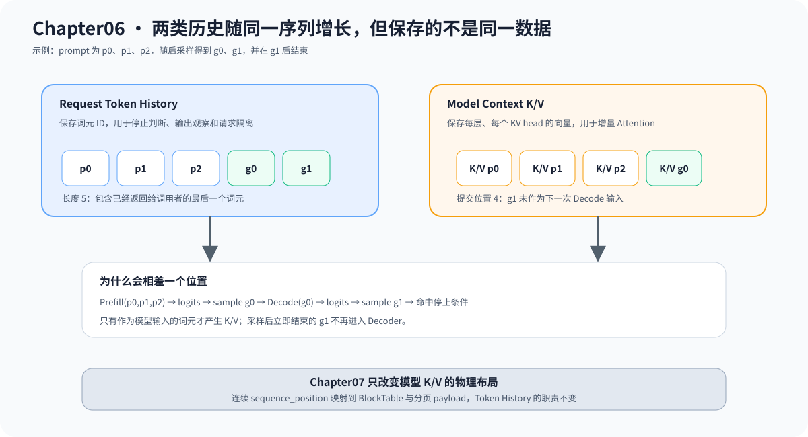

# 06.6 区分词元历史与模型 K/V

逐词元生成需要回看历史，但代码中有两类不同数据。请求的词元历史保存词元 ID，便于观察控制流；真实模型 Context 保存每层 Attention 的 K/V，避免 Decode 时重新计算全部历史。它们随序列一起增长，却不能互相替代。

## 两类历史数据

| 对象 | 保存内容 | 主要用途 | 当前所有者 |
| --- | --- | --- | --- |
| `Request::history()` | prompt 和已生成词元 ID | 检查历史长度与请求隔离 | `Request` |
| `RequestModelExecutor` Context | 每层、每个 KV head 的向量 | 增量 Attention | 请求专属执行器 |

词元历史实现位于 <a href="https://github.com/datawhalechina/cpp-llm-engine/blob/main/code/chapter06_generation/include/chapter06_generation/token_history.h"><code>token_history.h</code></a>。真实执行器通过 `execution_state()` 暴露已提交词元数、K/V 层数以及是否保存实际 K/V 值；物理存储布局从 Chapter07 开始引入。

## Decode 时长度怎样增长

假设 prompt 有三个词元，最多生成两个词元：

| 时刻 | 已返回给调用者的词元 | 模型已提交位置 | 教学词元历史 |
| --- | --- | --- | --- |
| Prefill 前 | 0 | 0 | 0 |
| Prefill 并采样 `g0` 后 | 1 | 3 | `[p0,p1,p2,g0]` |
| Decode `g0` 并采样 `g1` 后 | 2 | 4 | `[p0,p1,p2,g0,g1]` |
| 因长度上限结束 | 2 | 4 | 保持不变 |

最后一个输出词元不一定进入模型 Context：如果采样后已经命中停止条件，就没有下一次 Decode。模型已提交位置因此对应“已经参与模型计算的输入”，不是“调用者已经收到的全部词元”。

下图用同一个序列对齐两类数据。`g1` 已进入请求历史，但停止条件使它不再作为下一次 Decode 输入，因此模型 Context 中没有对应的 K/V。



连续 K/V 的逻辑 shape 可以写为：

```text
[layer, kv_head, sequence_position, head_dimension]
```

每次 Decode 只增加一个 `sequence_position`。Chapter07 会把相同逻辑位置映射到 BlockTable 和分页 payload；页面、物理槽位与回收策略不属于 Generation Core。

因此本章只固定两项请求级所有权：Request 管理词元与终态，模型 Context 管理每层数值状态。Chapter07 再让 BlockTable 管理逻辑位置到物理块的引用，Chapter10 负责在请求终止时分别释放执行器和缓存资源。

## 验证增长语义

默认 Generation 测试检查三个 prompt 加三个输出后，教学词元历史长度为六。真实模型执行状态可通过 `code/engine` 的执行器测试观察：

```bash
cmake -S code/engine -B /tmp/cpp-llm-engine-contract \
  -DCMAKE_BUILD_TYPE=Release
cmake --build /tmp/cpp-llm-engine-contract \
  --target embedding_request_executor_test -j2
ctest --test-dir /tmp/cpp-llm-engine-contract \
  -R '^embedding_request_executor_test$' --output-on-failure
```

该测试用三个预计算 embedding 完成 Prefill，生成两个词元，只执行一次 Decode；最终模型 Context 提交四个位置。通过后即可把“序列怎样增长”与“物理缓存怎样分页”分开学习。
