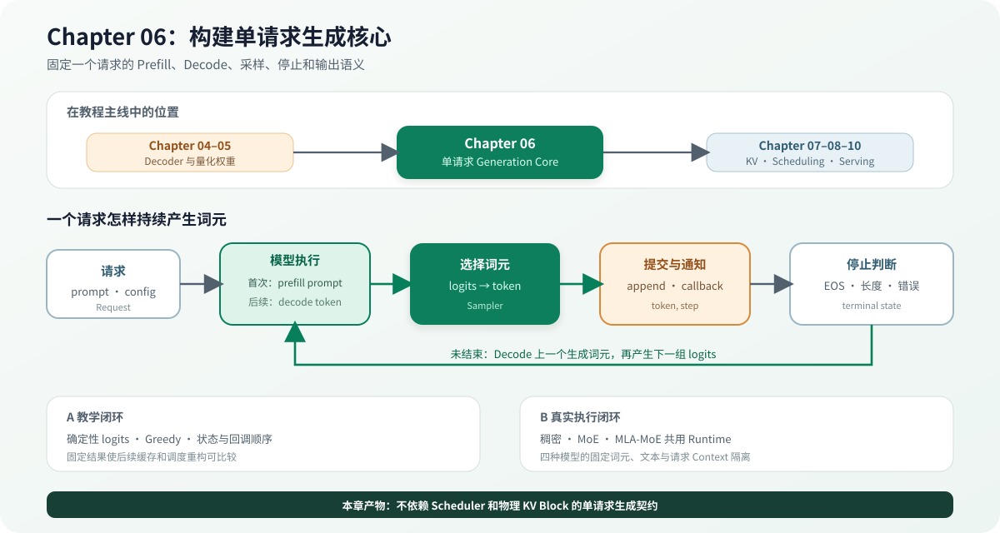

# 06.0 构建单请求生成核心

## 本章导读

Chapter04 已经固定 Decoder 的计算顺序，Chapter05 让真实量化权重能够进入 Linear。本章把一次模型前向扩展为单请求生成循环：先用 Prefill 处理 prompt，再逐词元 Decode，经过采样、停止判断和回调得到可观察输出。Chapter07 在这组语义下管理模型 K/V，Chapter08 再选择多个请求怎样共享执行机会。

| 学习线 | 本章怎样学习 | 可验证产物 |
| --- | --- | --- |
| A 教学闭环 | 用小词表、确定性 logits 和 Greedy 跟踪请求状态 | 固定 token、阶段、停止条件和回调顺序 |
| B 真实执行闭环 | 接入 TinyLlama、Qwen3、Qwen1.5-MoE 和 DeepSeek-V2-Lite 的 Tokenizer、完整 Decoder 和请求专属模型执行上下文 | 稠密、标准 MoE 与 MLA-MoE 架构的固定生成词元、文本结果和请求状态 |
| G GPU 扩展坐标 | 保持 Request 和停止语义不变，将模型执行器替换为设备后端 | TinyLlama、Qwen3 已完成真实文本闭环；DeepSeek 已接入固定词元 Runtime |
| M 多模态扩展坐标 | 视觉 embedding 进入模型后复用 Decode、采样和终态语义 | 当前接口坐标，不作为本章可运行输入路径 |

| 本章新术语 | 先这样理解 | 首次解释 |
| --- | --- | --- |
| 预填充（`prefill`） | 一次处理 prompt，并建立后续 Decode 所需的模型状态 | [`06.2 Prefill 与 Decode`](./02_prefill_decode.md) |
| 逐词元解码（`decode`） | 每次提交一个新词元并产生下一组 logits | [`06.2 Prefill 与 Decode`](./02_prefill_decode.md) |
| 模型执行上下文（Context） | 保存或绑定一个请求的位置、分层 K/V 和后端状态 | [`06.1 请求状态与模型调用`](./01_request_contract.md) |
| 模型执行器（`RequestModelExecutor`） | 使用一个请求的 Context，回答 logits 是什么 | [`06.1 请求状态与模型调用`](./01_request_contract.md) |
| 执行器工厂（Factory） | 复用共享模型，并为请求创建执行器和 Context | [`06.1 请求状态与模型调用`](./01_request_contract.md) |
| 采样器（`Sampler`） | 从 logits 选择下一个词元 | [`06.5 采样与停止`](./05_sampling_stop.md) |

## 开始学习

先沿单请求的状态推进理解 Generation Core：请求保存可观察状态，模型执行器持有模型执行上下文，Runtime 组织 Prefill、Decode、采样、停止和回调。随后接入 TinyLlama、Qwen3、Qwen1.5-MoE 与 DeepSeek-V2-Lite，观察层数、注意力和 FFN 结构变化时控制流保持不变。

| 顺序 | 路线 | 页面 | 先看源码 | 读完后应看到什么 |
| --- | --- | --- | --- | --- |
| 1 | A/B 公共 | [`06.1 请求状态与模型调用`](./01_request_contract.md)–[`06.3 单请求循环`](./03_single_request_loop.md) | <a href="https://github.com/datawhalechina/cpp-llm-engine/blob/main/code/chapter06_generation/src/runtime.cpp"><code>runtime.cpp</code></a> | prompt 怎样经过 Prefill 和 Decode 产生输出 |
| 2 | A/B 公共 | [`06.4 请求状态`](./04_request_lifecycle.md) | <a href="https://github.com/datawhalechina/cpp-llm-engine/blob/main/code/chapter06_generation/src/request.cpp"><code>request.cpp</code></a> | 五种终态为什么不能再次推进 |
| 3 | A | [`06.5 采样与停止`](./05_sampling_stop.md) | <a href="https://github.com/datawhalechina/cpp-llm-engine/blob/main/code/chapter06_generation/src/sampler.cpp"><code>sampler.cpp</code></a> | 固定 logits 怎样得到固定词元并结束请求 |
| 4 | A/B 公共 | [`06.6 单请求 K/V 语义`](./06_single_request_kv_semantics.md) | <a href="https://github.com/datawhalechina/cpp-llm-engine/blob/main/code/chapter06_generation/include/chapter06_generation/model_executor.h"><code>model_executor.h</code></a> | 词元历史与模型分层 K/V 为什么不是同一对象 |
| 5 | A/B 公共 | [`06.7 流式与错误`](./07_streaming_errors.md) | <a href="https://github.com/datawhalechina/cpp-llm-engine/blob/main/code/chapter06_generation/src/runtime.cpp"><code>runtime.cpp</code></a> | 词元提交、回调和失败状态的先后顺序 |
| 6 | B | [`06.8 真实模型`](./08_real_tinyllama_generation.md)、[`06.9 框架对照`](./09_framework_comparison.md) | <a href="https://github.com/datawhalechina/cpp-llm-engine/blob/main/code/engine/examples/real_tinyllama_generation_smoke.cpp"><code>real_tinyllama_generation_smoke.cpp</code></a>、<a href="https://github.com/datawhalechina/cpp-llm-engine/blob/main/code/engine/src/real_deepseek2_executor_factory.cpp"><code>real_deepseek2_executor_factory.cpp</code></a> | 四种模型怎样复用同一生成控制流 |

## 验证与下一步

完成本章后，一个请求可以独立完成 Prefill、Decode、采样、停止和逐词元通知；后续章节可以改变 K/V 存储或请求选择，而不改变这组结果语义。

| 验收层级 | 执行入口 | 通过条件 | 本章要求 |
| --- | --- | --- | --- |
| L1 默认 CPU | `bash code/chapter06_generation/scripts/run_generation_core.sh` | 单请求生成、Greedy、终态和回调测试通过，示例输出 `request phase: finished` | 必做 |
| L2 真实模型 | `bash code/chapter06_generation/scripts/run_real_generation.sh` | token golden 和连续请求 Context 隔离通过 | 有模型时必做 |
| L2 可选 Qwen3 | `bash code/chapter06_generation/scripts/run_qwen3_generation.sh` | 自动识别 `qwen3`，固定 token golden 和连续请求 Context 隔离通过 | 扩展模型时执行 |
| L2 可选 Qwen1.5-MoE | `bash code/engine/scripts/run_qwen15_moe_generation.sh` | 24 层分层 K/V、Runtime 状态、真实 Tokenizer 和文本解码通过 | 学习 MoE 时执行 |
| L2 可选 DeepSeek-V2-Lite | `bash code/engine/scripts/run_deepseek_v2_lite_generation.sh` | 27 层压缩 MLA 历史、Runtime 状态、固定词元和文本解码通过 | 学习 MLA-MoE 时执行 |
| L3 可选 DeepSeek CUDA Model | `CUDA_HOME=/usr/local/cuda-12.8 bash code/engine/scripts/run_deepseek_v2_lite_cuda_model.sh` | 27 层、最终归一化与 LM Head 的 logits 和贪心词元匹配 CPU | 学习完整 CUDA 模型时选做 |
| L3 可选 DeepSeek CUDA Runtime | `CUDA_HOME=/usr/local/cuda-12.8 bash code/engine/scripts/run_deepseek_v2_lite_cuda_runtime.sh` | 固定生成词元、分块 Prefill、27 层状态和重复请求隔离通过 | 学习 MLA-MoE GPU 生成时选做 |
| L3 可选 CUDA | `bash code/engine/scripts/run_real_cuda_generation.sh` | `Hello TinyLlama` 生成 CPU/CUDA 相同的四个 golden token，重复请求结果一致 | 有 NVIDIA GPU、模型和 llama.cpp 时选做 |
| L3 可选 Qwen3 CUDA | `bash code/engine/scripts/run_qwen3_cuda_generation.sh` | 自动读取 28 层架构，真实 Tokenizer、四个 golden token 与重复请求隔离通过 | 完成 Qwen3 CUDA Runtime 后执行 |
