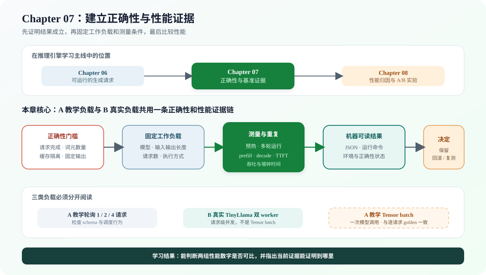

# 07.0 建立正确性与性能证据

## 本章导读

Chapter 06 已经能够推进一个或多个生成请求；本章固定输入、运行条件和结果格式，先检查请求是否正确完成，再记录预填充、逐词元解码、首词元延迟和吞吐。Chapter 08 将使用这些结果和事件轨迹定位耗时原因。

| 学习线 | 本章怎样学习 | 可验证产物 |
| --- | --- | --- |
| A 教学证据线 | 用确定性 Runtime 固定 workload、计时边界、JSON schema 和 round-robin/Tensor batch 对照 | `1/2/4` 请求正确性、逐轮样本和可重复 baseline |
| B 真实执行线 | 在 TinyLlama Decoder 与 ServiceCore 上比较串行、请求并发和 scalar Linear batch | golden、Context 隔离、真实延迟、吞吐和 batch 配对结果 |

| 本章新术语 | 先这样理解 | 首次解释 |
| --- | --- | --- |
| 工作负载（workload） | 一组固定的模型、输入长度、输出长度和请求方式 | [`07.3 性能指标`](./03_benchmark_metrics.md) |
| 预热（warmup） | 正式计时前先运行若干次，减少首次运行开销的影响 | [`07.5 测量稳定性`](./05_optimization_tips.md) |
| 首词元延迟（TTFT） | 请求开始到第一个输出词元可用的时间 | [`07.3 性能指标`](./03_benchmark_metrics.md) |
| 基准结果（baseline） | 在固定条件下保存、供后续版本比较的一组结果 | [`07.4 可重复执行脚本`](./04_benchmark_script.md) |



## 开始学习

先运行本章默认入口：

```bash
bash code/chapter07_benchmark/scripts/run.sh
```

脚本会隔离构建 Chapter07，依次运行固定格式示例、Chapter06 Runtime 实测、Round-robin/Tensor batch 的 `1/2/4` 请求基准和 CTest。终端应出现六个场景的 `correctness=PASS`，结果写入 `code/chapter07_benchmark/results/chapter07_cpu_baseline.json`。

| 顺序 | 路线 | 页面 | 先看源码 | 读完后应看到什么 |
| --- | --- | --- | --- | --- |
| 1 | A/B 公共 | [`07.1 测试入口`](./01_test_harness_setup.md)、[`07.2 端到端正确性`](./02_e2e_correctness.md) | <a href="../_code/chapter07_benchmark/tests/chapter07_benchmark_test.cpp"><code>chapter07_benchmark_test.cpp</code></a> | 局部格式测试、Runtime 行为测试和真实模型对照分别证明什么 |
| 2 | A | [`07.3 性能指标`](./03_benchmark_metrics.md)、[`07.4 可重复执行脚本`](./04_benchmark_script.md) | <a href="../_code/chapter07_benchmark/examples/multi_request_benchmark.cpp"><code>multi_request_benchmark.cpp</code></a> | 指标起止点、固定负载和 JSON 字段怎样对应 |
| 3 | A/B 验证 | [`07.5 测量稳定性`](./05_optimization_tips.md)、[`07.6 结果解读`](./06_result_interpretation.md) | <a href="../_code/chapter07_benchmark/results/chapter07_cpu_baseline.json"><code>chapter07_cpu_baseline.json</code></a> | 怎样判断结果可比，并据此保留、回滚或继续实验 |
| 4 | B | [`07.7 成熟框架对照`](./07_framework_comparison.md)、[`07.8 服务负载评测`](./08_service_workloads.md) | <a href="../_code/engine/scripts/run_real_parallel_requests_ab.sh"><code>run_real_parallel_requests_ab.sh</code></a>、<a href="../_code/engine/scripts/run_real_batch_benchmark.sh"><code>run_real_batch_benchmark.sh</code></a> | 教学轮询、真实请求级并发与 Tensor batch 的差别 |

## 验证与下一步

| 证据层级 | 执行入口 | 通过条件 | 当前范围 |
| --- | --- | --- | --- |
| E1 结构与行为 | `bash code/chapter07_benchmark/scripts/run.sh` | CTest 通过，`1/2/4` 请求均完成且 `correctness=true` | 默认必做 |
| E2 真实模型 | `bash scripts/run_real_decoder_learning.sh` | TinyLlama 固定输入得到固定贪心词元，并通过逐层数值检查 | 有模型时必做 |
| E3 真实服务负载 | `bash code/engine/scripts/run_real_parallel_requests_ab.sh` | 串行与双 worker 均通过正确性和 Context 隔离检查 | CPU 并发选做 |
| E4 教学 Tensor batch | `bash code/chapter07_benchmark/scripts/run.sh` | 多请求进入一次教学 Transformer 批量调用，并与逐请求结果一致 | CPU 教学路径已实现 |
| E5 真实 scalar Linear batch | `bash code/engine/scripts/run_real_batch_benchmark.sh` | 两个真实 Context 合并量化 Linear，logits 与 golden 等于顺序路径，并输出配对耗时和 batch 分段计时 | 固定双请求结果为 `0.8541x`，当前只作为正确性路径 |

本章留下可复查的正确性状态、工作负载参数、阶段耗时和结果文件。进入 [`Chapter 08`](../chapter08_profiling/intro.md) 后，再用 profiling 和 A/B 实验解释性能差异来自哪里。
