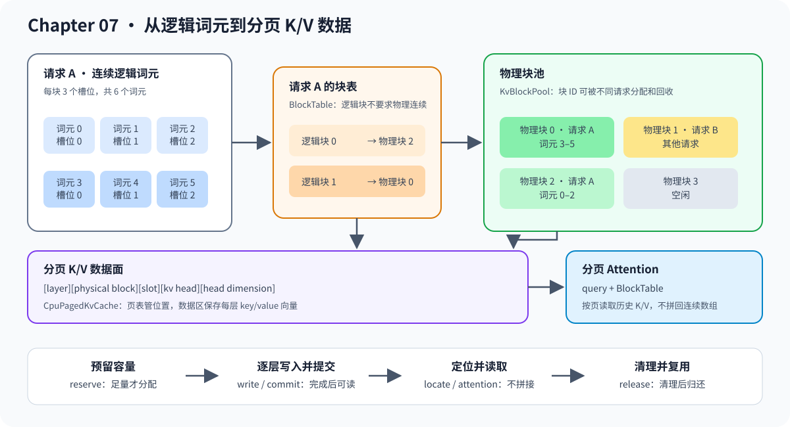

# 07.2 用块表映射物理内存

分页缓存把固定数量的词元组成一个物理块。请求仍使用从 0 开始的逻辑位置，块表负责把逻辑块转换为物理块；物理块不必连续。

## 逻辑位置怎样得到物理槽位

给定块大小 `block_size` 和逻辑位置 `token_index`，先计算逻辑块与块内槽位：

```text
logical_block = token_index / block_size
slot          = token_index % block_size
```

`BlockTable` 再把 `logical_block` 查成 `physical_block`。例如块大小为 3 时，逻辑位置 0、1、2 可以落在物理块 2，位置 3、4、5 可以落在物理块 0。请求看到的序列仍然连续，Attention 通过页表找到离散数据，不需要先拼接 K/V。

物理数据按 `[layer][physical_block][slot][kv_head][head_dimension]` 排列。`BlockTable` 和 `KvBlockPool` 只管理地址与所有权，不保存 K/V 数值。

| 对象 | 保存的信息 | 不保存的信息 |
| --- | --- | --- |
| `BlockTable` | 块大小、已提交词元数、物理块 ID | K/V 数值、请求优先级 |
| `KvBlockPool` | 物理块空闲状态、请求到页表的映射 | 每层 K/V、调度队列 |
| `BlockLocation` | 物理块 ID、块内槽位 | 层号、头号、向量值 |

## 预留容量不等于提交数据

块大小为 2 的请求预留 3 个词元时，需要两个物理块，容量为 4；但预留完成后 `token_count` 仍可为 0。`locate_reserved(2)` 能找到可写槽位，`locate(2)` 必须等第三个词元提交后才能读取。

`reserve` 先计算所需块数并检查总容量。容量不足时返回失败，原页表和空闲块计数保持不变；容量足够时才修改所有权。这使分配失败具备原子性。

| 场景 | 页表变化 | 空闲块变化 |
| --- | --- | --- |
| 已有容量足够 | 不变 | 不变 |
| 需要扩展且容量足够 | 追加物理块 | 减少 |
| 容量不足 | 不变 | 不变 |

## 地址转换图

下图先展示逻辑位置到物理槽位的转换，再展开最终 K/V 数据布局。



## 验证映射与分配

运行块池与分页缓存测试，检查跨块寻址、多请求隔离和分配失败原子性。

```bash
cmake -S code/chapter07_kv_cache -B /tmp/cpp-llm-chapter07-mapping \
  -DCMAKE_BUILD_TYPE=Release
cmake --build /tmp/cpp-llm-chapter07-mapping \
  --target chapter07_block_pool_test chapter07_paged_kv_cache_test -j2
ctest --test-dir /tmp/cpp-llm-chapter07-mapping \
  -R '^chapter07_(block_pool|paged_kv_cache)_test$' --output-on-failure
```
