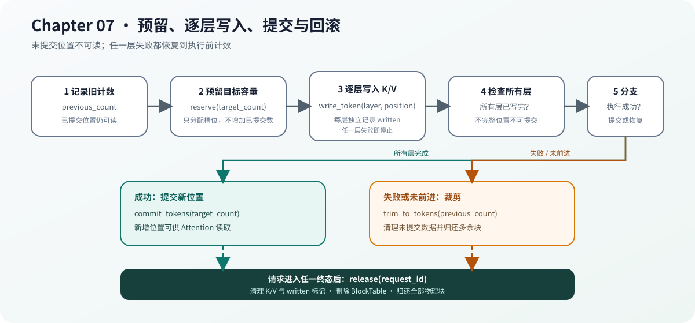

# 07.3 写入分页 K/V 并完成事务

页表只给出物理位置，`CpuPagedKvCache` 保存真正的 key 和 value。一次模型执行可能在任意层失败，因此物理槽位的预留、逐层写入、提交、裁剪和释放必须组成完整事务。

## 数据怎样进入分页槽位

写入操作接收请求、层号、逻辑词元位置和一行 K/V，经过页表定位后写入 `[layer, physical_block, slot, kv_head, head_dimension]`。`written_` 记录每个“层、物理块、槽位”是否写完，用于阻止不完整数据提交。

实现会拒绝越界层号、空指针、错误行宽、未预留位置以及覆盖已提交历史。源码见 <a href="/_code/chapter07_kv_cache/src/paged_kv_cache.cpp"><code>paged_kv_cache.cpp</code></a>。

| 动作 | 页表 | K/V 数据 | 写入标记 |
| --- | --- | --- | --- |
| `reserve` | 增加容量 | 保持初始值 | `false` |
| `write_token` | 不变 | 写入指定层和槽位 | 对应位置为 `true` |
| `commit_tokens` | 增加有效词元数 | 不变 | 保留 |
| `trim_to_tokens` | 裁剪映射和容量 | 清除被裁剪数据 | 清除被裁剪标记 |
| `release` | 删除请求页表 | 归还前清零 | 归还前清零 |

## 为什么要先预留、后提交

正常顺序是 `reserve -> write every layer -> commit`。执行失败时，调用者使用执行前记录的词元数调用 `trim_to_tokens(previous_count)`；请求结束或取消时调用 `release`。

`commit_tokens` 逐层检查写入标记，任一层缺失都拒绝提交。提交后的词元也不能原地覆盖，否则不同层或并发读取可能看到不一致历史。`trim_to_tokens` 与 `release` 都在物理块失去所有权前清理数据和标记，防止下一个请求读到旧 payload。

Chapter08 只依赖 `KvCacheTransaction`，不能直接修改页表。这样纯控制面的 `KvBlockPool` 和带真实数据面的 `CpuPagedKvCache` 都能保持各自正确的回收行为。

| 状态 | 推进时机 |
| --- | --- |
| 请求词元历史 | 请求接受新词元后 |
| 模型缓存计数 | 模型执行成功后 |
| `BlockTable` 已提交计数 | 所有层 K/V 写入成功后 |

## 缓存事务图

下图同时展示成功提交、失败裁剪和终态释放。



## 验证提交、回滚与复用

Chapter07 测试检查不完整写入不能提交、裁剪恢复容量和块复用无串扰；Chapter08 的跨章测试还会制造部分数据写入失败，确认调度器只能通过事务接口回滚。

```bash
cmake -S code/chapter07_kv_cache -B /tmp/cpp-llm-chapter07-transaction \
  -DCMAKE_BUILD_TYPE=Release
cmake --build /tmp/cpp-llm-chapter07-transaction \
  --target chapter07_block_pool_test chapter07_paged_kv_cache_test -j2
ctest --test-dir /tmp/cpp-llm-chapter07-transaction \
  -R '^chapter07_(block_pool|paged_kv_cache)_test$' --output-on-failure
```
