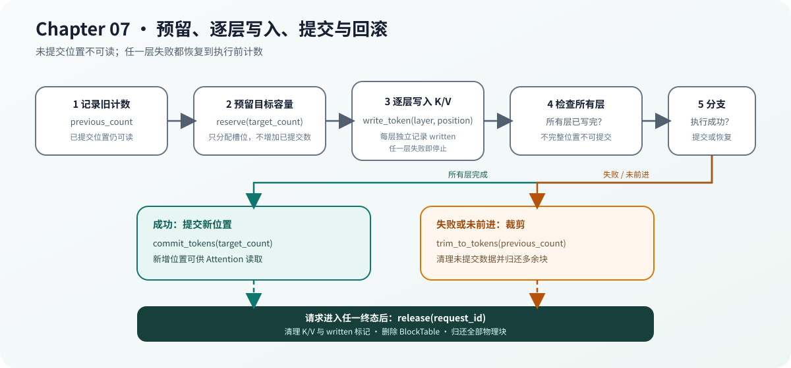

# 07.3 写入分页 K/V 并完成事务

页表只给出物理位置，`CpuPagedKvCache` 保存真正的 key 和 value。一次模型执行可能在任意层失败，因此物理槽位的预留、逐层写入、提交、裁剪和释放必须组成完整事务。

## 数据怎样进入分页槽位

写入操作接收请求、层号、逻辑词元位置和一行 K/V，经过页表定位后写入 `[layer, physical_block, slot, kv_head, head_dimension]`。`written_` 记录每个“层、物理块、槽位”是否写完，用于阻止不完整数据提交。

实现会拒绝越界层号、空指针、错误行宽、未预留位置以及覆盖已提交历史。源码见 <a href="https://github.com/datawhalechina/cpp-llm-engine/blob/main/code/chapter07_kv_cache/src/paged_kv_cache.cpp"><code>paged_kv_cache.cpp</code></a>。

| 动作 | 页表 | K/V 数据 | 写入标记 |
| --- | --- | --- | --- |
| `reserve` | 增加容量 | 保持初始值 | `false` |
| `write_token` | 不变 | 写入指定层和槽位 | 对应位置为 `true` |
| `commit_tokens` | 增加有效词元数 | 不变 | 保留 |
| `trim_to_tokens` | 裁剪映射和容量 | 清除被裁剪数据 | 清除被裁剪标记 |
| `release` | 删除请求页表 | 归还前清零 | 归还前清零 |

## 为什么要先预留、后提交

正常顺序是 `reserve -> write every layer -> commit`。执行失败时，调用者使用执行前记录的词元数调用 `trim_to_tokens(previous_count)`；请求结束或取消时调用 `release`。

`commit_tokens` 逐层检查写入标记，任一层缺失都拒绝提交。提交后的词元也不能原地覆盖，否则不同层或并发读取可能看到不一致历史。`trim_to_tokens` 与 `release` 都在物理块失去所有权前清理数据和标记，防止下一个请求读到旧载荷。

CUDA 清块是异步操作，提交清零命令不等于设备已经完成。`release_after_payload_cleanup()` 先清理所有最后引用块，再等待设备同步，最后才删除请求页表。清块或同步失败时，请求继续持有原物理块；调用者可以重试。由于失败前可能已有部分块完成清零，清块回调必须满足幂等性。

Chapter08 只依赖 `KvCacheTransaction`，不能直接修改页表。这样纯控制面的 `KvBlockPool` 和带真实数据面的 `CpuPagedKvCache` 都能保持各自正确的回收行为。

## MLA 为什么需要另一种分页载荷

标准 GQA 缓存按 `[layer, block, slot, kv_head, head_dimension]` 保存已经展开的 key 和 value。DeepSeek-V2-Lite 的 MLA 则保留压缩表示：每层每个词元保存一行 latent K/V 和一行经过 RoPE 的位置 key，Attention 使用时再完成投影。若把它提前展开成标准 K/V，分页仍能运行，但 MLA 节省缓存容量的意义会消失。

`CpuPagedMlaCache` 因此采用两块独立载荷：

| 载荷 | 物理形状 | 用途 |
| --- | --- | --- |
| latent K/V | `[layer, block, slot, latent_dimension]` | 保存内容相关的低秩状态 |
| RoPE key | `[layer, block, slot, rope_dimension]` | 保存位置相关的共享 key 分量 |

两种分页数据面只在槽位内容上不同。它们都把地址管理委托给 `KvBlockPool`，都要求每层写完后才能提交，也都在裁剪或释放后清除写入标记。这样 Chapter08 可以通过同一个 `KvCacheTransaction` 管理容量，而 Chapter04 的 GQA 或 MLA backend 分别解释物理块中的数值。

| 状态 | 推进时机 |
| --- | --- |
| 请求词元历史 | 请求接受新词元后 |
| 模型缓存计数 | 模型执行成功后 |
| `BlockTable` 已提交计数 | 所有层 K/V 写入成功后 |

## 缓存事务图

下图同时展示成功提交、失败裁剪和终态释放。



## 验证提交、回滚与复用

Chapter07 测试检查不完整写入不能提交、裁剪恢复容量、块复用无串扰，以及清块或设备同步失败后仍可重试释放；Chapter08 的跨章测试还会制造部分数据写入失败，确认调度器只能通过事务接口回滚。

```bash
cmake -S code/chapter07_kv_cache -B /tmp/cpp-llm-chapter07-transaction \
  -DCMAKE_BUILD_TYPE=Release
cmake --build /tmp/cpp-llm-chapter07-transaction \
  --target chapter07_block_pool_test chapter07_paged_kv_cache_test \
    chapter07_paged_mla_cache_test -j2
ctest --test-dir /tmp/cpp-llm-chapter07-transaction \
  -R '^chapter07_(block_pool|paged_kv_cache|paged_mla_cache)_test$' \
  --output-on-failure
```
