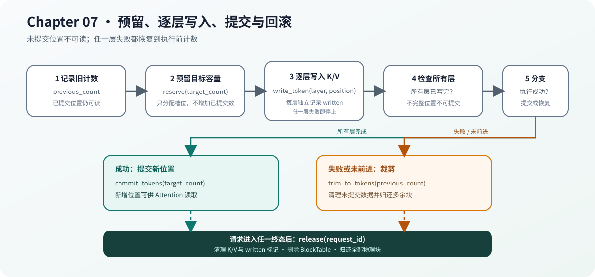

# 07.6 用缓存事务保护模型状态

一次 Decode 不应先永久占用物理块，再尝试模型计算。缓存操作需要与模型执行组成事务：先预留可写位置，所有层写入成功后提交；执行没有推进时，撤销本次新增容量。

## 五个动作组成什么顺序

```text
reserve
  -> write every layer
  -> commit

执行失败或没有推进
  -> trim_to_tokens(previous_count)

请求结束或取消
  -> release
```

| 动作 | 输入 | 成功后的保证 |
| --- | --- | --- |
| `reserve` | 目标总词元数 | 对应位置已有物理槽位，但不可读取 |
| `write_token` | 层、位置和 K/V | 指定层已经写完 |
| `commit_tokens` | 目标总词元数 | 新增位置的所有层均已写入，可以读取 |
| `trim_to_tokens` | 回退后的词元数 | 多余块归还，未提交数据被清理 |
| `release` | 请求 ID | 页表删除，全部物理块可安全复用 |

当前接口没有名为 `rollback` 的独立函数。回滚语义由 `trim_to_tokens(previous_count)` 实现：调用者在执行前记录已提交词元数，失败时恢复到该值。

## 为什么提交发生在所有层之后

一个词元要经过全部解码层。若第 0 层写入后就增加 `token_count`，Attention 可能读取到后续层尚未产生的 K/V。`CpuPagedKvCache::commit_tokens` 因此逐层检查写入标记，任一层缺失都拒绝提交。

提交后的词元不可原地覆盖。若允许覆盖，正在读取历史缓存的执行步骤会看到不一致数据，测试也无法区分“新结果”与“旧位置被修改”。

## 三份状态必须同步推进

多请求执行时需要核对三份计数：

| 状态 | 代表什么 | 推进时机 |
| --- | --- | --- |
| 请求词元历史 | 输入和已生成词元 | 请求接受新词元后 |
| 模型缓存计数 | 模型上下文已经处理的位置 | 模型执行成功后 |
| BlockTable 计数 | 已提交并允许读取的分页位置 | 所有层 K/V 写入成功后 |

Chapter08 的调度器只能编排这套事务，不能绕过 Chapter07 直接修改页表。服务取消请求时也必须最终调用 `release`，但网络生命周期属于 Chapter10。

下图把正常提交、失败裁剪和终态释放放入同一个事务边界。关键不是“最后能释放”，而是任一失败路径都能回到执行前的可读计数。



## 验证提交与回滚

```bash
cmake -S code/chapter07_kv_cache -B /tmp/cpp-llm-chapter07-transaction \
  -DCMAKE_BUILD_TYPE=Release
cmake --build /tmp/cpp-llm-chapter07-transaction \
  --target chapter07_block_pool_test \
           chapter07_paged_kv_cache_test -j2
ctest --test-dir /tmp/cpp-llm-chapter07-transaction \
  -R '^chapter07_(block_pool|paged_kv_cache)_test$' \
  --output-on-failure
```

Chapter07 专项测试验证预留失败不改变块所有权、裁剪后容量恢复，以及不完整的分层写入不能提交。请求历史、模型位置和页表计数的跨对象一致性由 Chapter08 的 `chapter08_cache_transaction_test` 和 `chapter08_step_scheduler_test` 验证。
