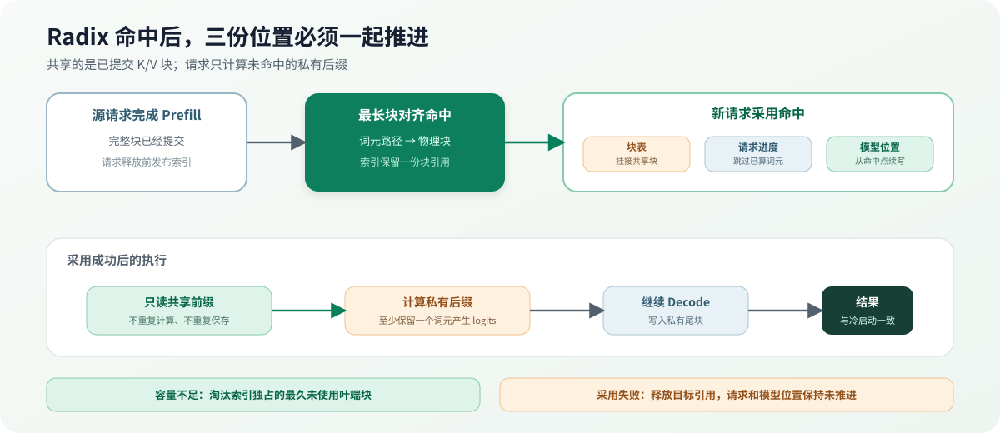

# 07.6 前缀复用与生产扩展

相同提示词（prompt）不需要为每个请求重复保存完整 K/V。`RadixPrefixCache` 按词元路径索引已提交的完整物理块，CPU 和 CUDA 请求命中后共享这些只读块，只为后续词元分配私有块。

## 前缀复用增加什么

两个请求拥有相同提示词时，独占缓存会重复计算并保存 K/V。前缀缓存为已计算的词元序列建立索引，让新请求引用只读前缀块，只计算未命中的后缀。

索引沿词元逐个匹配，只在块边界记录可共享结果。假设块大小为 4，命中 6 个词元时只能复用前 4 个；剩余 2 个仍需计算。这样不会让两个请求共享一个仍可能继续写入的半满块。

`KvBlockPool` 为每个物理块维护引用计数。Radix 索引持有一份引用，每个挂接的请求再持有一份。`PrefixBlockStore` 隔离索引与 payload：CPU 在最后一个引用释放后清理主机 K/V，CUDA 在降低最后一个引用前异步清理设备物理块。请求释放不会破坏索引或其他请求正在读取的共享前缀。

命中后必须同时推进三份状态：`BlockTable` 挂接共享物理块，`Request` 跳过已完成的 Prefill 词元，模型 `Context` 从同一位置继续写 K/V。只修改其中一份会造成位置错位，后续 Attention 会读取错误历史或重复计算前缀。

当前 CPU 与 CUDA Factory 都提供估算和采用两个入口。准入只遍历 Radix 路径，既不增加块引用，也不更新命中统计；请求获得运行槽时重新查询并采用真实前缀，在请求释放前发布可共享完整块。首版会保留至少一个未缓存的提示词词元：K/V payload 不保存最后一次前向传播产生的 logits，计算这个私有后缀才能得到首个生成词元。块池容量不足时，索引按最近使用时间从叶端后缀开始淘汰；仍被运行请求引用的块不会成为候选，较短的可达前缀也因此得以保留。Chapter08 只消费“命中多少词元”和“还需多少块”，不接管 K/V payload。

| 对象 | 当前状态 | 解决的问题 |
| --- | --- | --- |
| Radix 前缀索引 | 已实现 | 新请求与哪些完整 K/V 块匹配 |
| 共享引用计数 | 已实现 | 请求结束后物理块是否仍需保留 |
| 命中长度 | 已实现 | 新请求可从哪个块边界继续计算 |
| 活跃块保护 | CPU/CUDA 已实现 | 请求引用计数大于一时不参与索引淘汰 |
| 容量淘汰 | CPU/CUDA 已实现 | 容量不足时后缀优先回收最久未使用的叶端块 |
| 命中统计 | CPU/CUDA 已实现 | 记录查询、命中、未命中、匹配词元和淘汰块数 |
| 缓存感知排序 | 已实现 | 同优先级请求中优先选择更长命中 |
| 模型 Context 自动采用命中 | CPU/CUDA 已实现 | 同步块表、请求进度和模型位置，只计算私有后缀 |
| 两阶段估算与采用 | CPU/CUDA 已实现 | waiting 不固定共享块，提升运行时重新确认命中 |

## K/V Cache 量化改变什么

权重量化压缩长期只读参数，K/V Cache 量化压缩请求执行时不断增长的历史状态。Decoder 先计算当前 token 的 key/value，再在写入连续或分页缓存前量化；Attention 读取时可以先反量化，也可以由专用 kernel 直接消费低精度 K/V。

scale 可以按 Tensor、层、head、token 或 block 保存。粒度越细越能跟随不同请求和位置的数值范围，但 metadata、统计和寻址成本也更高。Key 会参与注意力分数，Value 会参与加权求和，两者的误差传播不同，因此不能只用缓存字节数判断方案是否可用。

当前 Chapter07 的 CPU/CUDA 连续与分页 payload 都保存浮点 K/V，Radix Cache 共享的也是浮点块。接入缓存量化时，需要同时修改 payload dtype、每块 scale metadata、写入事务、分页 Attention backend 和真实长上下文误差测试；BlockTable、引用计数和终态释放语义不应改变。

| 观察点 | 当前浮点 K/V | 量化 K/V 扩展 |
| --- | --- | --- |
| 写入 | 直接提交 K/V | 统计范围、量化并提交 scale 与整数 payload |
| 存储 | 浮点连续或分页块 | 低精度 payload 加量化 metadata |
| Attention 读取 | 直接参与 QK 与 Value 聚合 | 反量化后计算或低精度融合 kernel |
| 验证 | 连续/分页结果一致 | 内存、长上下文 logits、token 与吞吐共同验证 |
| 当前状态 | CPU/CUDA 已实现 | 原理介绍，代码未实现 |

## 教学对象怎样对应成熟系统

阅读框架源码时继续追踪三个问题：谁分配物理块，谁保存真实 K/V，Attention 怎样获得地址信息。CPU 与 GPU 可以使用不同数据布局和执行内核，但都要维护同一组请求所有权和提交语义。

| 教程对象 | 成熟系统中的方向 | 生产环境继续处理 |
| --- | --- | --- |
| `BlockTable` | 请求到物理 K/V 页的映射 | 设备元数据、批量更新、跨步持久化 |
| `KvBlockPool` | Cache manager / block allocator | 显存容量、抢占、交换、并发安全 |
| `CpuPagedKvCache` | Cache engine / Paged Attention 数据面 | GPU kernel、布局优化、多数据类型 |
| 连续与分页对照 | Reference / optimized backend | 数值误差、吞吐、回退策略 |
| `RadixPrefixCache` | Prefix / Radix Cache | 并发锁、批量更新和分层淘汰策略 |

## 继续阅读框架源码

llama.cpp 适合观察单机 Context 与真实模型 K/V；vLLM 适合追踪缓存管理、块表和 Attention metadata；Mini-SGLang 与 SGLang 展示 Radix 前缀复用和调度协作；TensorRT-LLM 展示 GPU K/V 与高性能 Attention kernel。Chapter08 接下来只通过 `KvCacheTransaction` 预留和回收资源，不直接读取 K/V 数值。

| 项目卡 | 重点追踪 |
| --- | --- |
| [llama.cpp](/reference/ecosystem/llama_cpp) | Context 怎样拥有并增长真实模型 K/V |
| [vLLM](/reference/ecosystem/vllm) | Cache manager、块表与 Attention metadata |
| [nano-vLLM](/reference/ecosystem/nano_vllm) | 紧凑代码中的页表与缓存分配骨架 |
| [Mini-SGLang](/reference/ecosystem/mini_sglang) | Radix Cache 的匹配、引用和释放 |
| [SGLang](/reference/ecosystem/sglang) | 前缀缓存、多级缓存与调度扩展 |
| [TensorRT-LLM](/reference/ecosystem/tensorrt_llm) | GPU K/V 与 Attention kernel 的工程入口 |
