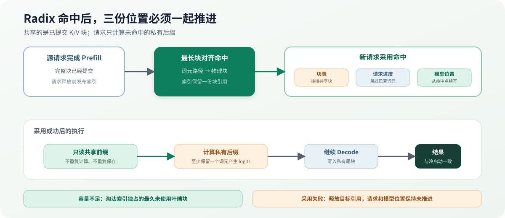

# 07.6 前缀复用与生产扩展

多个请求具有相同提示词（prompt）时，`RadixPrefixCache` 可以索引已经计算并提交的完整 K/V 块。CPU 和 CUDA 请求命中后引用这些只读块，只为未命中的后缀分配私有块和执行计算。

## 前缀复用增加什么

索引沿词元逐个匹配，只在块边界记录可共享结果。假设块大小为 4，命中 6 个词元时只能复用前 4 个；剩余 2 个仍需计算。这样不会让两个请求共享一个仍可能继续写入的半满块。

`KvBlockPool` 为每个物理块维护引用计数。Radix 索引持有一份引用，每个挂接的请求再持有一份。`PrefixBlockStore` 隔离索引与 payload：CPU 在最后一个引用释放后清理主机 K/V，CUDA 在降低最后一个引用前异步清理设备物理块。请求释放不会破坏索引或其他请求正在读取的共享前缀。

因此请求结束后仍有物理块占用不一定是泄漏：先检查请求引用是否已归还，再检查 Radix 索引是否为了后续复用持有独立引用。只有没有任何所有者却仍无法回收，才属于资源释放错误。

命中后必须同时推进三份状态：`BlockTable` 挂接共享物理块，`Request` 跳过已完成的 Prefill 词元，模型 `Context` 从同一位置继续写 K/V。只修改其中一份会造成位置错位，后续 Attention 会读取错误历史或重复计算前缀。

CPU 与 CUDA 执行器工厂都提供“估算”和“采用”两个入口。准入阶段遍历 Radix 路径并估算收益；请求获得运行槽时重新查询、增加块引用并采用真实前缀，在释放前发布可共享完整块。实现保留至少一个私有提示词词元，因为 K/V 载荷不保存最后一次前向传播产生的候选分数；执行这个后缀才能得到首个生成词元。块池容量不足时，索引按最近使用时间从叶端后缀开始淘汰；运行请求仍在引用的块受到保护，较短的可达前缀也得以保留。Chapter08 消费“命中多少词元”和“还需多少块”，K/V 数值仍由缓存数据面管理。

| 对象 | 已验证路径 | 解决的问题 |
| --- | --- | --- |
| Radix 前缀索引 | 已实现 | 新请求与哪些完整 K/V 块匹配 |
| 共享引用计数 | 已实现 | 请求结束后物理块是否仍需保留 |
| 命中长度 | 已实现 | 新请求可从哪个块边界继续计算 |
| 活跃块保护 | CPU/CUDA 已实现 | 请求引用计数大于一时不参与索引淘汰 |
| 容量淘汰 | CPU/CUDA 已实现 | 容量不足时后缀优先回收最久未使用的叶端块 |
| 命中统计 | CPU/CUDA 已实现 | 记录查询、命中、未命中、匹配词元和淘汰块数 |
| 缓存感知排序 | 已实现 | 同优先级请求中优先选择更长命中 |
| 模型 Context 自动采用命中 | CPU/CUDA 已实现 | 同步块表、请求进度和模型位置，只计算私有后缀 |
| 两阶段估算与采用 | CPU/CUDA 已实现 | waiting 不固定共享块，提升运行时重新确认命中 |

## K/V Cache 量化改变什么

权重量化压缩长期只读参数，K/V Cache 量化压缩请求执行时不断增长的历史状态。Decoder 先计算当前 token 的 key/value，再在写入连续或分页缓存前量化；Attention 读取时可以先反量化，也可以由专用 kernel 直接消费低精度 K/V。

scale 可以按 Tensor、层、head、token 或 block 保存。粒度越细越能跟随不同请求和位置的数值范围，但 metadata、统计和寻址成本也更高。Key 会参与注意力分数，Value 会参与加权求和，两者的误差传播不同，因此不能只用缓存字节数判断方案是否可用。

本章的 CPU/CUDA 连续与分页载荷保存浮点 K/V，Radix 前缀缓存共享同样的浮点块。缓存量化需要增加载荷数据类型、每块缩放因子元数据、写入事务、分页注意力后端和真实长上下文误差测试；块表、引用计数和终态释放继续沿用现有语义。

| 观察点 | 当前浮点 K/V | 量化 K/V 扩展 |
| --- | --- | --- |
| 写入 | 直接提交 K/V | 统计范围、量化并提交 scale 与整数 payload |
| 存储 | 浮点连续或分页块 | 低精度 payload 加量化 metadata |
| Attention 读取 | 直接参与 QK 与 Value 聚合 | 反量化后计算或低精度融合 kernel |
| 验证 | 连续/分页结果一致 | 内存、长上下文 logits、token 与吞吐共同验证 |
| 教程入口 | CPU/CUDA 可运行实现 | 原理与扩展设计 |

## 框架对照与继续阅读

阅读框架源码时沿着三个问题追踪：谁分配物理块，谁保存真实 K/V，Attention 怎样获得地址信息。CPU 与 GPU 可以使用不同数据布局和执行内核，但都要维护相同的请求所有权和提交语义。

| 教程对象 | 项目入口 | 重点追踪 |
| --- | --- | --- |
| 连续 K/V 与请求 Context | [llama.cpp](/reference/ecosystem/local_and_delivery#llama-cpp) | 单机 Context 怎样拥有并增长真实模型 K/V |
| `BlockTable`、`KvBlockPool` | [vLLM](/reference/ecosystem/production_frameworks#vllm) | Cache manager 怎样分配物理块并把地址元数据交给 Attention |
| 分页缓存最小骨架 | [nano-vLLM](/reference/ecosystem/teaching_projects#nano-vllm) | 页表、缓存分配和模型执行怎样传递状态 |
| `RadixPrefixCache` | [Mini-SGLang](/reference/ecosystem/teaching_projects#mini-sglang)、[SGLang](/reference/ecosystem/production_frameworks#sglang) | 前缀匹配、引用、释放、淘汰和缓存感知调度怎样协作 |
| CUDA 分页载荷与 Attention | [TensorRT-LLM](/reference/ecosystem/production_frameworks#tensorrt-llm) | 设备布局、K/V 数据类型和高性能 Attention kernel 怎样连接 |

Chapter08 接下来通过 `KvCacheTransaction` 预留和回收资源，K/V 数值继续由本章的数据面管理。
