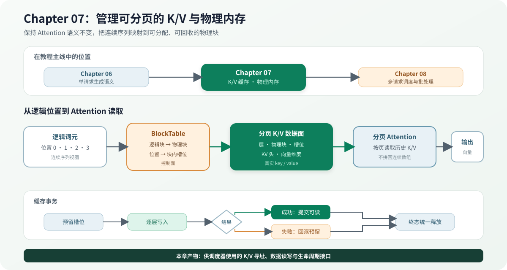

# 07.0 管理可分页的 K/V 与物理内存

## 本章导读

Chapter06 已经固定单请求的 Prefill、Decode 和停止语义。本章接管模型执行产生的 K/V：先用连续缓存建立数值基线，再把逻辑词元位置映射到固定大小物理块，完成分页读写、提交、回滚和释放。Chapter08 只通过这些资源接口安排多请求，不直接拥有 K/V 数据。

| 学习重点 | 本章怎样学习 | 完成后检查什么 |
| --- | --- | --- |
| A 缓存布局 | 用小尺寸连续 K/V 建立基线，再跟踪块表、物理槽位和分页 Attention | 跨块读写正确，连续与分页输出一致，释放后的块可以安全复用 |
| B 真实 CPU | 把 TinyLlama 的 22 层 K/V 接入同一分页事务 | 固定 token、连续/分页 logits 一致、失败回滚和终态释放 |
| G GPU 扩展 | 保留块表和提交规则，把 CPU 分页 Attention 替换为设备计算核 | CUDA 多词元分页预填充、Radix Context 采用和双请求解码批次 |
| M 多模态扩展 | 视觉 embedding 汇入语言 Decoder 后复用同一 K/V 生命周期 | 图文请求进入语言模型后复用同一套 K/V 管理 |

| 本章新术语 | 先这样理解 | 首次解释 |
| --- | --- | --- |
| 块表（`BlockTable`） | 保存一个请求的逻辑块到物理块映射 | [`07.2 块表与物理内存`](./02_block_mapping.md) |
| KV 块池（`KvBlockPool`） | 分配和回收固定大小物理块 | [`07.2 块表与物理内存`](./02_block_mapping.md) |
| 分页 K/V 数据面 | 按层、物理块和槽位保存真实 key/value | [`07.3 分页 K/V 事务`](./03_paged_transaction.md) |
| 分页 MLA 数据面 | 按层和物理槽位保存压缩 latent K/V 与 RoPE key | [`07.3 分页 K/V 事务`](./03_paged_transaction.md) |
| 分页注意力 | 根据块表直接读取离散 K/V 的 Attention | [`07.4 分页 Attention`](./04_paged_attention.md) |
| Radix 前缀缓存 | 按词元路径找到最长的完整 K/V 块前缀 | [`07.6 生产扩展`](./06_production_extensions.md) |
| K/V Cache 量化 | 用低精度载荷和缩放因子元数据保存请求历史 | [`07.6 生产扩展`](./06_production_extensions.md) |



本章在完整请求生命周期中的位置见 [Chapter06–10 跨章协作图](../../chapter06_generation/next/intro.md#跨章协作)。

## 当前缓存分成哪些层次

| 层次 | 负责什么 | 当前状态 |
| --- | --- | --- |
| 连续 K/V 基线 | 在单请求 Context 中按位置保存历史，提供数值参考 | CPU 已实现 |
| 地址控制面 | 用 `BlockTable`、`KvBlockPool` 管理逻辑位置、物理块和引用计数 | CPU/CUDA 使用相同规则 |
| 事务层 | 统一预留、逐层写入、提交、裁剪和终态释放 | 标准 K/V 与 MLA 已实现 |
| 分页数据面 | 分别保存标准 GQA K/V，或 MLA latent K/V 与 RoPE key | CPU 组件与 CUDA 路径已实现 |
| 前缀复用层 | 用 Radix 索引共享完整物理块，并保护活跃请求引用 | 当前接入 TinyLlama 标准 GQA 路径 |
| 低精度扩展 | 为 K/V 载荷增加量化数据与缩放因子元数据 | 原理与接口规划，尚未实现 |

这些层次描述缓存系统的不同职责。连续与分页是数据布局，标准 GQA 与 MLA 是载荷形状，Radix 是建立在分页块之上的跨请求前缀索引；Chapter08 和 Chapter10 再使用事务接口完成调度、准入与终态回收。

## 开始学习

| 顺序 | 路线 | 页面 | 先看源码 | 读完后应看到什么 |
| --- | --- | --- | --- | --- |
| 1 | A | [`07.1 K/V 形状与连续缓存`](./01_kv_baseline.md) | Chapter04 `kv_cache.cpp` | Attention 保存什么，连续基线怎样寻址 |
| 2 | A | [`07.2 块表与物理内存`](./02_block_mapping.md) | <a href="https://github.com/datawhalechina/cpp-llm-engine/blob/main/code/chapter07_kv_cache/src/block_table.cpp"><code>block_table.cpp</code></a> | 逻辑词元怎样获得物理槽位 |
| 3 | A | [`07.3 分页 K/V 事务`](./03_paged_transaction.md) | `paged_kv_cache.cpp`、`paged_mla_cache.cpp` | 两种 Attention 历史怎样共享写入、提交、回滚和释放语义 |
| 4 | A | [`07.4 分页 Attention`](./04_paged_attention.md) | <a href="https://github.com/datawhalechina/cpp-llm-engine/blob/main/code/chapter07_kv_cache/tests/paged_kv_cache_test.cpp"><code>paged_kv_cache_test.cpp</code></a> | 离散物理块为什么仍得到连续基线结果 |
| 5 | B | [`07.5 真实模型迁移`](./05_real_model_migration.md) | `code/engine` 真实模型入口 | 真实 Decoder 怎样绑定分页数据面并保持连续路径结果 |
| 6 | 扩展 | [`07.6 前缀复用与生产扩展`](./06_production_extensions.md) | `radix_prefix_cache.cpp`、生态卡 | CPU/CUDA 怎样共享前缀，K/V 量化怎样沿用块表和提交规则 |

## 验证与下一步

完成本章后，学习者可以分别检查 K/V 的逻辑形状、物理位置、数据写入和释放过程。Chapter08 只调用缓存事务来组织多请求，不需要改动分页数据的读写方式。

先运行无需模型的 Chapter07 入口：

```bash
bash code/chapter07_kv_cache/scripts/run.sh
```

| 验收层级 | 执行入口 | 通过条件 | 本章要求 |
| --- | --- | --- | --- |
| L1 连续基线 | `bash code/chapter04_attention/scripts/run.sh`（其中的 `chapter04_attention_test`） | 追加、容量与 Attention 读取通过 | 必做 |
| L2 CPU 分页 | `bash code/chapter07_kv_cache/scripts/run.sh` | 分配失败无泄漏、事务一致、跨块输出等价、前缀共享与释放无串扰 | 必做 |
| L3 真实模型分页 | `bash code/chapter07_kv_cache/scripts/run_real_paged_kv.sh` | TinyLlama 22 层 logits、固定 token、失败回滚、连续路径一致和终态释放 | 有模型时必做 |
| L4 CUDA 分页执行 | `bash code/engine/scripts/run_real_cuda_runtime.sh` | 多 Token Prefill、后续 Decode、Radix 命中和冷启动 token 一致 | 有 NVIDIA GPU 时选做 |
| L5 DeepSeek 分页 MLA | `bash code/engine/scripts/run_deepseek_v2_lite_cuda_runtime.sh` | 27 层连续/分页 logits、双请求批提交和终态块归零 | 有对应模型和 NVIDIA GPU 时选做 |
