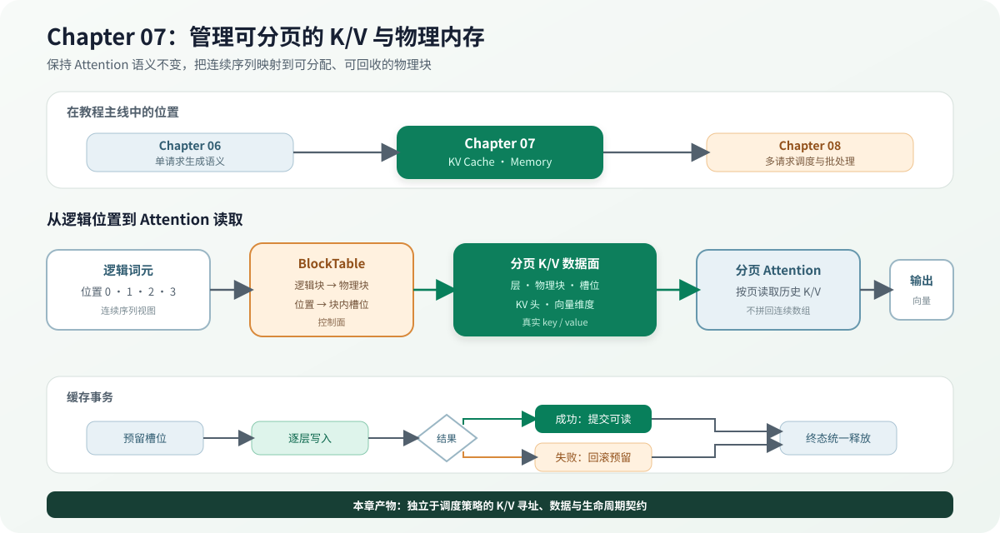

# 07.0 管理可分页的 K/V 与物理内存

## 本章导读

Chapter06 已经固定单请求的 Prefill、Decode 和停止语义。本章接管模型执行产生的 K/V：先用连续缓存建立数值基线，再把逻辑词元位置映射到固定大小物理块，完成分页读写、提交、回滚和释放。Chapter08 只通过这些资源接口安排多请求，不直接拥有 K/V 数据。

| 学习线 | 本章怎样学习 | 可验证产物 |
| --- | --- | --- |
| A 教学闭环 | 用小尺寸连续 K/V 建立基线，再跟踪块表、物理槽位和分页 Attention | 跨块读写、事务、连续/分页输出一致和安全复用 |
| B 真实 CPU | 把 TinyLlama 的 22 层 K/V 接入同一分页事务 | 固定 token、连续/分页 logits 一致、失败回滚和终态释放 |
| G GPU 扩展坐标 | 保留块表与事务语义，把 CPU 分页 Attention 替换为设备 kernel | CUDA 分页 payload、GQA 和双请求 Decode batch |
| M 多模态扩展坐标 | 视觉 embedding 汇入语言 Decoder 后复用同一 K/V 生命周期 | 当前复用语言缓存契约，不建立独立视觉 K/V Cache |

| 本章新术语 | 先这样理解 | 首次解释 |
| --- | --- | --- |
| 块表（`BlockTable`） | 保存一个请求的逻辑块到物理块映射 | [`07.2 块表与物理内存`](./02_block_mapping.md) |
| KV 块池（`KvBlockPool`） | 分配和回收固定大小物理块 | [`07.2 块表与物理内存`](./02_block_mapping.md) |
| 分页 K/V 数据面 | 按层、物理块和槽位保存真实 key/value | [`07.3 分页 K/V 事务`](./03_paged_transaction.md) |
| 分页注意力 | 根据块表直接读取离散 K/V 的 Attention | [`07.4 分页 Attention`](./04_paged_attention.md) |
| Radix 前缀缓存 | 按词元路径找到最长的完整 K/V 块前缀 | [`07.6 生产扩展`](./06_production_extensions.md) |
| K/V Cache 量化 | 用低精度 payload 和 scale metadata 保存请求历史 | [`07.6 生产扩展`](./06_production_extensions.md) |



## 开始学习

| 顺序 | 路线 | 页面 | 先看源码 | 读完后应看到什么 |
| --- | --- | --- | --- | --- |
| 1 | A | [`07.1 K/V 形状与连续缓存`](./01_kv_baseline.md) | Chapter04 `kv_cache.cpp` | Attention 保存什么，连续基线怎样寻址 |
| 2 | A | [`07.2 块表与物理内存`](./02_block_mapping.md) | <a href="../../_code/chapter07_kv_cache/src/block_table.cpp"><code>block_table.cpp</code></a> | 逻辑词元怎样获得物理槽位 |
| 3 | A | [`07.3 分页 K/V 事务`](./03_paged_transaction.md) | <a href="../../_code/chapter07_kv_cache/src/paged_kv_cache.cpp"><code>paged_kv_cache.cpp</code></a> | 写入、提交、回滚和释放怎样配合 |
| 4 | A | [`07.4 分页 Attention`](./04_paged_attention.md) | <a href="../../_code/chapter07_kv_cache/tests/paged_kv_cache_test.cpp"><code>paged_kv_cache_test.cpp</code></a> | 离散物理块为什么仍得到连续基线结果 |
| 5 | B | [`07.5 真实模型迁移`](./05_real_model_migration.md) | Engine 真实模型入口 | 真实 Decoder 怎样绑定分页数据面并保持连续路径结果 |
| 6 | A/G/M 扩展 | [`07.6 前缀复用与生产扩展`](./06_production_extensions.md) | `radix_prefix_cache.cpp`、生态卡 | CPU 前缀怎样共享，K/V 量化与 GPU、多模态怎样继承事务契约 |

## 验证与下一步

完成本章后，K/V 的逻辑形状、物理位置、数据写入和生命周期都有独立契约；Chapter08 可以使用缓存事务组织多请求执行，而不修改分页数据面。

先运行无需模型的 Chapter07 入口：

```bash
bash code/chapter07_kv_cache/scripts/run.sh
```

| 验收层级 | 执行入口 | 通过条件 | 本章要求 |
| --- | --- | --- | --- |
| L1 连续基线 | `bash code/chapter04_attention/scripts/run.sh`（其中的 `chapter04_attention_test`） | 追加、容量与 Attention 读取通过 | 必做 |
| L2 CPU 分页 | `bash code/chapter07_kv_cache/scripts/run.sh` | 分配失败无泄漏、事务一致、跨块输出等价、前缀共享与释放无串扰 | 必做 |
| L3 真实模型分页 | `bash code/chapter07_kv_cache/scripts/run_real_paged_kv.sh` | TinyLlama 22 层 logits、固定 token、失败回滚、连续路径一致和终态释放 | 有模型时必做 |
