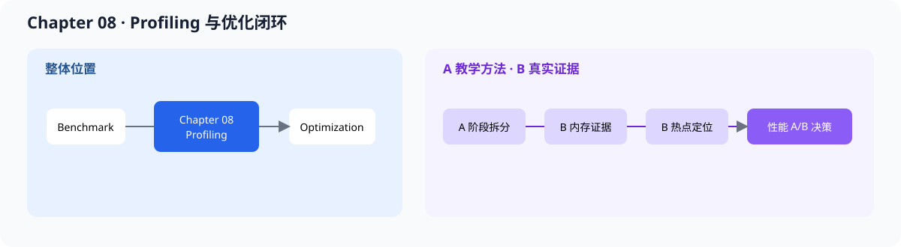

# 08.0 解释性能瓶颈并建立优化闭环

## 本章导读

Chapter 07 已经记录正确性、延迟和吞吐；本章继续定位时间落在哪个阶段，并把一次改动写成可以复查和回滚的 A/B 实验。学习产物不是一句“某个算子很慢”，而是一条从固定 workload、阶段计时、热点假设到保留或回滚决定的证据链。

本章工具能够读取 Chapter07 教学 JSON、真实 scalar batch JSON 和 Chapter09 服务 JSON，生成阶段报告并执行 correctness-first 的 A/B 判定。真实 TinyLlama 案例进一步把 Decoder 拆到 QKV、Attention、FFN、LM Head，以及 batch Linear 的输入整理、kernel 和输出拆分；硬件级结论仍需要 `perf` 或 Nsight 等系统 profiler 支持。

这里的学习线 A/B 表示证据来源，不是 08.5 中“只改变一个变量”的性能 A/B 实验。

| 学习线 | 本章怎样学习 | 可验证产物 |
| --- | --- | --- |
| A 教学证据线 | 消费 Chapter07 教学 JSON，练习阶段拆分、报告字段和 KEEP/REJECT 判定 | 可重复的 profile report 与判定逻辑测试 |
| B 真实执行线 | 消费 TinyLlama Decoder、scalar batch 和 ServiceCore 结果，下钻真实量化 Linear 热点 | 真实阶段计时、内存口径和单变量优化报告 |



## 开始学习

先运行不依赖真实模型和系统 profiler 权限的默认入口：

```bash
bash code/chapter08_profiling/scripts/run.sh
```

首轮只学习“怎样从数据形成一个可回滚的优化决定”。内存带宽、Kernel 启动和 CUDA Graph 属于硬件深入；真实 TinyLlama 案例和成熟框架阅读用于复盘。

| 路线 | 阅读范围 | 完成标志 |
| --- | --- | --- |
| A 首轮必读 | 08.1 性能分析基础、08.2 延迟拆解、08.5 A/B 实验、08.6 优化闭环 | 能从固定 workload 得到 `KEEP/REJECT` 决定 |
| B 真实证据 | 08.3 内存与带宽、08.8 真实服务案例、08.9 证据层级 | 能把真实阶段耗时下钻到资源或 Kernel 假设 |
| A/B 按需选读 | 08.4 Kernel/CUDA Graph、08.7 成熟框架阅读桥 | 能在设备工具或成熟框架中找到对应观测点 |

首轮源码只看 <a href="../_code/chapter08_profiling/include/chapter08_profiling/profile_record.h"><code>profile_record.h</code></a> 和 <a href="../_code/chapter08_profiling/include/chapter08_profiling/ab_compare.h"><code>ab_compare.h</code></a>。真实案例再进入 JSON adapter 和 <a href="../_code/engine/examples/real_tinyllama_decoder_profile.cpp"><code>real_tinyllama_decoder_profile.cpp</code></a>；原始结果与复现入口从[实验与验证资产索引](../reference/experiment_assets.md)查询。

| 顺序 | 路线 | 页面 | 读完后应看到什么 |
| --- | --- | --- | --- |
| 1 | A/B 公共 | [`08.1 性能分析基础`](./01_profiling_basics.md)、[`08.2 延迟拆解`](./02_latency_breakdown.md) | benchmark 与 profiling 的分工、阶段拆分 |
| 2 | A | [`08.5 A/B 实验`](./05_ab_experiment.md)、[`08.6 优化闭环`](./06_optimization_loop.md) | hypothesis、change、measure、decide 怎样闭合 |
| 3 | B | [`08.3 内存与带宽`](./03_memory_bandwidth.md)、[`08.4 Kernel 与 CUDA Graph`](./04_kernel_launch_and_cuda_graph.md) | 内存、带宽、launch 和同步点怎样形成假设 |
| 4 | B | [`08.8 真实服务 Profiling`](./08_real_service_profile.md)、[`08.9 证据层级`](./09_profiling_evidence_hierarchy.md) | 从 ServiceCore 进入 Decoder 子阶段并判断证据强度 |
| 5 | A/B 对照 | [`08.7 成熟框架阅读桥`](./07_vllm_nano_vllm_profiling_bridge.md) | 将同一分析方法映射到成熟项目 |

## 验证与下一步

一次有效记录必须固定硬件、模型、数据类型、输入输出长度和 batch，并同时保存 correctness、阶段耗时、热点证据、唯一变量和工程决定。默认脚本验证报告字段与 A/B 判定，真实实验再使用对应脚本复现 Q4_K/Q6_K 单变量和组合策略结果。

当前三组量化 Linear 单变量 A/B 及组合后的 Decoder/ServiceCore 回归均判定 `KEEP`，`optimized-avx2` 作为显式实验策略保留。真实 scalar batch 的 `0.8541x` 回退已定位到 batch kernel，仍只作为正确性路径；默认服务继续使用 scalar。进入 [`Chapter09`](../chapter09_serving/intro.md) 后，继续区分模型计算、服务编排和 transport 时间。
