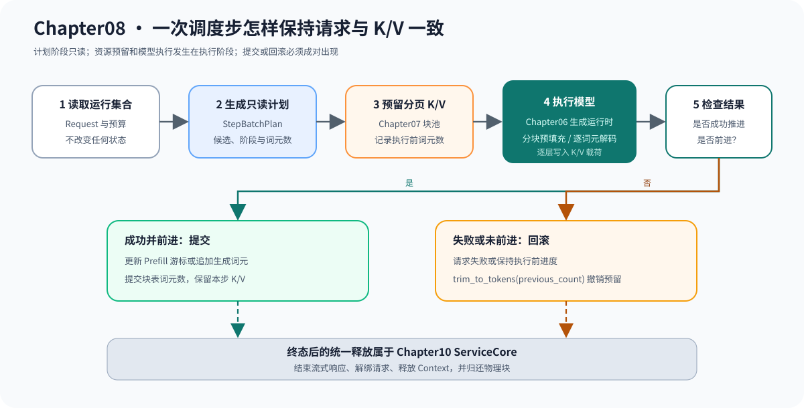

# 08.2 用单步计划组织连续批处理

连续批处理（Continuous Batching）不在请求开始时固定整批，而是在每个调度步重新读取运行集合。`StepBatchPlanner` 先生成只读计划，`ContinuousBatchScheduler` 再预留缓存、执行模型并提交结果。

词元预算、请求槽位和增量 K/V 块需求的统一计算见 [`F-SCHED-01`](../../reference/formulas.md#f-sched-01)。

## 计划同时表达候选和预算

Decode 每次消费一个词元。Prefill 默认消费剩余输入；Executor 支持分块时，Planner 才能按剩余预算截断。

| 计划信息 | 回答的问题 |
| --- | --- |
| `request_id`、`scheduled_index` | 候选属于哪个服务请求 |
| `prefill` | 本步执行 Prefill 还是 Decode |
| `token_count` | 本步为该请求处理多少输入词元 |
| `max_batch_tokens` | 本步最多处理多少词元 |
| `max_requests` | 本步最多接纳多少请求 |
| `max_prefill_chunk_tokens` | 单个 Prefill 片段的上限 |

## 一个调度步怎样执行

Planner 不预留 K/V，也不改变 Request。物理块是否足够由执行阶段询问 Chapter07；只有模型实际推进后才提交缓存计数。

```text
build read-only plan
  -> reserve candidate K/V capacity
  -> run prefill chunk or decode token
  -> advanced ? commit : trim
  -> emit token event
  -> 汇总本步统计
```

| 执行结果 | Request 变化 | 缓存动作 | 统计结果 |
| --- | --- | --- | --- |
| 成功推进 | 更新 Prefill 游标或生成词元 | 提交目标计数 | attempted、advanced 增加，生成时 generated 增加 |
| 容量不足 | 不调用模型 | 保持原计数 | deferred 增加 |
| 失败或无进展 | 失败或保持原状态 | 裁剪到执行前计数 | attempted 增加，advanced 保持不变 |
| 已处于终态 | 不进入计划 | 不变 | 不计入候选 |

代码中的 `scheduled_requests/scheduled_tokens` 统计实际发起的执行尝试，`advanced_requests/advanced_tokens` 统计真正推进的工作；两者之差用于定位模型失败或无进展。

下图把 Chapter06 的模型执行、Chapter07 的分页缓存与本章调度放进同一事务。终态后的资源释放由 Chapter10 ServiceCore 负责，不属于单步 Planner。



## Prefill 和 Decode 怎样共享预算

Decode 默认先进入计划以保护逐词元延迟；检测到可分块 Prefill 时，Planner 为新请求保留最小词元和请求槽。假设预算为 4，A 需要 Decode 一个词元，B 有三个输入词元，计划可以同时容纳 `A:1 + B:3`。

当 `max_requests=1` 且存在可分块 Prefill 时，唯一槽位交给 Prefill，使新请求至少推进一个词元；这是当前明确的 TTFT 优先边界。持续有 Prefill 到达时，该规则可能增加 Decode 的词元间延迟，生产实现通常结合动态 chunk、Deadline 或独立 Prefill/Decode 配额处理。

| 固定请求批次 | 连续批处理 |
| --- | --- |
| 请求开始时组成一批 | 每个调度步重新选择 |
| 短请求等待长请求结束 | 终态请求下一步退出 |
| 新请求等待整批结束 | 新请求可参加下一步 |
| 主要限制请求数 | 同时限制请求数、词元数和 K/V 容量 |

## 验证计划与事务

```bash
cmake -S code/chapter08_scheduling -B /tmp/cpp-llm-chapter08-step \
  -DCMAKE_BUILD_TYPE=Release
cmake --build /tmp/cpp-llm-chapter08-step \
  --target chapter08_step_scheduler_test chapter08_cache_transaction_test -j2
ctest --test-dir /tmp/cpp-llm-chapter08-step \
  -R '^chapter08_(step_scheduler|cache_transaction)_test$' --output-on-failure
```

| 通过条件 | 对应规则 |
| --- | --- |
| `build()` 前后 Request 和 BlockTable 不变 | 计划阶段只读 |
| Prefill 与 Decode 可在同一步出现 | 混合负载进入同一预算 |
| 容量不足不调用 Executor | 资源检查先于模型执行 |
| 模型失败后提交数回到原值 | 跨章事务可回滚 |
