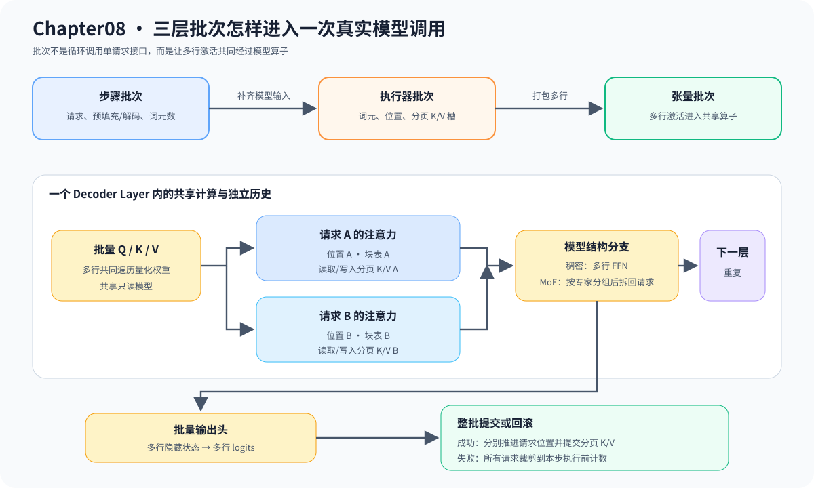

# 08.4 把调度计划交给真实解码批次

步骤批次（Step batch）回答本步选择哪些请求，执行器批次（Executor batch）补齐词元、位置和 K/V 写入位置，张量批次（Tensor batch）再把多行激活交给共享模型算子。只有一次算子或解码器调用真正处理多行激活，才形成模型批量计算；循环调用单请求执行器仍是顺序执行。

## 三层批次分别保存什么

| 层级 | 主要数据 | 产物 |
| --- | --- | --- |
| 步骤批次 | 请求 ID、阶段、词元数、预算 | 候选请求列表 |
| 执行器批次 | 词元、位置、K/V 写入槽 | 可校验的模型输入行 |
| 张量批次 | 多行激活、行边界或批次维度 | 一次算子或解码器调用的多行输出 |

## 组批、打包和融合怎样衔接

调度器形成步骤批次后，执行器才知道哪些行可以共同计算。等长 Prefill 可以把多个请求打包为 `[B*T,D]`；变长请求则需要行边界、分桶或填充。打包只改变数据布局，Attention 仍要根据请求边界读取各自的 K/V。

| 动作 | 负责对象 | 是否减少计算核边界 |
| --- | --- | --- |
| 选择同一步请求 | Chapter08 Planner | 不一定 |
| 构造执行器与张量批次 | `ExecutorBatchRunner`、模型工作区 | 不一定 |
| 让多行 Linear/FFN 共同执行 | 模型 CPU/CUDA 后端 | 通常减少重复权重读取或调用 |
| 合并相邻算子 | 专用融合计算核 | 目标是减少中间读写和启动次数 |

SmolVLM 的等长双请求路径会显式选择 Packed Prefill：Linear 与 FFN 处理打包行，每个请求保留独立 K/V，并按请求执行多查询 Attention。变量长度或自适应默认路径使用串行 Context Prefill。Chapter09 的配对实验显示 Packed 路径当前回退约 `7.7%`～`11.7%`，因此“已经形成张量批次”和“应该成为默认实现”由不同证据回答。

## 变长请求怎样进入同一步

教学张量批次保存每行边界，真实解码批次为每个请求携带独立位置和块表（BlockTable），因此不同历史长度可以进入同一步。某些稠密批量实现会用填充词元（PAD）补成矩形序列；填充只改变布局，有效词元、位置和 K/V 长度保持不变。输入超过 `max_context_tokens` 时，Chapter06 会在执行前报告错误，避免提示词被静默截断。

## 真实解码批次合并哪些计算

多个请求可以共享只读权重和多行 Linear，但每个请求仍保留独立上下文（Context）、位置和 K/V。以 TinyLlama 为例，解码阶段的 Q/K/V、输出投影、FFN 和语言模型头（LM Head）共同处理多行激活；Attention 则根据请求 ID 和块表分别读取历史。这样既复用权重访问，又避免请求之间读取彼此的 K/V。

| 执行部分 | 可以跨请求共享什么 | 必须按请求隔离什么 |
| --- | --- | --- |
| 量化 Linear | 多行共同读取权重并完成矩阵计算 | 每行输入与输出位置 |
| Attention | 可以共同发起设备计算 | 页表、位置、可见历史和输出行 |
| 稠密 FFN | Gate、Up、Down 权重和多行计算 | 每个请求的 hidden row |
| MoE FFN | 同一专家的输入行和专家权重 | Router 结果、Top-K 权重和拆回位置 |

不同模型共享 `ExecutorBatchRunner` 的整批成功或整批回滚规则，但共享计算的位置由模型结构决定：

| 模型结构 | Attention 历史 | 跨请求复用 |
| --- | --- | --- |
| 稠密 GQA | 每请求标准 K/V | Q/K/V、输出投影、FFN 与 LM Head 的多行 Linear |
| 标准 Attention + MoE | 每请求标准 K/V | 同层权重读取一次，FFN 输入按专家重新分组 |
| MLA + MoE | 每请求压缩 latent K/V 与位置 Key | Attention 保持隔离，FFN 输入按专家重新分组 |

以 MLA + MoE 为例，每个请求先从自己的压缩历史计算 Attention；所有请求到达 FFN 后，批量工作区读取 Router 结果，把命中同一专家的输入行放在一起，再批量完成 Gate、Up 和 Down。共享专家处理完整批次，结果最后按请求和 Top-K 权重拆回。

分页 MLA 统一了地址管理方式，但各请求仍使用自己的页表、位置和可见历史。`ExecutorBatchRunner` 负责保持输入顺序，并在批量调用失败时恢复每个模型 Context；具体哪些步骤在主机或设备执行属于后端实现，不改变这条隔离规则。

## 为什么批量临时张量需要复用

CUDA 解码每一步都会使用批量 hidden、logits、embedding rows、stream、cuBLAS handle 和 Decoder 中间 Tensor。这些对象只服务本次计算，不保存请求历史；如果每一步重新创建，就会在生成循环中重复执行设备分配与释放。

CUDA 执行器按批量大小保存持久化工作区（workspace）。例如，连续的 `batch=2` 解码步骤复用同一组 hidden、logits、Attention score 和页表空间；批量大小变化时选择另一组工作区。位置增长因此不会在每个解码步触发设备分配。工作区可以复用，请求位置和 K/V 绑定仍保存在各自的模型上下文中。

## 分页 K/V 怎样提交

ServiceCore 在准入时把请求 ID 绑定到执行器的分页数据面。进入批量解码前，Scheduler 为每个候选预留一个槽位，并构造词元、位置、请求 ID 和 K/V 写入位置；执行器再通过请求 ID 找到对应页表。Decoder 逐层写入 K/V，Attention 通过页表读取历史和当前行。

成功时 Runner 让每个模型 Context 恰好推进一个位置，并按输入顺序返回 logits；失败时 Runner 恢复模型 Context。Scheduler 随后提交或回滚 Request 与 Chapter07 资源。

```text
准入并绑定请求 ID
  -> 各请求预填充写入分页载荷
  -> 为每个请求预留一个槽位
  -> 构造 ExecutorBatchInput
  -> 调用真实 decode_batch
  -> 每层读写分页 K/V
  -> 整批提交
```

实现需要同时证明两件事：顺序与批量路径得到相同的 logits 和词元；错误位置、重复请求或执行失败不会部分提交批次。TinyLlama、Qwen1.5-MoE 和 DeepSeek-V2-Lite 的固定负载与性能数据统一记录在[实验资产](../../reference/experiment_assets.md)，正文只解释实验方法和结论适用范围。

下图强调共享模型计算与独立请求历史的分界：稠密模型让多行激活进入共同的 Linear，MoE 模型在 Attention 后按专家重新分组；每个请求仍从自己的标准 K/V 或压缩 MLA 历史计算 Attention。



## 验证教学批次和真实模型

```bash
bash code/chapter08_scheduling/scripts/run.sh
bash code/chapter08_scheduling/scripts/run_real_batch.sh
bash code/chapter08_scheduling/scripts/run_deepseek_v2_lite_batch.sh
CUDA_HOME=/usr/local/cuda-12.8 \
bash code/engine/scripts/run_deepseek_v2_lite_cuda_batch.sh
```

| 环境 | 检查结果 |
| --- | --- |
| 无模型文件 | Ragged batch、重复请求或槽位拒绝、缓存事务和结果等价 |
| 本地 TinyLlama | 真实 batch golden、批量 Linear、失败回滚和分页计数一致 |
| 本地 Qwen1.5-MoE | 独立 K/V、跨请求专家分组、连续批量调用和完整生成序列一致 |
| 本地 DeepSeek-V2-Lite | 独立 MLA 历史、一次按层 batch 调用、固定词元与位置同步推进 |
| 本地 DeepSeek-V2-Lite + CUDA | 两个请求共享批量工作区，各 MoE 层完成一次专家批执行，重复 ID 失败时位置保持不变 |
