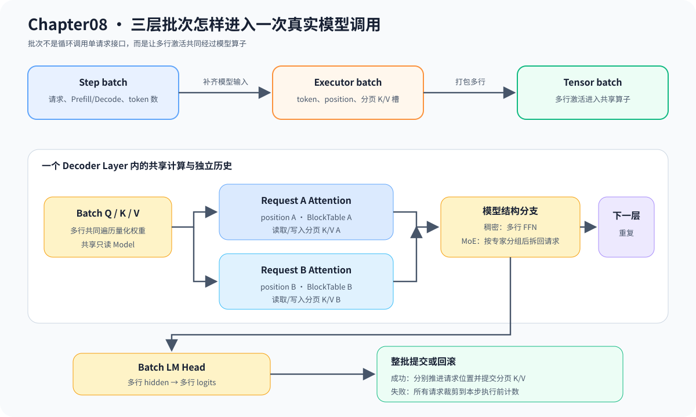

# 08.4 把调度计划交给真实 Decode Batch

Step batch 回答本步选择谁，Executor batch 补齐 token、position 和 K/V 写入位置，Tensor batch 再把多行激活交给共享模型算子。循环调用多个单请求 Executor 不属于真正的模型批量计算。

## 三层批次分别保存什么

| 层级 | 主要数据 | 产物 |
| --- | --- | --- |
| Step batch | request ID、阶段、token count、预算 | 候选请求列表 |
| Executor batch | token、position、K/V 写入槽 | 可校验的模型输入行 |
| Tensor batch | 多行激活、行边界或 batch 维度 | 一次算子或 Decoder 调用的多行输出 |

## 变长请求不要求先补齐

当前教学 Tensor batch 保存每行边界，真实 Decode batch 则为每个请求携带独立 position 和 BlockTable，因此不同历史长度可以进入同一步，不需要用 PAD 词元补成矩形序列。Padding 是某些稠密批量实现的布局选择，不应改变有效词元、位置或 K/V 长度。输入超过 `max_context_tokens` 时由 Chapter06 在执行前拒绝；当前主线不静默截断 prompt，避免基线输入在调用方不知情时改变。

## 当前真实 Decode 合并了哪些计算

`RealLlamaCpuModel::decode_batch()` 让多个请求共享只读 TinyLlama 权重，每个请求保留独立 Context。Decode 阶段的 Q/K/V、输出投影、FFN 和 LM Head 使用多行 Linear；不同历史长度的 Attention 仍按请求 ID 和 BlockTable 分别读取分页 K/V。真实多请求 Prefill 目前逐请求执行，不属于该批量路径。

| 执行部分 | 当前方式 | 还需要什么 |
| --- | --- | --- |
| 量化 Linear | 多行激活共同遍历权重 | AVX2 专用批量内核和更少打包开销 |
| Attention | 每个请求直接读取自己的分页 K/V | 融合的 Ragged/Paged Attention 批量内核 |
| Prefill | Runtime 支持分块，但真实模型仍逐请求执行 | 真实多请求 Prefill Tensor batch |
| Decode | CPU 与 CUDA 均有真实多 Context 批量调用 | 融合 kernel、减少行打包和跨 batch size 容量复用 |

## 为什么批量临时张量需要复用

CUDA Decode 每一步都会使用批量 hidden、logits、embedding rows、stream、cuBLAS handle 和 Decoder 中间 Tensor。这些对象只服务本次计算，不保存请求历史；如果每一步重新创建，就会在生成循环中重复执行设备分配与释放。

当前 CUDA 执行器工厂（`RealLlamaCudaExecutorFactory`）按精确批量大小保存一个持久化工作区（workspace）。例如批量大小为 2 的连续 Decode step 会复用同一组临时资源；批量大小变为 3 时单独创建另一组，避免用无效填充行参与计算。同一 workspace 由互斥锁保护，因此当前保证正确复用，不代表多个 batch 可以并发执行。每个请求的位置和 K/V 绑定仍属于自己的模型执行上下文，不能放进共享 workspace。

## 分页 K/V 怎样提交

ServiceCore 在 admission 时把请求 ID 绑定到真实 Executor 的分页数据面。进入批量 Decode 前，Scheduler 为每个候选预留一个槽位并构造 token、position、request ID 和 K/V 写入位置；K/V 位置用于批输入校验，真实 Runner 再通过 request ID 找到已绑定的数据面。Decoder 逐层写入 K/V，Attention 通过页表读取历史和当前行。

成功时 Runner 必须让每个模型 Context 恰好推进一个位置，并返回同顺序 logits；失败时 Runner 负责恢复模型 Context。Scheduler 随后负责提交或回滚 Request 与 Chapter07 资源，因为它无法直接修改模型内部状态。

```text
admission bind request ID
  -> per-request prefill writes paged payload
  -> reserve one slot per request
  -> build ExecutorBatchInput
  -> real decode_batch
  -> every layer reads/writes paged K/V
  -> commit the complete batch
```

| 当前证据 | 后续扩展 |
| --- | --- |
| 顺序与 batch logits、greedy token 一致 | 融合的 CPU PagedAttention 内核 |
| 错误 position 与无效 token 会整体回滚 | CUDA 双请求分页 batch 已接入同一事务边界 |
| CUDA 连续两步复用同尺寸 workspace | 多 batch 并发与容量型 workspace |
| ServiceCore 自动传递 request ID 并选择真实 batch | 协作式抢占和设备事件重叠 |
| Context position、页表和分页 payload 按整批提交 | 跨请求 Prefix Cache |

下图强调共享模型计算与独立请求历史的分界：Linear 和 LM Head 接收多行激活，每个请求的 Attention 仍通过自己的 BlockTable 访问分页 K/V。



## 验证教学批次和真实模型

```bash
bash code/chapter08_scheduling/scripts/run.sh
bash code/chapter08_scheduling/scripts/run_real_batch.sh
```

| 环境 | 必须通过 |
| --- | --- |
| 无模型文件 | Ragged batch、重复请求或槽位拒绝、缓存事务和结果等价 |
| 本地 TinyLlama | 真实 batch golden、批量 Linear、失败回滚和分页计数一致 |
