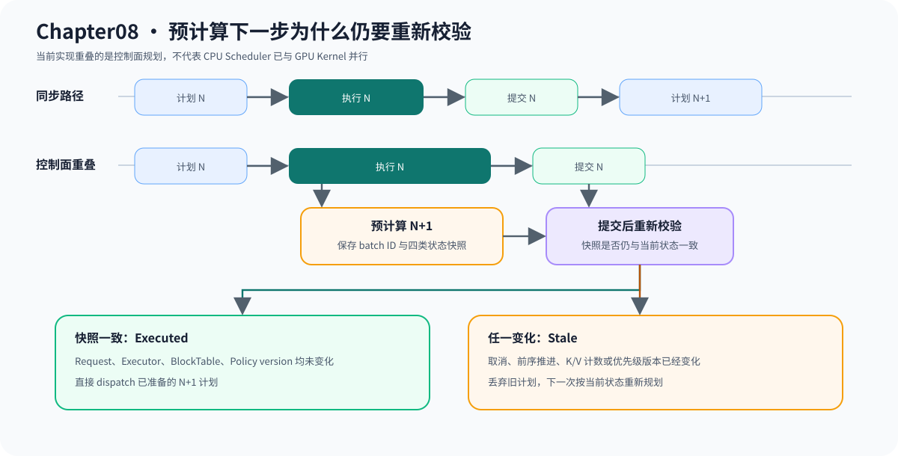

# 08.5 为重叠调度固定状态版本

同步 Scheduler 按“计划、执行、提交”串行推进。`OverlapScheduler` 保存带 batch ID 的预计算计划，并记录 Request、Executor、BlockTable 和优先级策略快照，为设备执行期间准备下一步建立控制面。

## 预计算计划为什么需要重新校验

```text
同步：plan N -> execute N -> commit N -> plan N+1

重叠：plan N -> execute N ----------------> commit N
                 plan N+1 (speculative) ----> validate / dispatch
```

计划 N+1 读取的是 N 尚未提交时的状态。N 完成后，词元位置、终态、K/V 提交数或优先级版本都可能变化，因此旧计划不能直接执行。

| 快照 | 检查内容 |
| --- | --- |
| batch ID | 区分当前和旧批次 |
| Request | 终态、Prefill 进度、生成长度、token history |
| Executor | 模型位置、K/V 层数和存储能力 |
| BlockTable | 是否存在及已提交词元数 |
| Policy version | 等待步数和优先级状态是否变化 |

## 当前控制面怎样处理结果

| 条件 | Dispatch 结果 | 是否调用 Runtime |
| --- | --- | --- |
| 所有快照一致且计划非空 | `Executed` | 是 |
| 计划没有候选 | `Empty` | 否 |
| 请求、模型、页表或策略已变化 | `Stale` | 否 |
| 关闭 overlap | `SynchronousFallback` | 走普通同步路径 |

## 验证计划失效

```bash
cmake -S code/chapter08_scheduling -B /tmp/cpp-llm-chapter08-overlap \
  -DCMAKE_BUILD_TYPE=Release
cmake --build /tmp/cpp-llm-chapter08-overlap \
  --target chapter08_overlap_scheduler_test -j2
ctest --test-dir /tmp/cpp-llm-chapter08-overlap \
  -R '^chapter08_overlap_scheduler_test$' --output-on-failure
```

| 已验证 | 不应误读为 |
| --- | --- |
| 同步与预计算路径结果一致 | CPU 调度已经与 GPU Kernel 并行 |
| 取消、前序推进和策略变化使计划失效 | 已有设备完成事件 |
| 关闭后安全回退 | 已有双缓冲模型输出 |

下图将“提前准备”和“可以执行”分开。预计算计划必须等第 N 步提交后重新校验；任何状态变化都会使其失效。


