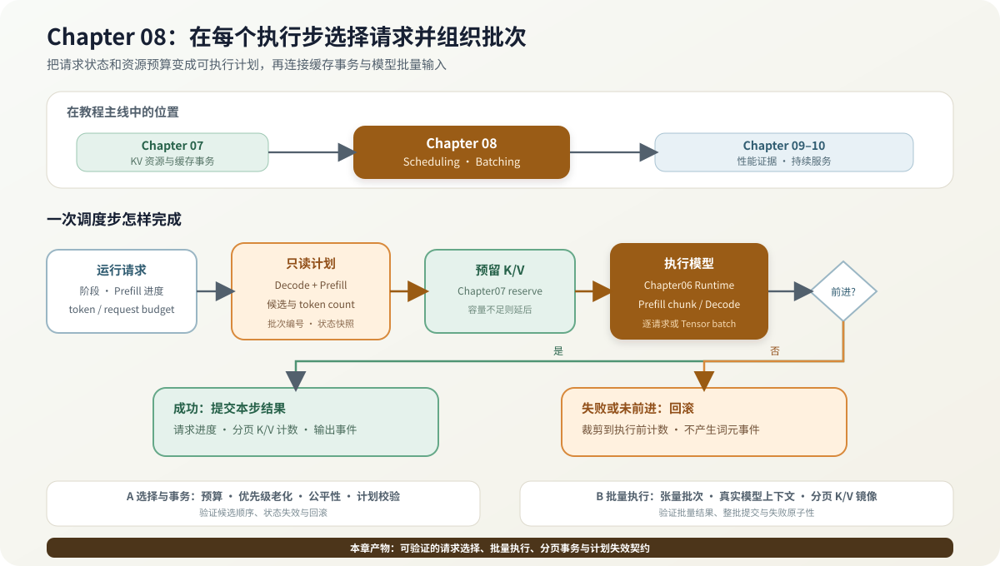

# 08.0 在每个执行步选择请求并组织批次

## 本章导读

Chapter06 固定单请求生成语义，Chapter07 提供可提交和回滚的 K/V 资源接口。本章在每个 step 读取请求状态和预算，选择 Prefill/Decode 候选，再把选择结果组织成模型执行输入。Chapter09 使用固定 workload 评估调度结果，Chapter10 负责 admission、等待队列和网络生命周期。

| 学习线 | 本章怎样学习 | 可验证产物 |
| --- | --- | --- |
| A 选择与事务 | 从 Round-robin 升级到 token budget、Continuous Batching、优先级和 Chunked Prefill | 固定候选顺序、老化、公平性与失败回滚 |
| B 批量执行 | 把 Step batch 转成 Executor/Tensor batch，再接入稠密模型或 MoE 的多 Context | 顺序/批量结果一致、位置校验和整批回滚 |
| G GPU 扩展坐标 | 保留计划与事务契约，把 Executor batch 交给设备后端和完成事件 | 当前只有 Overlap 状态校验，尚未实现设备执行重叠 |
| M 多模态扩展坐标 | 将视觉输入产生的词元和阶段成本纳入调度预算 | 当前多模态请求复用服务终态，尚未接入本章预算策略 |

| 本章新术语 | 先这样理解 | 首次解释 |
| --- | --- | --- |
| 调度步（step） | 一次重新选择请求并执行的最小循环 | [`08.2 单步计划`](./02_step_batching.md) |
| 连续批处理 | 每个 step 动态加入和移出请求 | [`08.2 单步计划`](./02_step_batching.md) |
| 分块预填充 | 把长 prompt 分成多个可调度片段 | [`08.3 长输入与公平性`](./03_chunked_priority.md) |
| 优先级老化 | 等待请求逐步提高有效优先级 | [`08.3 长输入与公平性`](./03_chunked_priority.md) |
| 张量批次 | 多个请求的激活值共同进入一次模型或算子调用 | [`08.4 真实批量执行`](./04_tensor_batch.md) |



## 开始学习

先把一次执行步拆成“选择、预留、执行、提交”四个动作。阅读时始终区分三类对象：Planner 只产生候选计划，Chapter07 缓存接口管理物理资源，Executor/Runtime 才改变模型和请求状态。理解同步路径后，再看 Chunked Prefill、真实 Decode batch 和 Overlap 计划校验。

| 顺序 | 路线 | 页面 | 先看源码 | 读完后应看到什么 |
| --- | --- | --- | --- | --- |
| 1 | A | [`08.1 调度规则与基线`](./01_scheduler_baseline.md) | <a href="../../_code/chapter08_scheduling/src/scheduler.cpp"><code>scheduler.cpp</code></a> | Scheduler 读取哪些状态，固定轮转怎样建立比较基线 |
| 2 | A | [`08.2 单步计划与连续批处理`](./02_step_batching.md) | <a href="../../_code/chapter08_scheduling/src/step_scheduler.cpp"><code>step_scheduler.cpp</code></a> | 请求、词元和缓存预算怎样形成一个可提交的 step |
| 3 | A | [`08.3 长输入、优先级与公平性`](./03_chunked_priority.md) | <a href="../../_code/chapter08_scheduling/tests/priority_aging_test.cpp"><code>priority_aging_test.cpp</code></a> | 长输入怎样分块，等待时间怎样改变候选顺序 |
| 4 | B | [`08.4 真实批量执行`](./04_tensor_batch.md) | <a href="../../_code/chapter08_scheduling/tests/cache_transaction_test.cpp"><code>cache_transaction_test.cpp</code></a>、<a href="../../_code/engine/examples/real_tinyllama_batch_smoke.cpp"><code>real_tinyllama_batch_smoke.cpp</code></a> | 计划怎样变成批量 Linear 和分页 K/V 事务 |
| 5 | 扩展 | [`08.5 Overlap`](./05_overlap_scheduling.md)、[`08.6 框架对照`](./06_framework_comparison.md) | <a href="../../_code/chapter08_scheduling/src/overlap_scheduler.cpp"><code>overlap_scheduler.cpp</code></a> | 预计算计划怎样失效，成熟框架还增加了什么 |

## 验证与下一步

完成正文后先运行无需模型的独立入口；本地已有 TinyLlama 和 llama.cpp CPU 构建时，再运行真实 Decode batch。调度策略、缓存资源和模型执行应保持单向依赖，改变预算或候选策略不应修改 Request 与 K/V 数据面。

```bash
bash code/chapter08_scheduling/scripts/run.sh
```

| 验收层级 | 执行入口 | 通过条件 | 本章要求 |
| --- | --- | --- | --- |
| L1 调度规则 | `bash code/chapter08_scheduling/scripts/run.sh` | Round-robin、预算、混排、分块 Prefill、优先级老化和回滚通过 | 必做 |
| L2 教学 Ragged batch | 同 L1 入口中的 `chapter08_tensor_batch_test` | 批量 Prefill、偏移、重复输入和准入原子性通过 | 必做 |
| L3 调度到 Decode batch | 同 L1 入口中的 `chapter08_cache_transaction_test` | 批输入校验、重复 ID 拒绝、失败回滚和分页计数一致 | 必做 |
| L4 稠密模型 batch | `bash code/chapter08_scheduling/scripts/run_real_batch.sh` | TinyLlama 顺序/批量 logits 与固定词元一致，错误位置不提交 | 有模型时必做 |
| L5 MoE 请求 batch | `bash code/chapter08_scheduling/scripts/run_qwen15_moe_batch.sh` | Qwen1.5-MoE 两个 Context 在一次 batch runner 调用中共同推进，固定词元一致 | 学习 MoE 调度时选做 |
| L5 Overlap 控制面 | 同 L1 入口中的 `chapter08_overlap_scheduler_test` | 同步结果一致，取消和状态变化使旧计划失效，关闭后同步回退 | 必做 |
