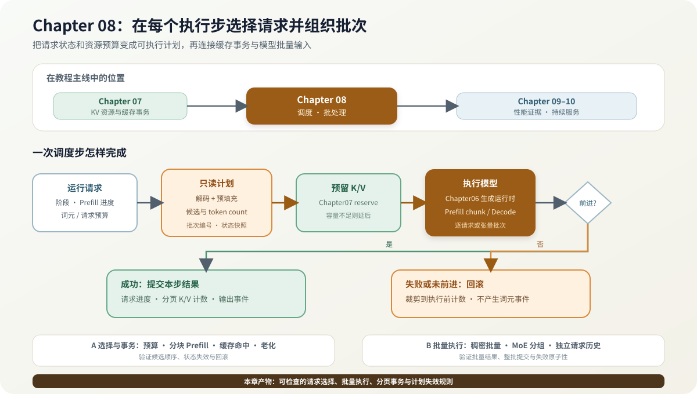

# 08.0 在每个执行步选择请求并组织批次

## 本章导读

Chapter06 用单请求状态机组织预填充、逐词元解码、采样和停止；Chapter07 管理这些步骤产生的 K/V 历史。本章把多个单请求循环放进同一个调度步：读取请求状态与预算，选择预填充或解码请求，再组织模型批次。Chapter09 使用固定负载评估结果，Chapter10 负责服务准入、等待队列和网络生命周期。

| 学习线 | 本章怎样学习 | 可验证产物 |
| --- | --- | --- |
| A 选择与事务 | 从固定轮转升级到词元预算、连续批处理、优先级和分块预填充 | 候选顺序、等待老化、公平推进与失败回滚 |
| B 批量执行 | 把调度步转换为执行器批次和张量批次，再接入稠密模型或 MoE 的多个请求上下文 | 顺序/批量结果一致、位置校验和整批回滚 |
| G GPU 扩展 | 保留计划与事务规则，把执行器批次交给设备后端 | 批量 Linear、按专家分组执行和重叠计划校验 |
| M 多模态扩展 | 将视觉词元和图片处理成本纳入调度预算 | 图文请求复用服务终态；视觉成本预算留作扩展 |

| 本章新术语 | 先这样理解 | 首次解释 |
| --- | --- | --- |
| 调度步（step） | 一次重新选择请求并执行的最小循环 | [`08.2 单步计划`](./02_step_batching.md) |
| 连续批处理 | 每个调度步动态加入和移出请求 | [`08.2 单步计划`](./02_step_batching.md) |
| 分块预填充 | 把长 prompt 分成多个可调度片段 | [`08.3 长输入与公平性`](./03_chunked_priority.md) |
| 优先级老化 | 等待请求逐步提高有效优先级 | [`08.3 长输入与公平性`](./03_chunked_priority.md) |
| 张量批次 | 多个请求的激活值共同进入一次模型或算子调用 | [`08.4 真实批量执行`](./04_tensor_batch.md) |



本章在完整请求生命周期中的位置见 [Chapter06–10 跨章协作图](../../chapter06_generation/next/intro.md#跨章协作)。

## 调度分成哪些层次

| 层次 | 决定什么 | 主要归属 |
| --- | --- | --- |
| 服务准入 | 请求能否进入系统、留在 waiting 还是进入 running | Chapter10 `ServiceCore` |
| 单步选择 | 本步选择哪些 Prefill/Decode 请求，各处理多少词元 | Chapter08 Planner 与策略 |
| 资源事务 | 为候选预留多少 K/V 容量，成功后提交还是失败后裁剪 | Chapter08 编排、Chapter07 保存资源 |
| 执行批次 | 把候选转换为词元、位置、请求 ID 和 K/V 写入位置，再组织张量批次 | Chapter08 与模型执行器 |
| 设备执行 | 执行流、工作区、计算核和设备事件怎样运行 | CPU/CUDA 后端；异步执行重叠留作扩展 |

Chapter08 聚焦中间三层。它读取 Chapter10 提供的 running 集合，调用 Chapter07 与 Executor，但不拥有网络队列、模型权重或设备事件。

## 开始学习

先把一次执行步拆成“选择、预留、执行、提交”四个动作。阅读时始终区分三类对象：Planner 只产生候选计划，Chapter07 缓存接口管理物理资源，Executor/Runtime 才改变模型和请求状态。理解同步路径后，再看 Chunked Prefill、真实 Decode batch 和 Overlap 计划校验。

| 顺序 | 路线 | 页面 | 先看源码 | 读完后应看到什么 |
| --- | --- | --- | --- | --- |
| 1 | A | [`08.1 调度规则与基线`](./01_scheduler_baseline.md) | <a href="https://github.com/datawhalechina/cpp-llm-engine/blob/main/code/chapter08_scheduling/src/scheduler.cpp"><code>scheduler.cpp</code></a> | Scheduler 读取哪些状态，固定轮转怎样建立比较基线 |
| 2 | A | [`08.2 单步计划与连续批处理`](./02_step_batching.md) | <a href="https://github.com/datawhalechina/cpp-llm-engine/blob/main/code/chapter08_scheduling/src/step_scheduler.cpp"><code>step_scheduler.cpp</code></a> | 请求、词元和缓存预算怎样形成一个可提交的调度步 |
| 3 | A | [`08.3 长输入、优先级与公平性`](./03_chunked_priority.md) | <a href="https://github.com/datawhalechina/cpp-llm-engine/blob/main/code/chapter08_scheduling/tests/priority_aging_test.cpp"><code>priority_aging_test.cpp</code></a> | 长输入怎样分块，等待时间怎样改变候选顺序 |
| 4 | B | [`08.4 真实批量执行`](./04_tensor_batch.md) | <a href="https://github.com/datawhalechina/cpp-llm-engine/blob/main/code/chapter08_scheduling/tests/cache_transaction_test.cpp"><code>cache_transaction_test.cpp</code></a>、<a href="https://github.com/datawhalechina/cpp-llm-engine/blob/main/code/engine/examples/real_tinyllama_batch_smoke.cpp"><code>real_tinyllama_batch_smoke.cpp</code></a> | 计划怎样变成批量 Linear 和分页 K/V 事务 |
| 5 | 扩展 | [`08.5 Overlap`](./05_overlap_scheduling.md)、[`08.6 框架对照`](./06_framework_comparison.md) | <a href="https://github.com/datawhalechina/cpp-llm-engine/blob/main/code/chapter08_scheduling/src/overlap_scheduler.cpp"><code>overlap_scheduler.cpp</code></a> | 预计算计划怎样失效，成熟框架还增加了什么 |

## 验证与下一步

完成正文后先运行无需模型的独立入口；本地已有 TinyLlama 和 llama.cpp CPU 构建时，再运行真实 Decode batch。调度策略、缓存资源和模型执行应保持单向依赖，改变预算或候选策略不应修改 Request 与 K/V 数据面。

```bash
bash code/chapter08_scheduling/scripts/run.sh
```

| 验收层级 | 执行入口 | 通过条件 | 本章要求 |
| --- | --- | --- | --- |
| L1 调度规则 | `bash code/chapter08_scheduling/scripts/run.sh` | Round-robin、预算、混排、分块 Prefill、优先级老化和回滚通过 | 必做 |
| L2 教学 Ragged batch | 同 L1 入口中的 `chapter08_tensor_batch_test` | 批量 Prefill、偏移、重复输入和准入原子性通过 | 必做 |
| L3 调度到 Decode batch | 同 L1 入口中的 `chapter08_cache_transaction_test` | 批输入校验、重复 ID 拒绝、失败回滚和分页计数一致 | 必做 |
| L4 稠密模型 batch | `bash code/chapter08_scheduling/scripts/run_real_batch.sh` | TinyLlama 顺序/批量 logits 与固定词元一致，错误位置不提交 | 有模型时必做 |
| L5 MoE 请求批次 | `bash code/chapter08_scheduling/scripts/run_qwen15_moe_batch.sh` | Qwen1.5-MoE 两个 Context 在一次批执行调用中共同推进，固定词元一致 | 学习 MoE 调度时选做 |
| L6 MLA-MoE 请求批次 | `bash code/chapter08_scheduling/scripts/run_deepseek_v2_lite_batch.sh` | DeepSeek 两个 Context 在一次按层批执行中生成固定词元 `185 85770` | 学习 MLA 调度时选做 |
| L7 CUDA MLA-MoE 批次 | `CUDA_HOME=/usr/local/cuda-12.8 bash code/engine/scripts/run_deepseek_v2_lite_cuda_batch.sh` | 两个请求共享一个持久化批量工作区，26 个 MoE 层分别完成一次专家批执行；非法重复 ID 不推进位置 | 有 NVIDIA GPU 时选做 |
| L8 重叠计划控制面 | 同 L1 入口中的 `chapter08_overlap_scheduler_test` | 同步结果一致，取消和状态变化使旧计划失效，关闭后回到同步路径 | 必做 |
