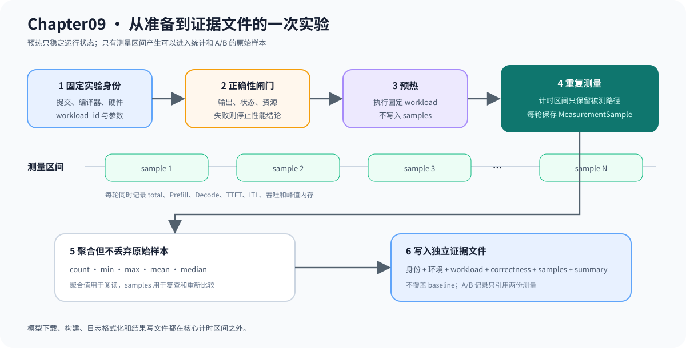

# 09.2 建立可重复的性能基准入口

Benchmark 入口需要完成环境登记、预热、重复运行和结果落盘。计时循环内只保留被测路径，模型下载、构建、日志格式化和结果写文件不能混入核心耗时。

## 一次实验的执行顺序

| 阶段 | 动作 | 记录 |
| --- | --- | --- |
| 准备 | 固定代码版本、构建类型、编译器、硬件和运行参数 | `environment` 与实验说明 |
| 校验 | 运行正确性闸门 | `correctness` |
| 预热 | 执行不计入样本的若干轮 | `warmup_iterations` |
| 测量 | 重复执行固定 workload | 原始 `samples` |
| 聚合 | 计算中位数、均值和范围 | `statistics` |
| 落盘 | 保存原始数据，不覆盖基线 | 实验结果文件 |

下图把预热和测量放在同一时间轴上。预热轮次不会进入 `samples`；正式测量的每一轮都先保留原始记录，再计算聚合值并写入独立证据文件。



## CPU 与 GPU 需要固定的环境

教学入口优先保证命令短、条件可见和结果可保存。需要严格发布结论时，再增加隔离后台负载、固定频率和多轮独立进程等控制条件。

| 范围 | CPU | CUDA GPU |
| --- | --- | --- |
| 构建 | 编译器、优化级别、指令集 | 编译器、CUDA、目标架构 |
| 硬件 | CPU 型号、核心数、NUMA | GPU 型号、显存、驱动 |
| 运行 | 线程数、亲和性、功耗状态 | stream、同步点、功耗状态 |
| 内存 | 权重与 K/V 常驻量 | Host/Device 拷贝和显存峰值 |

统一 evidence v2 会保存并比较硬件名称和主机逻辑并发数，防止两台不同机器仅因都写了 `device=cpu` 而进入同一结论。线程数、亲和性、频率、驱动和功耗状态仍需由实验入口固定并写入实验说明；当前比较器不会替代操作系统或设备级控制。

## 迁移旧实验结果

旧结果能否进入统一证据，取决于是否保留每轮测量，而不是文件中是否已经有均值或 P50。重构前的 Chapter07 教学 benchmark 和真实 batch 结果包含 `samples`，可以通过导入器转换；早期服务结果只保存聚合统计，只能作为历史参考，不能参与新的 A/B 回归。

```bash
node code/chapter09_performance/scripts/import_legacy_evidence.mjs \
  --input code/chapter09_performance/legacy/chapter07_benchmark/results/tinyllama_real_batch_scalar.json \
  --output-dir /tmp/chapter09-evidence
```

新的服务 benchmark 同时保存逐轮 Prefill、Decode、端到端时间、TTFT、吞吐和正确性。需要升级旧服务基线时，应使用原 workload 重新测量，不能用 mean 或 P50 生成伪样本。

## 验证实验入口

默认回归会运行 `chapter09_legacy_import_test`，检查保留原始样本的结果可以迁移，只有聚合值的文件必须被拒绝：

```bash
bash code/chapter09_performance/scripts/run.sh
```

有 TinyLlama GGUF 时，`bash code/chapter09_performance/scripts/run_real_evidence.sh service` 还应输出 `chapter09_real_evidence=PASS`，并在 `/tmp/cpp-llm-chapter09-real-evidence` 下生成原始样本和统一 evidence。`09.3` 使用这些样本区分延迟、吞吐和内存指标。
